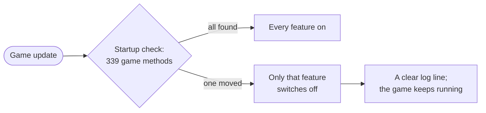
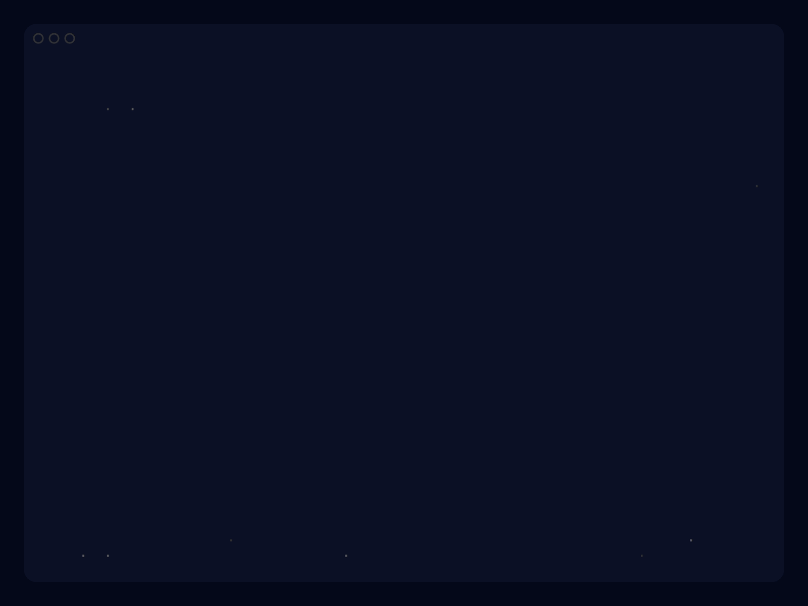

<div align="center">

<picture>
  <source media="(prefers-color-scheme: dark)" srcset=".github/assets/banner/0.9-dusk-dark.svg">
  
</picture>

**A mod loader for *Chill With You: Lo-Fi Story*, built so your mods keep working when the game updates.**

[](https://github.com/xMartin14091x/CWYLS-ModLoader/releases)
[](#-install)
[](LICENSE.md)

[**Download**](https://github.com/xMartin14091x/CWYLS-ModLoader/releases) &nbsp;·&nbsp; [**Make mods**](docs/guide/) &nbsp;·&nbsp; [**API reference**](docs/api/) &nbsp;·&nbsp; [**Report a problem**](https://github.com/xMartin14091x/CWYLS-ModLoader/issues)

</div>

> [!IMPORTANT]
> **Unofficial fan project.** Not made, endorsed or supported by Nestopi, so please don't contact them about it.
> Runs on the **full Steam release only**; it switches itself off on the free demo.

> [!NOTE]
> **0.9 is a developer preview.** Everything below works today; the mod API may still change before 1.0.

## ✦ Why

Every game update can move the code that mods hook into. Without a loader, every modder has to dig through the
game again, repair their mod and hope it doesn't damage a save. **CWY:LS Mod Loader does that work once.**
Mods talk to a stable API and plain content folders, and the loader keeps track of the game's internals for each
game version.



## ✦ What it does

| | |
|---|---|
| **Content packs** | A folder with a `manifest.json`, no code at all: text and new languages, voice clips, sound effects, extra music for the player, texture swaps, scenery colour grading, new dialogue lines and short scenes. |
| **Code mods** | A C# entry point with a helper API: game events, Satone's lines and expressions, mod windows, console commands, and game actions behind a safety gate. |
| **Version safety** | The 339 game methods the loader relies on are checked at startup, and offline with `tools/seamcheck`. If an update moves one, only that feature switches off. |
| **Save safety** | Mod content never goes into your save files, so they keep loading without mods. |
| **In-game console** | <kbd>Ctrl</kbd>+<kbd>Shift</kbd>+<kbd>C</kbd>: pack and mod status, cutscene replay with `scene play`, diagnostics. |
| **Diagnostic trace** | For bug reports, off by default. Turn it on with `trace on`, and off again with `trace off`. |
| **Local game API** | For tools on your own computer. Off by default, and only reachable from this computer. |

## ▶ Install

Download the zip for your system from **[Releases](https://github.com/xMartin14091x/CWYLS-ModLoader/releases)** and unzip it.

<div align="center">
<picture>
  <source media="(prefers-color-scheme: light)" srcset=".github/assets/installer/installer-demo-light.gif">
  
</picture>
<br>
<sub>The macOS installer, recorded with a test copy of the game. The Windows one looks the same.</sub>
</div>

<table>
<tr><th width="50%">macOS</th><th width="50%">Windows</th></tr>
<tr valign="top"><td>

1. Quit the game. Double-click **`install.command`**. If macOS blocks it, right-click it, then **Open** and **Open** again.
2. Choose **Install or update**.
3. In Steam, right-click the game, then **Properties… › Launch Options**, and press <kbd>⌘</kbd>+<kbd>V</kbd>. The installer has already copied the line for you.
4. Press **Play**.

</td><td>

1. Quit the game. Double-click **`install.bat`**. If SmartScreen appears, choose **More info › Run anyway**.
2. Choose **Install or update**.
3. Press **Play** in Steam. There's no launch option to set on Windows.

</td></tr>
</table>

The installer works **offline**:
- it brings BepInEx 5.4.23.6, unmodified;
- it never touches your saves;
- it can uninstall again, moving files aside without deleting anything.

Mods go in the **`CWYLS Mods`** folder inside the game folder. The installer can open it for you.

<details>
<summary><b>Uninstall</b></summary>

<br>

Run the installer again and choose one of these:
- **Uninstall the mod loader** removes the loader and keeps BepInEx.
- **Uninstall everything** removes BepInEx too. On macOS, also clear the game's **Launch Options** in Steam afterwards; the installer reminds you.

Either way the files are moved into a dated folder inside the game folder, never deleted. Your mods in `CWYLS Mods` and your saves stay where they are.

</details>

<details>
<summary><b>Tested on</b></summary>

<br>

| | Status |
|---|---|
| macOS on Apple Silicon, game 1.17.3 from Steam | Install, play through Steam, uninstall back to the plain game |
| Windows 11, game 1.17.3 | Install, loader and a content pack running in game |
| Intel Macs | Not tested yet |
| Other BepInEx mods alongside | Not tested yet |

</details>

## ⌘ Make mods

A mod is a folder in `CWYLS Mods` with a `manifest.json`. Files are enough for most things; code is there when you need it.

<details>
<summary><b>A content pack: no code</b></summary>

<br>

`CWYLS Mods/my.first.pack/manifest.json`

```json
{
  "id": "my.first.pack",
  "name": "My first pack",
  "version": "0.1.0",
  "gameVersion": "1.17.3",
  "loaderVersion": "0.9.0"
}
```

Then add your own files next to it: text rows in `data/`, voice clips in `audio/voice/`, textures in `textures/`.
[`packs/cwy.example`](packs/cwy.example) shows every kind.

</details>

<details>
<summary><b>A code mod: a few lines of C#</b></summary>

<br>

Add `"entryDll": "MyMod.dll"` to the manifest, and one class:

```csharp
public sealed class ModEntry : CwyMod
{
    public override void Entry(ICwyModHelper helper)
    {
        // Satone says hello whenever the room is ready.
        helper.Events.Subscribe<RoomReady>(_ => helper.Satone.Say("Hello from my mod!"));

        // A console command (Ctrl+Shift+C): type "hello".
        helper.Console.Register("hello", "Says hello.", "hello", _ => "hello back");
    }
}
```

The full, commented version is the [working sample](mods-src/cwy.sample.hello); start your own from the [template](templates/cwy-mod).

</details>

- **Start here:** the [author's guide](docs/guide/), and [`packs/README.md`](packs/README.md) for content packs.
- **Examples:**
  - [`cwy.example`](packs/cwy.example): every kind of content;
  - [`cwy.demo.audio`](packs/cwy.demo.audio): sounds and music;
  - [`cwy.demo.scenery`](packs/cwy.demo.scenery): colour grading;
  - [`cwy.demo.script`](packs/cwy.demo.script): scenes.
- **Reference:** the [API reference](docs/api/), generated from the source.

Rules for mods made for or with the loader: **free of charge**, **no game files inside**, **no paid-content unlocks**.

## ? Questions

<details>
<summary><b>Will it break my save?</b></summary>

<br>

No. Mod content is kept out of the game's save files, so your save keeps loading without mods. Back up your save before
trying new mods anyway.

</details>

<details>
<summary><b>Does it change the game's files?</b></summary>

<br>

No. The installer adds BepInEx and the loader next to the game, and mods are applied in memory while the game runs.
Uninstalling moves those added files aside again.

</details>

<details>
<summary><b>What about Steam Cloud?</b></summary>

<br>

The loader never touches Steam Cloud. Your save syncs as usual, and because no mod content goes into it, it also loads
on a computer without mods.

</details>

<details>
<summary><b>Does it work on the demo?</b></summary>

<br>

No. It runs on the full Steam release only and switches itself off on the free demo. That's a condition of the licence.

</details>

<details>
<summary><b>Is this allowed?</b></summary>

<br>

CWY:LS Mod Loader is unofficial. The game's own terms restrict analysing and modifying it, so you use mods at your
own risk. If Nestopi asks, this project will change or be taken down. See [`NOTICE.md`](NOTICE.md).

</details>

## ◈ Build from source

You need the **.NET 10 SDK**, the game installed through Steam, and BepInEx installed in it (run the installer once).

```sh
./build.sh --no-deploy            # build, run the tests and the offline seam check
./build.sh                        # the same, then copy the loader into the game (macOS)
tools/release/make-release.sh     # the release zips, into dist/
```

The build compiles against the game's own files **on your machine**; none of them are in this repository.

## ☾ Roadmap

Each release is a later hour of the same night, and adds one constellation to the sky.

| Release | | What's in it |
|---|---|---|
| **0.9 · Dusk** | now | The loader, content packs, the code-mod API (preview), the installers. |
| **1.0 · Starlit** | next | A frozen, versioned mod API; game actions for music, room and timer; cutscene triggers and conditions; editing any game table; hot reload; a bridge for voice packs. |
| **after** | | Language packs, Thai subtitles first, built on top of the loader. |

## ⚖ Licence and credits

[PolyForm Noncommercial 1.0.0](LICENSE.md), with the Required Notices at the top of that file:
- no commercial use;
- mods made for or with the loader must be free;
- copies and changed versions must keep the **demo lock**.

See also [`NOTICE.md`](NOTICE.md).

Built on [BepInEx](https://github.com/BepInEx/BepInEx) with [UnityDoorstop](https://github.com/NeighTools/UnityDoorstop),
[HarmonyX](https://github.com/BepInEx/HarmonyX), [MonoMod](https://github.com/MonoMod/MonoMod) and
[Mono.Cecil](https://github.com/jbevain/cecil). Their licences are in [`THIRD-PARTY-NOTICES.md`](THIRD-PARTY-NOTICES.md).
Banner lettering uses [Fraunces](https://github.com/undercasetype/Fraunces) and [Outfit](https://github.com/Outfitio/Outfit-Fonts)
(SIL Open Font License), turned into outlines.
*Chill With You: Lo-Fi Story* and everything in it belongs to Nestopi Inc.; none of it is included here.

**Contributors and AI coding tools:** read [`AGENTS.md`](AGENTS.md) first.

<br>

<picture>
  <source media="(prefers-color-scheme: dark)" srcset=".github/assets/banner/sky-so-far-dark.svg">
  
</picture>

<details>
<summary><sub>✦ psst… spin the star</sub></summary>

```stl
solid star
facet normal -0.63 0.24 0.74
 outer loop
  vertex 0 0 3.2
  vertex 0 10 0
  vertex -2.47 3.4 0
 endloop
endfacet
facet normal -0.63 0.24 -0.74
 outer loop
  vertex 0 0 -3.2
  vertex -2.47 3.4 0
  vertex 0 10 0
 endloop
endfacet
facet normal -0.03 0.67 0.74
 outer loop
  vertex 0 0 3.2
  vertex -2.47 3.4 0
  vertex -9.51 3.09 0
 endloop
endfacet
facet normal -0.03 0.67 -0.74
 outer loop
  vertex 0 0 -3.2
  vertex -9.51 3.09 0
  vertex -2.47 3.4 0
 endloop
endfacet
facet normal -0.42 -0.53 0.74
 outer loop
  vertex 0 0 3.2
  vertex -9.51 3.09 0
  vertex -3.99 -1.3 0
 endloop
endfacet
facet normal -0.42 -0.53 -0.74
 outer loop
  vertex 0 0 -3.2
  vertex -3.99 -1.3 0
  vertex -9.51 3.09 0
 endloop
endfacet
facet normal -0.65 0.18 0.74
 outer loop
  vertex 0 0 3.2
  vertex -3.99 -1.3 0
  vertex -5.88 -8.09 0
 endloop
endfacet
facet normal -0.65 0.18 -0.74
 outer loop
  vertex 0 0 -3.2
  vertex -5.88 -8.09 0
  vertex -3.99 -1.3 0
 endloop
endfacet
facet normal 0.37 -0.56 0.74
 outer loop
  vertex 0 0 3.2
  vertex -5.88 -8.09 0
  vertex 0 -4.2 0
 endloop
endfacet
facet normal 0.37 -0.56 -0.74
 outer loop
  vertex 0 0 -3.2
  vertex 0 -4.2 0
  vertex -5.88 -8.09 0
 endloop
endfacet
facet normal -0.37 -0.56 0.74
 outer loop
  vertex 0 0 3.2
  vertex 0 -4.2 0
  vertex 5.88 -8.09 0
 endloop
endfacet
facet normal -0.37 -0.56 -0.74
 outer loop
  vertex 0 0 -3.2
  vertex 5.88 -8.09 0
  vertex 0 -4.2 0
 endloop
endfacet
facet normal 0.65 0.18 0.74
 outer loop
  vertex 0 0 3.2
  vertex 5.88 -8.09 0
  vertex 3.99 -1.3 0
 endloop
endfacet
facet normal 0.65 0.18 -0.74
 outer loop
  vertex 0 0 -3.2
  vertex 3.99 -1.3 0
  vertex 5.88 -8.09 0
 endloop
endfacet
facet normal 0.42 -0.53 0.74
 outer loop
  vertex 0 0 3.2
  vertex 3.99 -1.3 0
  vertex 9.51 3.09 0
 endloop
endfacet
facet normal 0.42 -0.53 -0.74
 outer loop
  vertex 0 0 -3.2
  vertex 9.51 3.09 0
  vertex 3.99 -1.3 0
 endloop
endfacet
facet normal 0.03 0.67 0.74
 outer loop
  vertex 0 0 3.2
  vertex 9.51 3.09 0
  vertex 2.47 3.4 0
 endloop
endfacet
facet normal 0.03 0.67 -0.74
 outer loop
  vertex 0 0 -3.2
  vertex 2.47 3.4 0
  vertex 9.51 3.09 0
 endloop
endfacet
facet normal 0.63 0.24 0.74
 outer loop
  vertex 0 0 3.2
  vertex 2.47 3.4 0
  vertex 0 10 0
 endloop
endfacet
facet normal 0.63 0.24 -0.74
 outer loop
  vertex 0 0 -3.2
  vertex 0 10 0
  vertex 2.47 3.4 0
 endloop
endfacet
endsolid star
```

</details>
