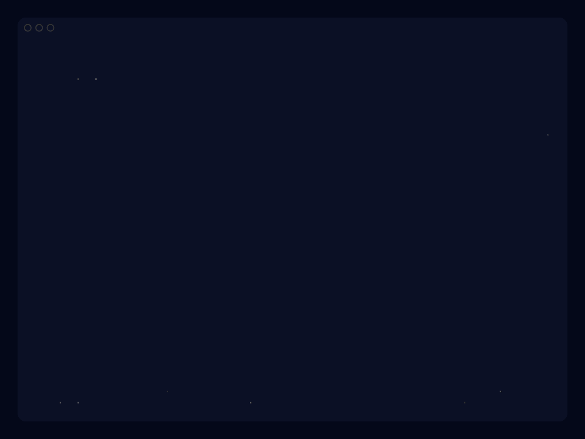

<div align="center">

<picture>
  <source media="(prefers-color-scheme: dark)" srcset=".github/assets/banner/0.9-dusk-dark.svg">
  
</picture>

**A mod loader for *Chill With You: Lo-Fi Story*, built so your mods keep working when the game updates.**

[](https://github.com/xMartin14091x/CWYLS-ModLoader/releases)
[](#-install)
[](LICENSE.md)

[**Download**](https://github.com/xMartin14091x/CWYLS-ModLoader/releases) &nbsp;·&nbsp; [**Nexus Mods**](https://www.nexusmods.com/chillwithyoulofistory/mods/16) &nbsp;·&nbsp; [**Make mods**](docs/guide/) &nbsp;·&nbsp; [**API reference**](docs/api/) &nbsp;·&nbsp; [**Discord**](https://discord.gg/z7vQ63cH6B) &nbsp;·&nbsp; [**Report a problem**](https://github.com/xMartin14091x/CWYLS-ModLoader/issues)

</div>

> [!IMPORTANT]
> **Unofficial fan project.** Not made, endorsed or supported by Nestopi, so please don't contact them about it.
> Runs on the **full Steam release only**; it switches itself off on the free demo.

> [!NOTE]
> **CWY:LS Mod Loader v0.9.2 is a developer preview, including Pack Maker.** The mod API may still change before 1.0. The roadmap lists future work.

## ✦ Why

Every game update can move the code that mods hook into. Without a loader, every modder has to dig through the
game again, repair their mod and hope it doesn't damage a save. **CWY:LS Mod Loader does that work once.**
Mods talk to a stable API and plain content folders, and the loader keeps track of the game's internals for each
game version.

<picture>
  <source media="(prefers-color-scheme: dark)" srcset=".github/assets/banner/version-safety-dark.svg">
  
</picture>

## ✦ What it does

| | |
|---|---|
| **Content packs** | A folder of JSON text files and media, no programming: text and new languages, voice clips, sound effects, extra music for the player, texture swaps, scenery colour grading, new dialogue lines and short scenes. [Pack Maker](docs/guide/pack-maker.md) edits story subtitles and dub takes in the browser; other content uses files. |
| **Pack Maker (preview)** | Create a language pack, write subtitles, record or import dub takes, label their voice origin, try a line in game (subtitles alone work with the original voice), and export a checked `.zip`. Open it with `maker` in the mod console while the game is running. Restart the game once after creating a pack. |
| **Code mods** | A C# entry point with a helper API: game events, Satone's lines and expressions, mod windows, console commands, and game actions behind a safety gate. |
| **Version safety** | The 359 game methods and fields the loader relies on are checked at startup, and offline with `tools/seamcheck`. If an update moves one, only that feature switches off. |
| **Save safety** | Mod content never goes into your save files, so they keep loading without mods. |
| **Save backups** | Every launch copies your save folder to `CWYLS Backups`, next to the game's own save folder and outside the game folder, so uninstalling the game keeps them (skipped when nothing changed). It keeps the last 5, plus one per day for 7 days, one per week for 3 weeks and one per month for 3 months. Restore by hand with the game closed; `saves` in the console shows how. |
| **In-game console** | <kbd>Ctrl</kbd>+<kbd>Shift</kbd>+<kbd>C</kbd>: pack and mod status, cutscene replay with `scene play`, diagnostics. |
| **Diagnostic trace** | For bug reports, off by default. Turn it on with `trace on`, and off again with `trace off`. |
| **Local game API** | For tools on your own computer. Off by default, and only reachable from this computer. |

## ▶ Install

Download the zip for your system from **[Releases](https://github.com/xMartin14091x/CWYLS-ModLoader/releases)** or **[Nexus Mods](https://www.nexusmods.com/chillwithyoulofistory/mods/16)** and unzip it.

<div align="center">
<picture>
  <source media="(prefers-color-scheme: light)" srcset=".github/assets/installer/installer-demo-light.gif">
  
</picture>
<br>
<sub>The macOS installer, recorded with a test copy of the game. The Windows installer has the same screens.</sub>
</div>

<table>
<tr><th width="50%">macOS</th><th width="50%">Windows</th></tr>
<tr valign="top"><td>

1. Quit the game. Double-click **`install.command`**. If macOS blocks it, open **System Settings › Privacy & Security**, click **Open Anyway** next to `install.command`, and open it again (macOS 14 and older: right-click it, then **Open** and **Open** again).
2. Choose **Install or update**.
3. In Steam, right-click the game, then **Properties… › Launch Options**, and press <kbd>⌘</kbd>+<kbd>V</kbd>. The installer has already copied the line for you.
4. Press **Play**.

</td><td>

1. Quit the game. Double-click **`install.bat`**. If SmartScreen appears, choose **More info › Run anyway**.
2. Choose **Install or update**.
3. Press **Play** in Steam. There's no launch option to set on Windows.

</td></tr>
</table>

The installer works **offline**:
- it brings BepInEx 5.4.23.6, unmodified;
- it never touches your saves;
- it can uninstall again, moving files aside without deleting anything.

Mods go in the **`CWYLS Mods`** folder inside the game folder. The installer can open it for you.

<details>
<summary><b>Uninstall</b></summary>

<br>

Run the installer again and choose one of these:
- **Uninstall the mod loader** removes the loader and keeps BepInEx.
- **Uninstall everything** removes BepInEx too. On macOS, also clear the game's **Launch Options** in Steam afterwards; the installer reminds you.

Either way the files are moved into a dated folder inside the game folder, never deleted. Your mods in `CWYLS Mods`, your saves and your save backups stay where they are.

</details>

<details>
<summary><b>Tested on</b></summary>

<br>

| | Status |
|---|---|
| macOS on Apple Silicon, game 1.17.3 from Steam | Install, play through Steam, uninstall back to the plain game |
| Windows 11, game 1.17.3 | Install, loader and a content pack running in game |
| Windows 11, game 1.18.0 (2026-11-01) | Update from 0.9.0 with the installer; content packs, pack lines, Thai, mod windows, `scene play`, save backups and the local API running in game |
| Game 1.18.0 (2026-10-31) | All 359 checks found on macOS and Windows (`tools/seamcheck`); on macOS, loader and content packs running in game |
| Intel Macs | Not tested yet |
| Other BepInEx mods alongside | Not supported; see "Do other BepInEx mods work alongside it?" below |

</details>

## ⌘ Make mods

A mod is a folder in `CWYLS Mods` with a `manifest.json`. Files are enough for most things; code is there when you need it.

**Translating the game?** Start from [`templates/cwy-language/`](templates/cwy-language/) and the [translation guide](docs/guide/translate.md). The loader handles Thai tone marks and line breaks for you.

**Making story subtitles or dubs?** Follow the [Pack Maker creator guide](docs/guide/pack-maker.md). Its browser editor covers story lines; game UI text still uses files.

<details>
<summary><b>A content pack: no programming, just text files</b></summary>

<br>

`CWYLS Mods/my.first.pack/manifest.json`

```json
{
  "id": "my.first.pack",
  "name": "My first pack",
  "version": "0.1.0",
  "gameVersion": "1.18.0",
  "loaderVersion": "0.9.0"
}
```

Then add your own files next to it: text rows in `data/`, voice clips in `audio/voice/`, textures in `textures/`.
[`packs/cwy.example`](packs/cwy.example) shows every kind.

</details>

<details>
<summary><b>A code mod: a few lines of C#</b></summary>

<br>

Add `"entryDll": "MyMod.dll"` to the manifest, and one class:

```csharp
public sealed class ModEntry : CwyMod
{
    public override void Entry(ICwyModHelper helper)
    {
        // Satone says hello whenever the room is ready.
        helper.Events.Subscribe<RoomReady>(_ => helper.Satone.Say("Hello from my mod!"));

        // A console command (Ctrl+Shift+C): type "hello".
        helper.Console.Register("hello", "Says hello.", "hello", _ => "hello back");
    }
}
```

The full, commented version is the [working sample](mods-src/cwy.sample.hello); start your own from the [template](templates/cwy-mod).

</details>

- **Start here:** the [author's guide](docs/guide/), and [`packs/README.md`](packs/README.md) for content packs.
- **Examples:**
  - [`cwy.example`](packs/cwy.example): every kind of content;
  - [`cwy.demo.audio`](packs/cwy.demo.audio): sounds and music;
  - [`cwy.demo.scenery`](packs/cwy.demo.scenery): colour grading;
  - [`cwy.demo.script`](packs/cwy.demo.script): scenes.
- **Reference:** the [API reference](docs/api/), generated from the source, and [API stability](docs/guide/api-stability.md) (what freezes at 1.0 vs stays experimental or internal).

Rules for mods made for or with the loader: **free of charge**, **no game files inside**, **no paid-content unlocks**.

## ? Questions

Ask in the **[Discord](https://discord.gg/z7vQ63cH6B)** (English and ไทย, a support forum, and a lo-fi lounge to hang out), or open an [issue](https://github.com/xMartin14091x/CWYLS-ModLoader/issues) for a bug.

<details>
<summary><b>Will it break my save?</b></summary>

<br>

No. Mod content is kept out of the game's save files, so your save keeps loading without mods. Back up your save before
trying new mods anyway.

</details>

<details>
<summary><b>Does it change the game's files?</b></summary>

<br>

No. The installer adds BepInEx and the loader next to the game, and mods are applied in memory while the game runs.
Uninstalling moves those added files aside again.

</details>

<details>
<summary><b>What about Steam Cloud?</b></summary>

<br>

The loader never touches Steam Cloud. Your save syncs as usual, and because no mod content goes into it, it also loads
on a computer without mods.

</details>

<details>
<summary><b>Does it work on the demo?</b></summary>

<br>

No. It runs on the full Steam release only and switches itself off on the free demo. That's a condition of the licence.

</details>

<details>
<summary><b>Do other BepInEx mods work alongside it?</b></summary>

<br>

They may, but CWY:LS only supports mods made for CWY:LS: content packs and code mods in `CWYLS Mods`. We
don't block other BepInEx plugins, and we don't test them either. If something breaks, try without them first,
and report it to that mod's author. A plugin that replaces the game's song list, for example, also hides the music
your packs add. Some mods ship their own copy of BepInEx: copying it over ours can replace it with an older
version, and on a Mac an older BepInEx stops every mod from loading. Copy only that mod's own folder from
`BepInEx/plugins/`, or run our installer again afterwards; its status screen warns when BepInEx was replaced.
Authors can move a plugin over: see [Port a BepInEx mod](docs/guide/porting.md).

</details>

<details>
<summary><b>Is this allowed?</b></summary>

<br>

CWY:LS Mod Loader is unofficial. The game's own terms restrict analysing and modifying it, so you use mods at your
own risk. If Nestopi asks, this project will change or be taken down. See [`NOTICE.md`](NOTICE.md).

</details>

## ◈ Build from source

You need the **.NET 10 SDK**, the game installed through Steam, and BepInEx installed in it (run the installer once).

```sh
./build.sh --no-deploy            # build, run the tests and the offline seam check
./build.sh                        # the same, then copy the loader into the game (macOS)
tools/release/make-release.sh     # the release zips, into dist/
```

The build compiles against the game's own files **on your machine**; none of them are in this repository.
When the game updates, follow [docs/maintaining/game-updates.md](docs/maintaining/game-updates.md).

## ☾ Roadmap

Each release is a later hour of the same night, and adds one constellation to the sky.

| Release | | What's in it |
|---|---|---|
| **0.9 · Dusk** | now | The loader, content packs, the code-mod API (preview), the installers, Thai script support built in (0.9.1), and [Pack Maker for story subtitles and dubs](docs/guide/pack-maker.md) (0.9.2 preview); the Thai translation pack comes later. |
| **0.9.x** | planned | Notes on running alongside the popular mods (Costume Mod, music players, Radio). The [outfit and texture guide](docs/guide/textures.md) is available now. |
| **1.0 · Starlit** | next | Fonts shipped in packs, for scripts the game cannot draw yet; a frozen, versioned mod API; game actions for music, room and timer; cutscene triggers and conditions evaluated at runtime; editing any game table; hot reload for pack lines, voices, audio and master data. |
| **after** | | Language packs, Thai subtitles first, built on top of the loader. |

## ⚖ Licence and credits

[PolyForm Noncommercial 1.0.0](LICENSE.md), with the Additional Terms at the top of that file:
- no selling the loader or its code, in any form, changed or not;
- videos, streams and other content made with it are fine, paid ones included;
- mods made for or with the loader must be free (tips are fine);
- copies and changed versions must keep the **demo lock**.
- you are responsible for the packs you make and share (no game files, no game text copied in bulk);
- every copy keeps [`AGENTS.md`](AGENTS.md), the rules for AI assistants, unchanged.

See also [`NOTICE.md`](NOTICE.md).

Built on [BepInEx](https://github.com/BepInEx/BepInEx) with [UnityDoorstop](https://github.com/NeighTools/UnityDoorstop),
[HarmonyX](https://github.com/BepInEx/HarmonyX), [MonoMod](https://github.com/MonoMod/MonoMod) and
[Mono.Cecil](https://github.com/jbevain/cecil). Their licences are in [`THIRD-PARTY-NOTICES.md`](THIRD-PARTY-NOTICES.md).
The artwork uses the installer's own lettering, drawn in [DejaVu Sans Mono](https://dejavu-fonts.github.io/) and turned into outlines.
*Chill With You: Lo-Fi Story* and everything in it belongs to Nestopi Inc.; none of it is included here.

**Contributors and AI coding tools:** read [`AGENTS.md`](AGENTS.md) first.

<br>

<picture>
  <source media="(prefers-color-scheme: dark)" srcset=".github/assets/banner/sky-so-far-dark.svg">
  
</picture>

<p align="center"><sub>✦ psst… <a href=".github/assets/star.stl">spin the star</a></sub></p>
