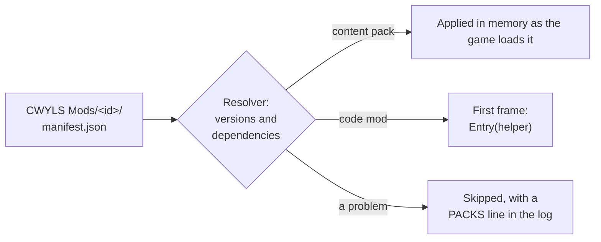

<picture>
  <source media="(prefers-color-scheme: dark)" srcset="../../.github/assets/banner/docs-guide-dark.svg">
  
</picture>

**Guide** &nbsp;·&nbsp; [Getting started](getting-started.md) &nbsp;·&nbsp; [Manifest](manifest.md) &nbsp;·&nbsp; [Lifecycle](lifecycle.md) &nbsp;·&nbsp; [Helper](helper.md) &nbsp;·&nbsp; [Troubleshooting](troubleshooting.md) &nbsp;·&nbsp; [Versioning](versioning.md) &nbsp;·&nbsp; [API reference](../api/README.md)

# CWY:LS Mod Loader author's guide

CWY:LS Mod Loader is an unofficial, fan-made mod loader for *Chill with You : Lo-Fi Story*
(Nestopi Inc.). It is not made, endorsed or supported by Nestopi. It runs inside the game as a set
of BepInEx 5 plugins on the game's Unity Mono runtime, on macOS and Windows, and only on the full
Steam release of the game (it switches itself off on the free demo). It loads your **content packs**
and **code mods** from one folder, applies them in memory while the game runs, and never changes a
game file.

This guide is for people who make packs and mods. It describes CWY:LS Mod Loader **0.9**, a
developer preview (mod API `0.9.0`). The API freezes at **1.0**; until then a minor version may
still change it, always announced first (see [versioning](versioning.md)).

<!-- API version: src/CwyLs.ModLoader.Core/Mods/CwyApi.cs:24; freeze: CwyApi.cs:27. -->

## Pages

| Page | Read it when |
|---|---|
| [getting-started.md](getting-started.md) | You want a first mod running: copy the template, build, install, read the console. Includes a line-by-line tour of the sample mod |
| [manifest.md](manifest.md) | You write or debug a `manifest.json` or a `language.json`; every field, and every reason a pack or mod is skipped |
| [lifecycle.md](lifecycle.md) | You need to know when your code runs, what `Entry` may do, how mods talk to each other, and what happens when something throws |
| [helper.md](helper.md) | You use the helper: one short example per facet, and the threading rules |
| [troubleshooting.md](troubleshooting.md) | Something did not load or does not work; the log lines and what they mean |
| [versioning.md](versioning.md) | You want to know what can change under your mod, and how deprecations are announced |

Reference: the generated [API reference](../api/README.md) (every public type and member, from the
source comments). The module READMEs go deeper: `src/CwyLs.ModLoader/Mods/README.md` (the loader),
`packs/README.md` (content packs), `packs/cwy.example/README.md` (folder conventions), and
[manifest.md](manifest.md#languagejson-a-separate-file-not-a-manifest-member) (language packs).

## Content packs and code mods

Both are a folder with a `manifest.json` in `<game root>/CWYLS Mods/<id>/`. They share one dependency
graph and the same version checks.

| | Content pack | Code mod |
|---|---|---|
| What it is | Your own files: textures, voice clips, master-data rows, text tables, a language declaration | A DLL with one class deriving from `CwyMod`, plus any content of its own |
| Manifest | `id`, `name`, `version` (+ optional fields) | the same, plus `entryDll` |
| Needs a compiler | No | Yes (C#, `netstandard2.1`) |
| Can do | Replace or add textures, voices, dialogue rows, scenario rows; add a game language | Everything a content pack can, plus react to game events, make Satone speak, read the player's data, add console commands, hotkeys and windows |
| Example in the repo | `packs/cwy.example/`, `packs/cwy.demo.audio/`, `packs/cwy.demo.scenery/`, `packs/cwy.demo.script/` | `mods-src/cwy.sample.hello/` (built into `packs/cwy.sample.hello/`) |
| Start from | a copy of `packs/cwy.example/` | a copy of `templates/cwy-mod/` |

A content pack can also be data *for* a code mod (`contentPackFor`); the code mod then reads it
through `helper.ContentPacks`. Pick a content pack whenever files are enough: it cannot crash
anything and needs no rebuild when the framework changes.

<!-- entryDll makes a code mod: src/CwyLs.ModLoader.Core/Packs/PackManifest.cs:204 (IsCodeMod); shared graph: src/CwyLs.ModLoader.Core/Packs/PackResolver.cs:7-11. -->

## Where things live

| Path (under the game folder) | What | Who writes it |
|---|---|---|
| `CWYLS Mods/<id>/` | Your pack or mod: `manifest.json`, the DLL, content | You (or `./deploy-packs.sh`) |
| `BepInEx/plugins/CwyLsModLoader/` | The framework's own DLLs | The installer or `./build.sh` only; never put a mod here |
| `BepInEx/config/cwy.mod.<id>.cfg` | Your mod's settings and hotkeys, created on first use | The framework, for your mod |
| `BepInEx/data/mods/<id>/` | Your mod's own files (`helper.Data`) | Your mod, through the framework |
| `BepInEx/config/cwyls.modloader.cfg` | Framework settings, e.g. `[Mods] Enabled`, `[Packs] IgnoreGameVersion` | BepInEx |
| `BepInEx/cwy-console.log` | Every console line of this session (the last 5 sessions are kept as `cwy-console.<stamp>.log`) | The framework |
| `BepInEx/trace/trace-<stamp>.jsonl` | The full diagnostic stream, including stack traces; `trace/latest.txt` names the current file | The Trace plugin |

The game folder is where Steam installed the game. With Steam's default library it is
`~/Library/Application Support/Steam/steamapps/common/Chill with You Lo-Fi Story/` on macOS and
`C:\Program Files (x86)\Steam\steamapps\common\Chill with You Lo-Fi Story\` on Windows; with
another library folder it is under that folder's `steamapps\common\`. In Steam, *Manage → Browse
local files* on the game opens it.

> [!WARNING]
> Install and update code mods with the game closed: a loaded DLL must never be overwritten. Packs
> are read once at startup, so a changed pack needs a restart too (textures are the one exception:
> they reload live, see `packs/README.md`).

<!-- PacksRoot: src/CwyLs.ModLoader/ModLoaderPaths.cs:14; DataRoot :24; mod config: src/CwyLs.ModLoader/Mods/ModHelper.cs:20,:107; mod data: src/CwyLs.ModLoader/Mods/ModFacets.Framework.cs:65,:74; console log roll: src/CwyLs.ModLoader/README.md "Where it goes"; default Steam paths: Directory.Build.props, templates/cwy-mod/MyMod.csproj. -->

## The rules

These are not optional. They come from the licence (`LICENSE.md`), from [`NOTICE.md`](../../NOTICE.md)
and [`AGENTS.md`](../../AGENTS.md), and from the game's own terms.

1. **Free of charge, no commercial use.** CWY:LS Mod Loader is licensed under PolyForm
   Noncommercial 1.0.0 with the Required Notices at the top of `LICENSE.md`. Mods, content packs
   and other works made for or with the loader must be distributed free of charge. Anyone who gets
   a copy of CWY:LS Mod Loader from you must also get the licence terms and the Required Notices.
2. **Paid game content is never modded.** No unlocking of the shop, DLC, the full version or level
   caps, or collaboration content, by any route.
3. **Account linking, cloud sync, social sharing and the shop are off limits.** Do not read, change
   or automate them. The player's save syncs through Steam Cloud, so a broken write travels to
   every machine. Saves must stay loadable by the game without mods.
4. **Your files only.** A pack contains your own work. Never copy, extract or redistribute game
   files (textures, audio, text, code); they belong to Nestopi Inc.
5. **Full game only.** The loader runs on the full Steam release and switches itself off on the
   free demo. Do not work around that.
6. **Unofficial, and at your own risk.** CWY:LS Mod Loader is not made, endorsed or supported by
   Nestopi Inc. Please do not contact Nestopi about it or about mods made with it; report problems
   to this project instead. The game's own terms restrict analysing and modifying it, so you make
   and use mods at your own risk. If Nestopi asks, this project will change or be taken down.

This is a summary for authors, not legal advice.

<!-- Rule 1: LICENSE.md (Required Notices), NOTICE.md; rules 2-4: AGENTS.md "Project rules", NOTICE.md; rule 5: AGENTS.md "Protected controls", NOTICE.md; rule 6: NOTICE.md. -->
