<picture>
  <source media="(prefers-color-scheme: dark)" srcset="../../.github/assets/banner/docs-versioning-dark.svg">
  
</picture>

[Guide](README.md) &nbsp;·&nbsp; [Getting started](getting-started.md) &nbsp;·&nbsp; [Manifest](manifest.md) &nbsp;·&nbsp; [Lifecycle](lifecycle.md) &nbsp;·&nbsp; [Helper](helper.md) &nbsp;·&nbsp; [Troubleshooting](troubleshooting.md) &nbsp;·&nbsp; [Versioning](versioning.md) &nbsp;·&nbsp; **API stability** &nbsp;·&nbsp; [Translate](translate.md) &nbsp;·&nbsp; [Textures](textures.md) &nbsp;·&nbsp; [Porting](porting.md) &nbsp;·&nbsp; [Dub & Subtitle Studio](pack-maker.md) &nbsp;·&nbsp; [คู่มือภาษาไทย](pack-maker.th.md) &nbsp;·&nbsp; [API reference](../api/README.md)

# API stability (v1.0 freeze boundary)

This page is the authoritative list of what freezes at **1.0** and what stays **experimental** or
**internal** across every mod-facing surface of CWY:LS Mod Loader: the C# mod SDK, manifest and pack
formats, console commands, the general HTTP `/v1` API, and Pack Maker `/v1/maker`.

The automated contract tests in `src/CwyLs.ModLoader.Tests/ApiSurface/` hold the frozen C# list.

## What each label means

| Label | Promise from 1.0 onwards |
|---|---|
| **Frozen** | Existing names, signatures, accepted documented inputs, structural outputs and documented meanings stay compatible through every `1.x` release. Only a new **major** version (`2.0.0`, …) may break them, and a deprecated frozen member stays until that major version ([versioning.md](versioning.md)). Additive changes remain allowed under the [consumer rules](versioning.md#what-additive-means-for-your-mod): mods consume framework-owned interfaces, tolerate new enum values, event types and properties, and never implement helper or facet interfaces themselves. Security, privacy, ownership and save-safety requirements remain binding; any stricter limit or refusal must be documented, and a successful operation is not silently redefined. |
| **Experimental** | Implemented or reserved mod-facing surface whose current shape is inventoried, but **may change in a `1.x` minor version with a release note**. Experimental status never relaxes protected controls (demo lock, paid-content rules, save-safety). |
| **Internal** | Cross-assembly, test or diagnostic plumbing with no third-party compatibility promise. A `public` C# access modifier or a recognized pack folder path alone does not make a supported SDK; internal surfaces may change or move without deprecation. |

---

## C# mod SDK

The code-mod SDK lives in `CwyLs.ModLoader.Mods` and `CwyLs.ModLoader.Core.Mods`, plus the six
Core types that close the frozen signatures (`CwyLs.ModLoader.Core.Packs`,
`CwyLs.ModLoader.Core.Events`, and `CwyLs.ModLoader.Core.Threading`). A member-level label overrides
its containing interface or class.

### Frozen C# types and members (23 types, 136 direct members)

| Namespace | Type | Frozen members | Notes & per-member exceptions |
|---|---|---|---|
| `CwyLs.ModLoader.Mods` | `CwyMod` | All 6 (`Helper`, `Log`, `Manifest`, `Entry`, `GetApi`, `OnShutdown`) | Entry base class |
| `CwyLs.ModLoader.Mods` | `ICwyModHelper` | 12 of 29 (`ModId`, `Manifest`, `DirectoryPath`, `Log`, `Config`, `Data`, `Events`, `ContentPacks`, `Input`, `Console`, `MainThread`, `ModRegistry`) | **Per-member exception:** the other 17 facet properties on `ICwyModHelper` are **experimental** (listed below). `Config` binds BepInEx 5 `ConfigFile` |
| `CwyLs.ModLoader.Mods` | `ICwyModManifest` | All 11 (`Id`, `Name`, `Version`, `Author`, `Description`, `GameVersion`, `LoaderVersion`, `EntryDll`, `ContentPackFor`, `DependsOn`, `Extensions`) | Read-only view of `manifest.json` |
| `CwyLs.ModLoader.Mods` | `ICwyModInfo` | All 6 (`Id`, `Manifest`, `DirectoryPath`, `IsCodeMod`, `State`, `Detail`) | |
| `CwyLs.ModLoader.Mods` | `ICwyModRegistry` | All 4 (`IsLoaded`, `Get`, `GetAll`, `GetApi<T>`) | |
| `CwyLs.ModLoader.Mods` | `ICwyModLog` | All 4 (`Trace`, `Info`, `Warn`, `Error`) | |
| `CwyLs.ModLoader.Mods` | `ICwyModData` | All 8 (`DirectoryPath`, `Exists`, `ReadText`, `WriteText`, `ReadJson`, `WriteJson`, `Delete`, `Keys`) | |
| `CwyLs.ModLoader.Mods` | `ICwyModEvents` | 4 of 5 (`IsAvailable`, `Subscribe<T>`, `EveryFrame`, `OnModsReady`) | **Per-member exception:** `SubscribeAny(Action<AnyEvent>)` is **experimental**. `Subscribe<T>` freezes the generic mechanism (`T : ICwyEvent`), not every concrete event record shape |
| `CwyLs.ModLoader.Mods` | `ICwyModInput` | All 1 (`Register`) | |
| `CwyLs.ModLoader.Mods` | `ICwyModConsole` | All 1 (`Register`) | |
| `CwyLs.ModLoader.Mods` | `ICwyModMainThread` | All 9 (`IsMainThread`, `Now`, `Post`, `RunOrPost`, `PostAfter`, `InvokeAsync` ×2, `Invoke` ×2) | |
| `CwyLs.ModLoader.Mods` | `ICwyModFacet` | All 2 (`IsAvailable`, `Status`) | |
| `CwyLs.ModLoader.Mods` | `CwyRegistration` | All 6 (`Name`, `IsActive`, `Problem`, `WasRefused`, `Dispose`, `ToString`) | |
| `CwyLs.ModLoader.Core.Mods` | `CwyApi` | All 7 (`PluginVersionText`, `VersionText`, `FreezeVersionText`, `Version`, `FreezeVersion`, `IsFrozen`, `Satisfies`) | Signatures and meaning are frozen; version values advance with releases |
| `CwyLs.ModLoader.Core.Mods` | `CwyDeprecatedAttribute` | All 4 (constructor, `Since`, `Stage`, `Replacement`) | |
| `CwyLs.ModLoader.Core.Mods` | `DeprecationStage` | All 3 (`Notice`, `Info`, `PendingRemoval`) | |
| `CwyLs.ModLoader.Core.Mods` | `ModState` | All 5 (`Pending`, `Loaded`, `Skipped`, `Failed`, `ShutDown`) | |
| `CwyLs.ModLoader.Core.Packs` | `SemVer` | All 21 (`Major`, `Minor`, `Patch`, `Prerelease`, `Build`, `IsPrerelease`, `Parse`, `TryParse` ×2, `Compare`, `CompareTo`, `Equals` ×2, `GetHashCode`, `==`, `!=`, `<`, `>`, `<=`, `>=`, `ToString`) | Signature closure |
| `CwyLs.ModLoader.Core.Packs` | `PackDependency` | All 7 (constructor, `Id`, `MinVersion`, `IsOptional`, `IsSatisfiedBy`, `AsRequired`, `ToString`) | Signature closure |
| `CwyLs.ModLoader.Core.Events` | `ICwyEvent` | All 2 (`Describe`, `Fields`) | Signature closure |
| `CwyLs.ModLoader.Core.Threading` | `DelayedWork` | All 5 (`IsAccepted`, `RejectReason`, `IsPending`, `Cancel`, `Dispose`) | Signature closure |
| `CwyLs.ModLoader.Core.Threading` | `MainThreadRejectReason` | All 3 (`QueueFull`, `OwnerNotRunning`, `ShuttingDown`) | Signature closure |
| `CwyLs.ModLoader.Core.Threading` | `MainThreadRejectedException` | All 5 (constructor, `Reason`, `Owner`, `Label`, `Describe`) | Signature closure |

### Experimental C# facets and members

These facets, helper accessors, event payloads and their facet-specific DTOs may change in a `1.x`
minor version with a release note:

- **Game-facing and feature facets:** `Satone` (`ICwyModSatone`), `GameData` (`ICwyModGameData`),
  `Language` (`ICwyModLanguage`), `Content` (`ICwyModContent`), `Ui` (`ICwyModUi`), `Harmony`
  (`ICwyModHarmony`), `Audio` (`ICwyModAudio`), `Grading` (`ICwyModGrading`), `Scenes`
  (`ICwyModScenes`), `Api` (`ICwyModApi`), `Conditions` (`ICwyModConditions`), and `Actions`
  (`ICwyModActions`).
- **Legacy UI compatibility:** `CwyWindowOptions`, `ICwyModWindow`, and
  `ICwyModUi.CreateWindow(CwyWindowOptions, out string)` (deprecated `Notice` since `0.9.0`;
  replacement `CreateWindow(CwyWindowSpec)`).
- **Reserved / unbuilt slots (keep `IsAvailable == false` until built):** `EditData`
  (`ICwyModEditData`), `UiSkin` (`ICwyModUiSkin`), `Camera` (`ICwyModCamera`), `VoiceStream`
  (`ICwyModVoiceStream`), `Mic` (`ICwyModMic`, `CwyMicRoute`).
- **Concrete event shapes:** `ICwyModEvents.SubscribeAny(Action<AnyEvent>)`, `AnyEvent`, and all
  concrete game-event records (`RoomReady`, `SatoneStateChanged`, `LineSpoken`, `LineEnded`,
  `ScenarioStarted`, `ScenarioEnded`, `PomodoroEvent`, `PomodoroTick`, `MusicChanged`,
  `WindowChanged`, `SaveSection`, `SceneChanged`, `GameClockTick`, and any record added later).

### Internal C# surfaces and upstream dependencies

- **`CwyLs.ModLoader.Api` (`ApiPlugin`):** The HTTP plugin assembly is **not** a code-mod SDK.
  `ApiPlugin` (`PluginGuid = "cwyls.modloader.api"`, `PluginName = "CWYLS API"`, and its implicit
  constructor) is **internal**; the plugin GUID remains deployment identity only.
- **Framework and Core plumbing:** All other public types in `CwyLs.ModLoader`,
  `CwyLs.ModLoader.Core` and the other plugin assemblies (such as `ModLoader`,
  `ModAssemblyLoadMode`, `ModBackends`, `IMod*Source`, `ModFacetBackends`, `CoreRegistrySinks`,
  `CwyDeprecations`, and Core resolver, planner, limiter, data-key and failure helpers) are
  **internal**.
- **Upstream dependencies:** `BepInEx.Configuration.ConfigFile`, `UnityEngine.*`,
  `HarmonyLib.Harmony` and `System.*` types retain their own upstream contracts.

---

## Manifest and pack formats

| Format / path family | Status | Scope & notes |
|---|---|---|
| `manifest.json` core fields | **Frozen** | `id`, `name`, `version`, `author`, `description`, `gameVersion`, `minGameVersion`, `maxGameVersion`, `loaderVersion`, `entryDll`, `contentPackFor` (string or `{id, minVersion?}`), `dependsOn` (string or `{id, minVersion?, optional?}`), `x-*` extension prefix; SemVer 2.0.0 precedence and dependency cycle/order rules. `gameVersion` remains informational |
| `manifest.json` legacy `contentPatcherVersion` | **Experimental** | Accepted legacy alias when `loaderVersion` is absent (`loaderVersion` wins if both are supplied) |
| `language.json` | **Frozen** | Object or array; `schema: 1`, `code`, `caption`, `englishName`, `script`, `fallback`, `font.gameAssets`, `marks`, `lineBreaks`, `x-*`. `font.file` remains refused; first declaration wins; base-language save semantics preserved |
| `data/subtitles/<code>.json` & `marks` tables | **Frozen** | Flat localization-id → string table; schema-1 mark tables (`schema`, `font`, `source`, `fallbackGap`, `marks`, `pairs`) |
| `audio/voice/<name>.ogg\|wav`, `audio/voice/<lang>/<name>.ogg\|wav` | **Frozen** | Path, naming and precedence contract (global voice names are case-sensitive; later pack wins; runtime overrides outrank packs). Decoder implementation and native playback availability are not frozen |
| `textures/<renderer>/<slot>.png`, `textures/@<material>/<slot>.png`, `_rules.json` texture entries, `textures/_*/**` | **Frozen** | Parsing, precedence (`renderer`/`material`, `property`, `file`, `materialIndex`), refusal and restore semantics. Game renderer and material names belong to game assets |
| `_rules.json` material property values & `grading/<name>.json` | **Experimental** | `color`, `tint`, `float`, `vector`, `intensity` property rules; `grading/<name>.json` schema 1 and controls/time blocks |
| `data/localization.json`, `data/novel.json`, `data/scenario_groups.json`, scenario scripts | **Experimental** | Game-shaped master-data row columns (9 Localization / 14 Novel / 15 ScenarioGroup fields, including `Languages`, `Pool`, `Weight`) and `cwy.do`, `cwy.defer`, `cwy.wait`, `cwy.flag` in Novel `Arg1` |
| Replacement audio & pack music | **Experimental** | `audio/ambient`, `audio/ambient_se`, `audio/se/system`, `audio/se/timer`, `audio/direction_music` (`.ogg\|wav`); `audio/music/*.ogg\|wav` and optional `_tracks.json` (`{schema, tracks}` or array `{file, title, credit, tag}`, `x-*`) |
| Maker export & disclosure files | **Experimental** | `voice-provenance.json`, `icon.png`, exported `CHANGELOG.md` and ZIP naming/content policy |
| Reserved unimplemented paths | **Internal** | `data/edit/*.json`, `data/triggers.json`, `ui/**.png`, `ui/_sprites.json` (recognized by the content index only; no runtime reader/applicator) |
| `.maker/**`, `materials.json`, unmatched `Other` files | **Internal** | Maker working projects/takes/receipts/journals/recovery archives, diagnostic material scans, hidden/dot files, README/source art and unmatched files (`Other`) |

---

## Console commands (32 built-in roots)

Freezing a root/grammar preserves the command name and accepted argument grammar, not printed
prose, line ordering, game object names, or dynamic command names registered by mods through
`ICwyModConsole`.

| Status | Built-in command roots and grammar |
|---|---|
| **Frozen (12)** | `help [command]` · `commands` · `version` · `paths` · `stats` · `packs list\|rescan` · `keys` · `panels [name]` · `dump [path]` · `clear` · `mods [list\|status]` · `api on\|off\|status\|rotate` |
| **Experimental (12)** | `maker [open\|stop\|off\|serve\|status\|trace on\|off]` *(empty = open; `trace` subcommand is **internal**)* · `act [status]\|list [prefix]\|run <name> [key=value ...]` · `voice list\|play <name>\|satone <name>` · `tex apply\|restore\|reload\|list\|scan [pattern]\|export [pattern\|all]` · `satone state\|face <name>\|motion <name>\|look <scale> <sec>\|say <text>` · `audio [status]\|list [all\|replaced\|<table>]\|ab <name\|table\|all> [original\|pack]\|play <name>\|music\|on\|off\|reload` · `grade list\|apply <name>\|off\|set <control> <value>\|save <name>\|ab\|export\|controls [filter]\|reload` · `lines list\|test <groupId>\|test off` · `scene list\|lint [groupId]\|play <groupId\|rowId\|game click line\|game episode>\|unseen on\|off\|flags` · `scenery scan [pattern]\|export [pattern\|all]\|list\|restore\|apply` · `windows [status]\|list\|demo\|forget <modId/windowId>\|forget all` · `saves list\|folder` |
| **Internal (8)** | `smoke run [quiet\|loud]\|report\|list` · `targets verify` · `trace on\|off\|full\|status` · `bus emit <sys> <name> [k=v ...]\|stats` · `log <text>` · `events last [n]` · `data snapshot\|todos\|notes\|habits\|pomodoro [--full]` · `masterdata status` |

Sample `hello` and template `mymod` are internal examples, not built-in roots.

---

## General HTTP `/v1`

All **6** general `/v1` route contracts and their shared wire/security rules are **frozen** at 1.0,
with specific open/experimental contents inside actions and events:

| Method & path | Status | Frozen vs experimental inside the contract |
|---|---|---|
| `GET /v1/info` | **Frozen** | Schema and field names/types are frozen; runtime capability booleans and transport diagnostics remain runtime facts, not fixed literals |
| `GET /v1/state` | **Frozen** | Schema-1 cached document and privacy omissions are frozen; unknown/new game state strings and nullable/unavailable sections remain valid |
| `GET /v1/events?after&wait&limit` | **Frozen** | Cursor envelope and the 14 mapped event schemas are frozen; clients must use `next`, handle `reset`/`dropped`/epoch changes, and tolerate unknown future event types |
| `GET /v1/actions` | **Frozen envelope** | Envelope and descriptor fields are frozen; action registry membership and mod-provided parameter schemas are dynamic |
| `POST /v1/actions/{name}` | **Frozen envelope** | Transport, `{args:{...}}` binding, `Idempotency-Key`, `202` + `Location`, and `200` `replayed:true` envelope are frozen; **per-action `result.data` and extension-provided action schemas/behaviour are experimental** |
| `GET /v1/actions/{handle}?wait` | **Frozen envelope** | Handle format (`act-` + 24 hex), `state`, `result.status` and `result.path` vocabulary are frozen; **per-action `result.data` is experimental**, `message` is human diagnostic, and finished handles may be evicted under capacity pressure before the nominal 10-minute retention |

Shared **frozen** rules: bearer auth, exact loopback `Host` (`127.0.0.1:<port>`, noting that the
platform transport may reject an invalid `Host` before the router), browser refusal (`Origin`,
`Sec-Fetch-Site` or `Sec-Fetch-Mode` → `403` `browser_refused`), no CORS, strict target/query/body
parsing, JSON and error envelopes, `Cache-Control: no-store`, documented error codes/statuses,
bounded cursor/long-poll/idempotency semantics, off-by-default (`[Api] Enabled = false`), and
`AllowActions` / confirmation / `[Data] AllowWrites` gates.

**Internal:** listener implementation details, diagnostic error message wording, rate-limit ceilings as
guaranteed throughput, and scheduling/backoff internals.

---

## Pack Maker `/v1/maker`

**Pack Maker the app is supported; its HTTP routes are not a third-party contract yet.**

- **Experimental (44 routes):** All 10 legacy `/v1/maker/*` routes (`GET /v1/maker/status`,
  `GET /v1/maker/packs`, `GET /v1/maker/lines`, `GET /v1/maker/lines/{id}`,
  `PUT|DELETE /v1/maker/packs/{packId}/subtitles/{lang}/{id}`,
  `PUT|DELETE /v1/maker/packs/{packId}/voice/{lang}/{clip}`, `POST /v1/maker/play`,
  `GET /v1/maker/events`) and all 34 functional `/v1/maker/studio/*` routes (recovery/resolve,
  capabilities, status, packs, lines, line detail, groups, workflow, subtitle, history/revert,
  takes, take audio PUT/GET, take update/delete, favourite, publish/unpublish, glossary GET/PUT,
  pack create/info/icon/export/download, pack voice default GET/PUT, operation lookup, and Studio
  play) may change in a `1.x` minor version with a release note.
- **Internal (1 route):** `POST /v1/maker/studio/client-log` is diagnostics only and has no
  compatibility promise.

Operational invariants (separate Maker session token, same-origin/`Host` checks, no raw game-asset
downloads, bounded WAV/PNG uploads, explicit consent/provenance checks, optimistic revisions, and
durable operation receipts) remain enforced while experimental. Static assets under `/maker/` are
page hosting, not API endpoints.
