<picture>
  <source media="(prefers-color-scheme: dark)" srcset="../../.github/assets/banner/docs-getting-started-dark.svg">
  
</picture>

<sub>[Guide](README.md) &nbsp;·&nbsp; **Getting started** &nbsp;·&nbsp; [Manifest](manifest.md) &nbsp;·&nbsp; [Lifecycle](lifecycle.md) &nbsp;·&nbsp; [Helper](helper.md) &nbsp;·&nbsp; [Troubleshooting](troubleshooting.md) &nbsp;·&nbsp; [Versioning](versioning.md) &nbsp;·&nbsp; [Translate](translate.md) &nbsp;·&nbsp; [API reference](../api/README.md)</sub>

# Getting started: your first code mod

By the end of this page you have a mod that loads, logs a line and reacts when the room is ready,
and you know how to read what the loader says about it. Then we walk through the sample mod,
`cwy.sample.hello`, line by line.

Content packs need no programming, but for now you edit JSON text files by hand (a point-and-click
Pack Maker is planned for 1.0): copy `packs/cwy.example/`, edit its `manifest.json`, add files as
`packs/cwy.example/README.md` describes, and install it the same way as in step 5 below.

## What you need

- **A CWY:LS Mod Loader checkout with the framework built.** Your mod compiles against the framework's
  DLLs in `src/CwyLs.ModLoader/bin/Release/netstandard2.1/` and
  `src/CwyLs.ModLoader.Core/bin/Release/netstandard2.1/`. `./build.sh --no-deploy` in the checkout
  builds them (and runs the tests).
- **The .NET 10 SDK.** With Homebrew's .NET on macOS, commands may need
  `export DOTNET_ROOT=/opt/homebrew/opt/dotnet/libexec` first (`build.sh` uses that default when
  `DOTNET_ROOT` is not set).
- **The full game with BepInEx and CWY:LS Mod Loader installed.** Run the installer from a release
  zip once (`install.command` on macOS, `install.bat` on Windows; see the top-level `README.md`).
  On macOS, `./build.sh` then deploys the framework you built over the installed one.

<!-- Template references: templates/cwy-mod/MyMod.csproj (HintPaths into src/*/bin/$(CwyConfiguration)/netstandard2.1, BepInEx core and the game's Managed folder). -->

## 1. Copy the template

```
cp -R templates/cwy-mod mods-src/yourname.mymod
```

Inside the checkout, `mods-src/` is the place: `./build.sh` builds every `mods-src/*/*.csproj`
after the framework. Anywhere else works too; then every build needs
`-p:CwyRepoRoot=/path/to/checkout/` (with the trailing slash).

You get four files: `MyMod.csproj`, `manifest.json`, `ModEntry.cs` and a README.

<!-- build.sh:50-57 builds mods-src/*/*.csproj; CwyRepoRoot default: templates/cwy-mod/MyMod.csproj. A copy outside the repo builds with -p:CwyRepoRoot. -->

## 2. Give it an id

The id is how everything finds your mod: its folder, its config file, its data folder, other mods'
dependencies. Lowercase letters, digits, `.`, `_` and `-`, 3 to 64 characters, starting with a
letter or digit, for example `yourname.mymod`. It never changes once the mod is in use.

Set it in two places, and keep the DLL name and `entryDll` in step:

| File | Change |
|---|---|
| `MyMod.csproj` | `<ModId>yourname.mymod</ModId>`; optionally `<AssemblyName>` (the DLL's name) and `<RootNamespace>` |
| `manifest.json` | `"id": "yourname.mymod"`, `"name"`, `"author"`, `"description"`, and `"entryDll": "<AssemblyName>.dll"` |

Pick an `AssemblyName` no other mod uses: two mods whose DLLs have the same name cannot both load
(the second is skipped as `AssemblyAlreadyLoaded`).

<!-- Id rule: src/CwyLs.ModLoader.Core/Packs/PackManifest.cs:35 (^[a-z0-9][a-z0-9._-]{2,63}$); name clash: src/CwyLs.ModLoader/Mods/ModLoader.cs:286-292. A renamed copy (ModId yourname.greeter, AssemblyName Greeter, entryDll Greeter.dll) builds and packs Greeter.dll/.pdb/manifest.json. -->

## 3. Write `Entry`

The DLL must contain exactly one concrete class that derives from `CwyMod` and has a parameterless
constructor. The framework creates it and calls `Entry` once. The smallest useful mod:

```csharp
using CwyLs.ModLoader.Core.Events;
using CwyLs.ModLoader.Mods;

namespace MyMod
{
    public sealed class ModEntry : CwyMod
    {
        public override void Entry(ICwyModHelper helper)
        {
            helper.Log.Info("hello from my first mod");
            helper.Events.Subscribe<RoomReady>(_ => helper.Log.Info("the room is ready"));
        }
    }
}
```

`Entry` runs on the first frame, before the room exists: register things here (events, commands,
hotkeys, config), and do anything that needs the room, Satone or the player's data when
`RoomReady` arrives. [lifecycle.md](lifecycle.md) explains why.

The template's `ModEntry.cs` is a fuller starting point: a config entry, a counter saved in the
mod's data folder, a console command, a hotkey and a Satone line.

## 4. Build

```
cd mods-src/yourname.mymod
dotnet build -c Release
```

(Outside the checkout: `dotnet build -c Release -p:CwyRepoRoot=/path/to/checkout/`.)

The build assembles the whole mod folder in `bin/Release/netstandard2.1/pack/<ModId>/`: your DLL,
its `.pdb` and `manifest.json`. Nothing else belongs there: every reference is `Private=false`, so
the framework, BepInEx and Unity DLLs are never copied. Keep the `.pdb`; it is what gives stack
traces line numbers.

If the build cannot find `CwyLs.ModLoader.dll`, the framework is not built yet or `CwyRepoRoot` points
at the wrong folder. If it cannot find `UnityEngine.CoreModule.dll`, pass
`-p:GameManagedPath=<the game's Managed folder>`.

<!-- Output folder: templates/cwy-mod/MyMod.csproj ($(OutDir)pack/$(ModId)/, OutDir = bin/Release/netstandard2.1/). Private=false: the Reference items in MyMod.csproj. -->

## 5. Install, with the game closed

Copy the folder so that it becomes `<game root>/CWYLS Mods/<id>/`:

- **Through the repo:** copy `bin/Release/netstandard2.1/pack/yourname.mymod/` to
  `packs/yourname.mymod/`, then run `./deploy-packs.sh`. It replaces each `CWYLS Mods/<id>/` with the
  repo's `packs/<id>/`, so a file you deleted does not survive.
- **Directly:** copy the folder into `<game root>/CWYLS Mods/`.

`./deploy-packs.sh` finds the game in Steam's default library on macOS; anywhere else, set
`GAME_ROOT` to the game folder first (`GAME_ROOT="<game folder>" ./deploy-packs.sh`).

Quit the game first. A loaded mod DLL stays memory-mapped for the whole session; overwriting it
while the game runs can crash the game, and even when it does not, the new code is not used until
the next start.

<!-- deploy-packs.sh:1-9 (replace, not merge), :22-33 (GAME_ROOT); no reload: src/CwyLs.ModLoader/Mods/ModLoader.cs:48-52. -->

## 6. Start the game and read the console

Start the game (on the Mac: `tools/mac/launch-mac.sh --log`). These lines tell you the mod loaded;
they are also in `BepInEx/cwy-console.log`, and `tools/mac/watch-log.sh` shows them in colour:

```
SETUP  code-mod loader armed; mods load on the first frame  src=mods api=0.9.0 enabled=True assemblyLoad=LoadFrom
MOD    yourname.mymod: hello from my first mod
MODS   yourname.mymod@0.1.0 loaded  type=MyMod.ModEntry ms=0.8
MODS   1 loaded (yourname.mymod@0.1.0); 0 skipped; 0 failed  api=0.9.0 backends=events,satone,gameData,language,ui
MOD    yourname.mymod: the room is ready
```

`MOD` lines are what your mod logs; `MODS` lines are what the loader says about mods. The `ms=`
value and the `backends` list depend on your machine and on which game adapter plugins loaded.

Then open the in-game console with **Ctrl+Shift+C** and type:

| Command | Shows |
|---|---|
| `mods` | every code mod with its state (Loaded, Skipped, Failed) and why, then the API version and the main-thread dispatcher |
| `mods list` / `mods status` | the first or the second half of that |
| `help` | every command, grouped; yours appear under `[yourname.mymod]` |
| `help <command>` | one command's usage, description and group |
| `packs list` | the content packs and code mods the resolver accepted or skipped |

A mod that is missing from `mods` was never a code mod (no `entryDll`) or was skipped before
loading: look for its `PACKS` line. [troubleshooting.md](troubleshooting.md) lists every line.

<!-- SETUP line: src/CwyLs.ModLoader/Mods/ModLoader.cs:157-162; loaded line :369-380; summary :223-234 and src/CwyLs.ModLoader.Core/Mods/ModConsoleLines.cs:40-78; MOD line: src/CwyLs.ModLoader/Mods/ModFacets.Framework.cs:38-58; mods command: src/CwyLs.ModLoader/Mods/ModCommands.cs:19-41; help grouping: src/CwyLs.ModLoader.Core/Console/CommandRegistry.cs Help(). -->

## 7. Change, rebuild, restart

There is no code reload: Mono cannot unload an assembly. The loop is: quit the game, change the
code, `dotnet build -c Release`, copy the folder, start the game. Content in your mod folder
follows the pack rules: textures reload live, everything else is read at startup.

---

## The sample mod, line by line

`mods-src/cwy.sample.hello/` is the working example. It uses only the helper (no Harmony, no game
types): when the room is ready, Satone welcomes you back once per session, and the console command
`hello [name]` makes her greet you. The build copies its DLL, `.pdb` and manifest into
`packs/cwy.sample.hello/`.

### `manifest.json`

```json
{
  "id": "cwy.sample.hello",
  "name": "CWY Sample: Hello",
  "version": "0.1.0",
  "author": "CWY:LS",
  "description": "Sample code mod: Satone welcomes you back once per session, and the console command hello [name].",
  "gameVersion": "1.18.0",
  "loaderVersion": "0.9.0",
  "entryDll": "CwySampleHello.dll",
  "dependsOn": []
}
```

- `entryDll` makes it a code mod; the file sits at the top of the mod folder.
- `loaderVersion: 0.9.0` is the oldest framework API it runs on. An older framework skips
  it instead of half-loading it.
- `dependsOn` is empty: the sample needs no other pack or mod. [manifest.md](manifest.md#three-examples)
  shows a required and an optional dependency.

### `cwy.sample.hello.csproj`

It targets `netstandard2.1` (what the game's Mono loads), references `CwyLs.ModLoader`,
`CwyLs.ModLoader.Core`, `BepInEx`, `UnityEngine.CoreModule` and `UnityEngine.AudioModule`, all
`Private=false`, and its `CopyToPack` target copies the DLL, `.pdb` and manifest into
`packs/cwy.sample.hello/`. Unlike the template it writes straight into the repo's `packs/`, so
`./deploy-packs.sh` installs it.

### `ModEntry.cs`

```csharp
using System.Collections.Generic;
using CwyLs.ModLoader.Core.Events;        // RoomReady and the other game events
using CwyLs.ModLoader.Core.Satone.Say;    // SayRequest, SayOutcome
using CwyLs.ModLoader.Mods;               // CwyMod, ICwyModHelper
```

Three namespaces cover almost every mod: the mod API (`CwyLs.ModLoader.Mods`), the event records
(`CwyLs.ModLoader.Core.Events`) and the Satone line types (`CwyLs.ModLoader.Core.Satone.Say`).

```csharp
public sealed class ModEntry : CwyMod
{
    private const double FirstTrySeconds = 4;               // let the game's own arrival scene start first
    private const double RetrySeconds = 1;                  // ask again while Satone is busy
    private const double GiveUpSeconds = 60;                // then queue it anyway

    private bool _greeted;                                  // once per session
    private double _roomReadyAt;
```

One concrete `CwyMod` subclass with the implicit parameterless constructor: that is what the loader
looks for. Fields are fine; the constructor must not use `Helper` (it is attached just before
`Entry`, and reading it earlier throws).

```csharp
    public override void Entry(ICwyModHelper helper)
    {
        helper.Events.Subscribe<RoomReady>(_ => OnRoomReady());
        helper.Console.Register(
            "hello",
            "Satone greets you, by name if you give one.",
            "hello [name]",
            Hello);

        helper.Log.Info("ready: a welcome once per session when the room is up; console command: hello [name]");
    }
```

`Entry` only registers. The subscription and the command belong to this mod: if the mod fails,
both are removed; when the game quits, the framework removes them after `OnShutdown`. The usage
string `hello [name]` is also what Tab completion offers. The log line appears as
`MOD  cwy.sample.hello: ready: …`.

```csharp
    private void OnRoomReady()
    {
        if (_greeted)                                       // RoomReady comes after every room load
        {
            return;
        }

        _roomReadyAt = Helper.MainThread.Now;               // a monotonic clock, in seconds
        Helper.MainThread.PostAfter(FirstTrySeconds, "welcome", TryWelcome);
    }
```

`RoomReady` is published each time the room scene loads and its services resolve, so a handler that
must run once needs its own flag. `PostAfter` runs `TryWelcome` on the main thread about 4 s later
(real time) without blocking a frame; the label `"welcome"` names the work in failure lines.

```csharp
    private void TryWelcome()
    {
        if (_greeted)
        {
            return;
        }

        var waited = Helper.MainThread.Now - _roomReadyAt;
        if (!Helper.Satone.CanInteract && waited < GiveUpSeconds)
        {
            Helper.MainThread.PostAfter(RetrySeconds, "welcome", TryWelcome);   // try again in 1 s
            return;
        }

        _greeted = true;
        var handle = Helper.Satone.Say(Line("Welcome back!"));
        Helper.Log.Info(
            "welcome queued as line " + handle.Id + " after " +
            waited.ToString("0.0", System.Globalization.CultureInfo.InvariantCulture) + " s");
    }
```

`CanInteract` is the game's own "can she be talked to now" check. Polling it once a second is
polite: the welcome does not cut into the game's own arrival lines. After 60 s the mod queues the
line anyway; `Say` itself waits for a free moment and falls back if the game stays busy. `Say`
returns at once with a `SayHandle`; the line plays later.

```csharp
    private string? Hello(IReadOnlyList<string> args)
    {
        var name = args.Count == 0 ? string.Empty : string.Join(" ", args).Trim();
        var handle = Helper.Satone.Say(Line(name.Length == 0 ? "Hello!" : "Hello, " + name + "!"));
        if (handle.IsCompleted && handle.Outcome == SayOutcome.Rejected)
        {
            return "Satone cannot say it: " + handle.Detail;
        }

        return "Satone will greet " + (name.Length == 0 ? "you" : name) + " (line " + handle.Id + ")";
    }
```

A console handler gets the words after the command name and returns the text to print. A refused
line (bad request, queue full, no game adapter) comes back already completed as `Rejected`, with
the reason in `Detail`; the command prints it instead of pretending.

```csharp
    private static SayRequest Line(string english) =>
        new SayRequest
        {
            Text = english,                                  // every language column of the game's row
            Language = "en",
            Facial = "smile",                                // an expression by name
        };
}
```

The sample keeps to English: `Text` fills every language column of the game's row, so the line
shows whatever language the player picked. Add `TextJa = "…"` to give the Japanese column its own
line (`Texts` does not cover the game's own languages). For a language that a pack adds
([manifest.md](manifest.md#languagejson-a-separate-file-not-a-manifest-member)), put the
translation in `Texts`, keyed by the language's code (`Texts = new Dictionary<string, string> { ["vi"] = "…" }`);
while the player has that language chosen, the game's text box shows it.
`Facial` takes a name, alias or id from the framework's expression table.

What the sample does not show: config, data files, hotkeys, windows, other mods' APIs. The
template covers the first three; [helper.md](helper.md) has an example for each facet.

<!-- Sample: mods-src/cwy.sample.hello/ModEntry.cs, manifest.json, cwy.sample.hello.csproj:57-62 (CopyToPack). Helper attached before Entry: src/CwyLs.ModLoader/Mods/CwyMod.cs:29-36, ModLoader.cs:348-356. RoomReady per room load: src/CwyLs.ModLoader.Bulbul/Events/EventRunner.cs:106-123, src/CwyLs.ModLoader.Core/Events/GameEvents.cs:361-365. Say returns a handle / Rejected: src/CwyLs.ModLoader.Bulbul/Satone/Say/Satone.Say.cs:44-47. Text vs Texts: src/CwyLs.ModLoader.Core/Satone/Say/SayRequest.cs:18-27. -->
