<picture>
  <source media="(prefers-color-scheme: dark)" srcset="../../.github/assets/banner/docs-helper-dark.svg">
  
</picture>

<sub>[Guide](README.md) &nbsp;·&nbsp; [Getting started](getting-started.md) &nbsp;·&nbsp; [Manifest](manifest.md) &nbsp;·&nbsp; [Lifecycle](lifecycle.md) &nbsp;·&nbsp; **Helper** &nbsp;·&nbsp; [Troubleshooting](troubleshooting.md) &nbsp;·&nbsp; [Versioning](versioning.md) &nbsp;·&nbsp; [API stability](api-stability.md) &nbsp;·&nbsp; [Translate](translate.md) &nbsp;·&nbsp; [Textures](textures.md) &nbsp;·&nbsp; [Porting](porting.md) &nbsp;·&nbsp; [Dub & Subtitle Studio](pack-maker.md) &nbsp;·&nbsp; [คู่มือภาษาไทย](pack-maker.th.md) &nbsp;·&nbsp; [API reference](../api/README.md)</sub>

# The helper (`ICwyModHelper`)

Everything your mod does goes through one object, the helper. `Entry` receives it, and `Helper`
returns it anywhere else in your `CwyMod` class. It is made for your mod alone: its log lines,
commands, hotkeys, config and data carry your mod's id, every call into your code is wrapped, and
everything you registered is removed when your mod stops.

This page gives one short example per facet, then the reference notes, then the threading rules.
Exact signatures are in the [API reference](../api/CwyLs.ModLoader.Mods.md#icwymodhelper).

| Member | What it gives you |
|---|---|
| `ModId`, `Manifest`, `DirectoryPath` | Your id, your parsed `manifest.json`, your folder in `CWYLS Mods` |
| [`Log`](#log) | Console and trace lines tagged with your id |
| [`Config`](#config) | Your BepInEx config file, `BepInEx/config/cwy.mod.<id>.cfg` |
| [`Data`](#data) | Your own files in `BepInEx/data/mods/<id>/`, written atomically |
| [`Events`](#events) | Game events, per-frame ticks, the mods-ready signal (`SubscribeAny` and concrete event records are *(Experimental)*) |
| [`Satone`](#satone) | *(Experimental)* Expression, motion, gaze, restore, new spoken lines |
| [`GameData`](#gamedata) | *(Experimental)* The player's data: a read-only snapshot and change notifications |
| [`Language`](#language) | *(Experimental)* The language the game is showing, including pack languages |
| [`Content`](#content) | *(Experimental)* Files in your own folder: text, JSON, PNG, WAV, OGG |
| [`ContentPacks`](#contentpacks) | Content packs made for your mod |
| [`Input`](#input) | Hotkeys, rebindable in your config file |
| [`Console`](#console) | Commands for the in-game console |
| [`Ui`](#ui) | *(Experimental)* Windows in the game's own style: text, lists, chat bubbles, inputs, buttons, tabs |
| [`MainThread`](#mainthread) | The shared main-thread dispatcher |
| [`ModRegistry`](#modregistry) | Other mods and packs, and their APIs |
| [`Harmony`](#harmony) | *(Experimental)* A Harmony instance with your mod's id, unpatched when your mod stops |
| [`Audio`](#audio) | *(Experimental)* Game sound rows and pack music tracks: list, replace a clip, live A/B switch, reload |
| [`Grading`](#grading) | *(Experimental)* Post-processing colour grading: presets, JSON presets, live controls, A/B compare |
| [`Scenes`](#scenes) | *(Experimental)* Custom script commands (`5000`–`5999`), playing pack scenes, persistent flags |
| [`Api`](#api) | *(Experimental)* Status and loopback address of the local game API (`http://127.0.0.1:7870/`) |
| [`Actions`](#actions) | *(Experimental / partial)* Semantic action registry and runner (`List`, `Register`, `RunAsync`) |
| [`Conditions`](#conditions) | *(Experimental / partial)* Pack condition parser, mod tokens and change events |
| `Mic`, `EditData`, `UiSkin`, `Camera`, `VoiceStream` | *(Experimental / not built yet)* [reserved slots](#not-built-yet) (`IsAvailable = false`) |

The game-specific and optional facets (`Events`, `Satone`, `GameData`, `Language`, `Ui`, `Audio`,
`Grading`, `Scenes`, `Api`, `Actions`, `Conditions`, `Mic`, `EditData`, `UiSkin`, `Camera`,
`VoiceStream`) come from the adapter plugins or feature backends. Every facet from `Ui` onwards
implements `ICwyModFacet` (`IsAvailable` and a non-empty `Status` line). Without its backend a
facet reports `IsAvailable = false` and does nothing; `Events`, `Satone` and `GameData` also log
one `MODS <id>: … not available …` warning the first time you use them, and `Ui.CreateWindow`
returns a refused `CwyWindowResult` with the reason in `Problem`. None of them throws for it.

Registration methods (`Input.Register`, `Console.Register`, `Audio.ReplaceClip`,
`Scenes.RegisterCommand`, `Actions.Register`, `Conditions.RegisterToken`) return a
`CwyRegistration` (`Name`, `IsActive`, `Problem`, `WasRefused`, `Dispose()`). A refused
registration logs one `MODS` warning and returns inactive with `Problem` set instead of throwing.
Every active registration is disposed automatically when your mod stops.

<!-- src/CwyLs.ModLoader/Mods/ICwyModHelper.cs:14-111; ICwyModFacet & CwyRegistration: src/CwyLs.ModLoader/Mods/Facets/CwyRegistration.cs:13-77; backends: src/CwyLs.ModLoader/Mods/ModBackends.cs:60-140, src/CwyLs.ModLoader/Mods/Facets/ModFacetBackends.cs:21-121; warn-once & Deactivate: src/CwyLs.ModLoader/Mods/ModHelper.cs:309-322, :332-385. -->

---

## Log

```csharp
helper.Log.Info("ready");                         // MOD  my.mod: ready
helper.Log.Warn("Volume out of range; using 5");  // same line at warning level
helper.Log.Trace("raw reply: {...}");             // trace file only
try
{
    helper.Data.WriteText("notes.txt", "…");
}
catch (Exception ex)
{
    helper.Log.Error("could not save notes", ex); // message on the console, stack in the trace
}
```

- `Info`, `Warn` and `Error` write one console line, tag `MOD`, text `<id>: <message>`. Line
  breaks are folded into spaces: one call, one line.
- `Error(message, exception)` appends `(ExceptionType: message)` to the line and puts the full
  stack in the trace file.
- `Trace` goes to the trace file only (`"sys":"mod"`, `"m":"<id>"`), never to the console.
- Safe from any thread.

<!-- src/CwyLs.ModLoader/Mods/ModFacets.Framework.cs:25-61; ICwyModFacets.cs:18-36; bus safe from any thread: src/CwyLs.ModLoader.Core/Bus/TraceBus.cs:68-71. -->

## Config

```csharp
ConfigEntry<bool> greet = helper.Config.Bind("General", "Greet", true, "Say hello when the room is ready.");
ConfigEntry<int> volume = helper.Config.Bind("General", "Volume", 5, "0 to 10.");
if (greet.Value && volume.Value > 0)
{
    helper.Log.Info("greeting at volume " + volume.Value);
}
```

- A standard BepInEx `ConfigFile` (`using BepInEx.Configuration;`), stored as
  `BepInEx/config/cwy.mod.<id>.cfg` and created the first time you touch `Config`.
- Your hotkeys live in the same file, section `[Hotkeys]` (see [Input](#input)).
- The player edits the file with the game closed; bind in `Entry` so the entries (with their
  descriptions) exist after the first run.

<!-- src/CwyLs.ModLoader/Mods/ModHelper.cs:72-80, :149; ICwyModHelper.cs:28-35. -->

## Data

```csharp
helper.Data.WriteText("count.txt", "3");
string? text = helper.Data.ReadText("count.txt");      // null when the file does not exist

helper.Data.WriteJson("state.json", new State { Arrivals = 3 });   // writes {"arrivals":3}
object? json = helper.Data.ReadJson("state.json");               // a JsonObject graph, or null
long arrivals = JsonPath.Get(json, "arrivals") is long n ? n : 0;
```

(`State` is any class of yours with public properties; `JsonPath` is in `CwyLs.ModLoader.Core.Json`.)

- Files live in `BepInEx/data/mods/<id>/`, created on the first write. `Data.DirectoryPath` is the
  absolute path.
- A **key** is a file name: letters, digits, `_`, `.` and `-`, 1 to 64 characters, not starting or
  ending with a dot, no `..`, and not a Windows device name (`CON`, `NUL`, `COM1`, …). Keys are
  case-insensitive and stored in lower case. Anything else throws `ArgumentException`, so a key can
  never point outside the folder.
- **Writes are atomic**: the text goes to `<key>.tmp~` first, then replaces the file, so a crash
  never leaves half a file. Text is UTF-8.
- `WriteJson` writes public properties and fields, **keys in camelCase**, up to 12 levels deep;
  `ulong` values become strings (they exceed what JSON numbers hold exactly), enums their names,
  dates ISO-8601. Dictionaries become JSON objects with their keys as they are, so what `ReadJson`
  returns writes back as the same JSON.
- `ReadJson` parses strict JSON; there is no typed deserialiser. An object comes back as a
  `JsonObject` (keys in file order), an array as `List<object?>`, a string as `string`, a number as
  `long` when it is a whole number that fits and `double` otherwise, `true`/`false` as `bool`.
  It returns **null both when the file does not exist and when the file holds JSON `null`**; use
  `Exists` to tell them apart. A broken file throws `JsonParseException` with the line and column.
- `Exists`, `Delete` (true when a file was deleted) and `Keys()` (sorted) complete the set.
- Thread-safe.

<!-- src/CwyLs.ModLoader/Mods/ICwyModFacets.cs:46-95; ModFacets.Framework.cs:69-214; key rule: src/CwyLs.ModLoader.Core/Mods/ModDataKey.cs:15,:28-46, src/CwyLs.ModLoader.Core/Packs/SafeFileNames.cs:16-83; JSON writer rules: src/CwyLs.ModLoader.Core/Data/JsonWriter.cs:16-48 remarks (camel-cased keys, ulong as string, depth 12, string-keyed dictionaries as objects); reader types: src/CwyLs.ModLoader.Core/Json/JsonReader.cs:18-25; round trip: src/CwyLs.ModLoader.Tests/DataJsonRoundTripTests.cs. -->

## Events

```csharp
helper.Events.Subscribe<PomodoroEvent>(e =>
{
    if (e.Kind == PomodoroEventKind.WorkStarted)
    {
        helper.Log.Info("focus time: " + e.PomodoroType);
    }
});

helper.Events.Subscribe<LineSpoken>(e => helper.Log.Trace("she said: " + e.Text));

IDisposable ticker = helper.Events.EveryFrame(() =>
{
    // runs every frame on the main thread; keep it cheap
});
ticker.Dispose();   // stop early; otherwise it stops when the mod stops
```

The events (records in `CwyLs.ModLoader.Core.Events`):

*Experimental: concrete event record shapes and `SubscribeAny` may change in a 1.x minor version; see [API stability](api-stability.md). (`Subscribe<T>`, `EveryFrame`, `OnModsReady` and `IsAvailable` are frozen.)*

| Event | When | Main fields |
|---|---|---|
| `RoomReady` | The room is up and its services resolve; once per room load | — |
| `SatoneStateChanged` | Her action state changed | `Previous`, `Next` |
| `LineSpoken` | She started speaking a line | `Text`, `TextJa`, `VoiceName`, `LocalizationId`, `Source`, `DurationSec` |
| `LineEnded` | She stopped speaking | `VoiceName`, `DurationSec` |
| `ScenarioStarted` / `ScenarioEnded` | A scenario started / finished | `GroupId` (+ `ScenarioType`, `ReadMode`) |
| `PomodoroEvent` | A pomodoro transition | `Kind` (Started, WorkStarted, WorkEnded, BreakStarted, BreakEnded, Completed, Paused, Unpaused), `PomodoroType` |
| `PomodoroTick` | The timer advanced (once a second) | `ElapsedSec`, `RemainingSec` |
| `MusicChanged` | A track started | `Title`, `Index`, `IsShuffle` |
| `WindowChanged` | A window view was switched on or off | `Window`, `Active` |
| `SaveSection` | The game saved a section of the player's data | `Section` |
| `SceneChanged` | A Unity scene loaded or unloaded | `Scene`, `Loaded` |
| `GameClockTick` | One second of wall-clock time passed | `Time` |

- `Subscribe<T>` returns a handle; dispose it to stop early. Everything stops when your mod stops.
- `SubscribeAny` delivers every event as an `AnyEvent` (`Name`, `Args`).
- `EveryFrame` runs once per frame, after the frame's queued main-thread work: at the game's frame
  rate setting while focused (60 by default on PC) and 24 times a second by default while not.
- `OnModsReady` runs once, when every mod has entered and published its API (see
  [lifecycle.md](lifecycle.md#talking-to-other-mods-getapi)). Registered later, it runs on the next
  frame.
- Handlers run on the main thread, inside the game's own call. A handler that throws is logged
  against your mod and keeps its subscription. Mods cannot publish events of their own yet.

<!-- ICwyModFacets.cs:96-125; ModFacets.Game.cs:17-83; event records: src/CwyLs.ModLoader.Core/Events/GameEvents.cs:64-373; fps: measured in game (unfocused median 23.8; the game's unfocused frame rate defaults to 24). -->

## Satone

*Experimental: may change in a 1.x minor version; see [API stability](api-stability.md).*

```csharp
if (!helper.Satone.CanInteract)
{
    return;   // she is busy (a scene, a click reaction); try again later
}

SayHandle handle = helper.Satone.Say(new SayRequest
{
    Text = "Time for a short break?",
    TextJa = "ちょっと休憩しようか？",
    Facial = "smile",
});

if (handle.IsCompleted && handle.Outcome == SayOutcome.Rejected)
{
    helper.Log.Warn("Satone cannot say it: " + handle.Detail);
}
```

**Speaking.** `Say(string)` shows a line in the game's text box (no voice). `Say(SayRequest)`
adds translations, a voice clip name, an expression, a motion and a gaze. `SayWithClip(request,
clip)` speaks an `AudioClip` your mod made or loaded (for example with `Content.LoadAudioAsync`). Each returns a `SayHandle` at once: `Id`,
`IsCompleted`, `Outcome`, `Detail`, `Completion` (a `Task<SayOutcome>`) and `Cancel()`.

| `SayRequest` member | Meaning |
|---|---|
| `Text` | Required, at most 500 characters. Fills every language column of the game except Japanese |
| `TextJa` | The Japanese column; null uses `Text` |
| `Texts` | Translations keyed by language code, for languages packs declare (e.g. `vi`) |
| `VoiceName` | A voice clip name (letters, digits, `_`, `-`); null for a text-only line. With `SayWithClip` it may stay null: a name is generated |
| `Facial`, `Motion` | Expression / body motion by name, alias or id; null leaves them alone |
| `LookScale`, `LookSeconds` | Turn towards the player (0..1) over that many seconds; null leaves the gaze to the game |
| `Language` | The language `Text` is written in; null means English |
| `MoveMouth` | Mouth animation while a clip plays (default true) |

| Outcome | Meaning |
|---|---|
| `Pending` | Still queued or being spoken |
| `Spoken` | Played through the game's own scenario reader: text box, voice, motion, timing |
| `FellBack` | The game stayed busy, so only the voice played (her mouth moves, no text box, no scenario motion); a line without a voice then appears only in the log |
| `Cancelled` | You cancelled it before it started |
| `Rejected` | Never accepted: bad request, feature off, or the queue (8 lines by default) was full; `Detail` says which |
| `TimedOut` | Started, but the game never reported the end, so the queue moved on |

**Face, motion, gaze.** `Face("smile")`, `FaceReset()`, `Motion("wild001_good")`,
`LookAt(scale, seconds)`, `LookReset()` return true when the request was accepted (`Face` and
`Motion` return false for a name the table does not know).
`RestoreDefaults(scope)` hands her back to the game the game's own way (re-dispatches her current
state, resets the face, eases the gaze) and returns what it did. The names come from the
framework's table, `src/CwyLs.ModLoader.Core/Satone/satone-table.json`: 20 expressions (`smile`,
`joy`, `wink`, `sleepy`, …) and 181 motions; the console command `satone face <name>` or
`satone motion <name>` tries one out.

**State.** `CanInteract` (the game's own "can she be talked to now"; false while the room is not
loaded), `IsSaying` (one of the framework's lines is playing), `State` (her AI state name, e.g.
`work_pc`; `unknown` without a room).

- Safe from any thread: off the main thread a call is queued for the next frame.
- `Completion` is an ordinary `Task`; a continuation may run on another thread, so get back to the
  main thread with `helper.MainThread` before touching Unity or the game.
- Each call leaves a trace-file record naming your mod.

<!-- ICwyModFacets.cs:131-185; ModFacets.Game.cs:86-193; SayRequest: src/CwyLs.ModLoader.Core/Satone/Say/SayRequest.cs:29-120 (MaxTextLength :40); outcomes: SayOutcome.cs:4-34; queue 8/10 s/120 s: SayQueue.cs:40-46; generated voice name: src/CwyLs.ModLoader.Bulbul/Satone/Say/SatoneSayFeature.cs:842-850; restore: src/CwyLs.ModLoader.Bulbul/Satone/Motion/README.md; any thread: Satone.Say.cs:49-51; CanInteract false without room: src/CwyLs.ModLoader.Bulbul/Satone/Motion/Satone.cs:247-259; table counts: satone-table.json "counts". -->

## GameData

*Experimental: may change in a 1.x minor version; see [API stability](api-stability.md).*

```csharp
helper.GameData.OnChanged(change =>
{
    if (change.Section != GameDataSection.Todos)
    {
        return;
    }

    // Leave the game's save first, then read.
    helper.MainThread.Post("count todos", () =>
    {
        GameDataSnapshot? snapshot = helper.GameData.Snapshot();
        if (snapshot is null)
        {
            return;
        }

        var open = 0;
        foreach (TodoListView list in snapshot.Todos)
        {
            open += list.OpenCount;
        }

        helper.Log.Info(open + " open todo(s)");
    });
});
```

- **Read-only.** `Snapshot()` returns an immutable copy of the player's data: `Player`, `Profile`,
  `Account`, `Pomodoro`, `Todos`, `Notes`, `Habits`, `Calendar`, `Settings`, `Music`,
  `Environment`, `Story`, `Achievements` (types in `CwyLs.ModLoader.Core.Data`). Main thread only:
  elsewhere it throws `InvalidOperationException`; use `helper.MainThread.InvokeAsync`.
- `IsReady` is false until the game has loaded the save; before that the snapshot holds defaults.
- `OnChanged` tells you which `GameDataSection` changed (`Todos`, `Notes`, `Pomodoro`, `All`, …). It
  runs inside the game's save, so keep it short and do the work in a posted item, as above.
- The data bus's privacy rules apply: the device id is never published, and local music paths are
  reduced to file names.
- Writing the player's data (todos, notes, habits, calendar) with backups and in-game confirmation
  is planned; it is not in the helper yet.

<!-- ICwyModFacets.cs:188-208; ModFacets.Game.cs:196-241; snapshot members: src/CwyLs.ModLoader.Core/Data/GameDataSnapshot.cs:22-91; sections: GameDataSection.cs:14; privacy: src/CwyLs.ModLoader.Core/Data/GameDataPrivacy.cs. -->

## Language

*Experimental: may change in a 1.x minor version; see [API stability](api-stability.md).*

```csharp
string code = helper.Language.CurrentCode;    // "en", "ja", ..., or a pack language's code such as "vi"
return helper.Language.IsPackLanguage ? "pack language " + code : "game language " + code;
```

- `CurrentCode` is the language being shown: a pack language's code (e.g. `vi`) or one of the
  game's own (`en`, `ja`, `zh-hans`, `zh-hant`, `pt-br`, `ko`, `ru`). Empty before the save loads.
- `IsPackLanguage` is true while a pack-declared language is shown.
- To show your own text in the player's language, give Satone's lines a `Texts` table rather than
  switching on the code yourself: the game's text box then picks the right one.

<!-- ICwyModFacets.cs:211-221; ModFacets.Game.cs:244-251; game codes: src/CwyLs.ModLoader.Core/Subtitles/SubtitleLanguages.cs (InGame). Pack languages: manifest.md "language.json". -->

## Content

*Experimental: may change in a 1.x minor version; see [API stability](api-stability.md).*

```csharp
if (helper.Content.Exists("data/lines.json"))
{
    object? lines = helper.Content.ReadJson("data/lines.json");
    helper.Log.Trace("lines: " + lines);
}

Texture2D? icon = helper.Content.LoadTexture("assets/icon.png");   // main thread only
helper.Log.Trace("icon: " + (icon != null));

helper.Content.LoadAudioAsync("audio/hello.ogg", clip =>
{
    if (clip != null)
    {
        helper.Satone.SayWithClip(new SayRequest { Text = "Hello!" }, clip);
    }
});
```

- Paths are relative to your mod folder, with forward slashes. `GetPath` gives the absolute path
  and throws `ArgumentException` for a path that leaves the folder; `Exists` returns false for it.
- `ReadText` (UTF-8) and `ReadJson` return null when the file does not exist.
- `LoadTexture` (PNG, cached by path and file time) and `LoadWav` (16-bit PCM WAV only) run on the
  main thread and return null when the file cannot load (the reason is logged). Off the main
  thread they throw `InvalidOperationException`.
- `LoadAudioAsync` loads OGG or WAV without blocking; call it from any thread, and your callback
  runs on the main thread with the clip, or null on failure.
- Your mod folder is also a content pack: files in the pack folder conventions (`textures/`,
  `audio/voice/`, `data/`) are applied like any pack's, before your code runs.

<!-- ICwyModFacets.cs:224-260; ModFacets.Framework.cs:217-293; code mod content = content pack: src/CwyLs.ModLoader/Mods/README.md:3-6. -->

## ContentPacks

```csharp
foreach (ICwyModInfo pack in helper.ContentPacks)
{
    helper.Log.Info("content pack " + pack.Id + " in " + pack.DirectoryPath);
}
```

The loaded content packs whose manifest says `"contentPackFor": "<your id>"`, in load order. Read
their files with ordinary file IO under `pack.DirectoryPath`, and their `x-` metadata from
`pack.Manifest.Extensions`.

<!-- ICwyModHelper.cs:55-56; ModHelper.cs:95-111. -->

## Input

```csharp
helper.Input.Register(
    "greet",                       // becomes <mod id>.greet
    "Satone greets you.",
    "Ctrl+Shift+G",                // primary chord
    null,                          // no alternate
    () => helper.Satone.Say("Hi!"));
```

- The id (letters, digits, `.`, `_`, `-`) is registered as `mod:<mod id>/<id>`, so it can never
  collide with a framework key or another mod's. The player can rebind both chords in
  `cwy.mod.<id>.cfg`, section `[Hotkeys]`, entries `<id>.Primary` and `<id>.Alt`.
- `Register` returns a `CwyRegistration`: dispose it to stop the callback (the key stays listed in
  the table until restart). A refused registration (id already held, bad chord) comes back
  inactive with `Problem` set; a chord another key already uses still registers, with one warning.
- Chords are written like `Ctrl+Shift+G` or `F7`; key names are Unity `KeyCode` names. On macOS an
  F-key is a media key unless Fn is held, so make the primary a `Ctrl+Shift+letter` chord.
- Keys never fire while a text field has focus. The callback runs on the main thread.
- A bad alternate chord is dropped with a warning.
- Taken by the framework: `Ctrl+Shift+C` / `F10` (console), `Ctrl+Shift+S` / `F9` (smoke run),
  `Ctrl+Shift+R` / `F8` (texture reload), `Ctrl+Shift+K` (local game API off); reserved
  for 1.0: `Ctrl+Shift+T` (hold to talk). The console command `keys` lists the table.
- When your mod stops or fails, the framework disposes its registrations, so its keys stop firing.

<!-- ICwyModFacets.cs:267-285; ModFacets.Framework.cs:301-415; [Keys] naming: src/CwyLs.ModLoader/Input/Hotkeys.cs:30-37, :134-146; framework keys: src/CwyLs.ModLoader/Console/ConsoleFeature.cs:69-74,:206-215, src/CwyLs.ModLoader/Smoke/SmokeHost.cs:61-65,:133-143, src/CwyLs.ModLoader.Bulbul/Textures/TextureReload.cs:145-154, src/CwyLs.ModLoader.Api/ApiFeature.cs:43,:133-140; registrations disposed on stop: ModHelper.cs:344-364; claims: src/CwyLs.ModLoader.Core/Mods/HotkeyClaims.cs. -->

## Console

```csharp
helper.Console.Register("mymod", "Shows or resets my mod's counter.", "mymod [reset]", args =>
{
    if (args.Count > 0 && args[0] == "reset")
    {
        _count = 0;
        return "counter reset";
    }

    return "counter: " + _count;
});
```

- The console opens with **Ctrl+Shift+C**. Your commands are listed under `[<mod id>]` in `help`.
- The name is the first word the player types: no spaces, matched case-insensitively.
- The handler gets the words after the name and returns the text to print (null prints nothing).
  It runs on the main thread. If it throws, the console prints
  `<name> failed; the error is in the log (MODS line)`.
- The usage string (`mymod [reset]`) is shown by `help` and drives Tab completion.
- `Register` returns a `CwyRegistration`; disposing it removes the command. A name another mod or
  the framework already uses is refused (`WasRefused = true`, `Problem` set, one warning), never
  replaced. Registering your own name again replaces your command.

<!-- ICwyModFacets.cs:288-300; ModFacets.Framework.cs:418-490; name rules: src/CwyLs.ModLoader.Core/Console/ConsoleCommand.cs:16-65. -->

## Ui

*Experimental: may change in a 1.x minor version; see [API stability](api-stability.md).*

```csharp
CwyWindowResult result = helper.Ui.CreateWindow(new CwyWindowSpec("main")
{
    Title = "My Mod",
    Parts =
    {
        new CwyTextSpec("log"),
        new CwyInputSpec("prompt") { Placeholder = "Type here" },
    },
});
if (!result.Ok || result.Window is null)
{
    helper.Log.Warn("no window: " + result.Problem);
    return;
}

ICwyWindow window = result.Window;
ICwyTextView log = window.Text("log");
log.AppendLine("<b>Hello</b> from my mod");
window.Input("prompt").Submitted += text => log.AppendLine("> " + CwyRichText.Escape(text));
window.Show();
```

(Types are in `CwyLs.ModLoader.Core.Ui`.)

- `CreateWindow(CwyWindowSpec)` builds a window in the game's own style (title bar, close button,
  drag, resize, the game's fade) and returns a `CwyWindowResult` (`Ok`, `Window`, `Problem`).
  `Windows` lists your mod's open windows (`IReadOnlyList<ICwyWindow>`), and `Find(windowId)` finds
  one by id.
- A `CwyWindowSpec(id)` configures `Title`, `Width`, `Height` (0 sizes the window from its parts),
  `MinWidth` (default 420, floor 240), `MinHeight` (default 280, floor 160), `Resizable` (default
  true), `RememberRect` (default true, saved in `BepInEx/data/ui/windows.json`), `FollowHideUi`
  (default true), `CloseOnEscape` (default true), `HideOnClose` (default true) and up to 32 `Parts`.
- Window, part and button ids are 1 to 48 characters of letters, digits, `.`, `_` or `-`, not
  starting with a dot. Each part (`CwyPartSpec`) has `Id`, `Kind`, `Height` (0 uses its default or
  fills remaining height) and `Tab` (`-1` for every tab, or `0..n-1` when the window has a tab
  strip).

| Part spec | Accessor on `ICwyWindow` | Main members |
|---|---|---|
| `CwyTextSpec(id)` | `window.Text(id)` (`ICwyTextView`) | Scrolling TextMeshPro rich-text view (`MaxLines` default 500, 1..5000): `Count`, `IsFollowing`, `SetLines`, `AppendLine`, `Clear`, `ScrollToEnd`, `ScrollToStart`. Escape untrusted text with `CwyRichText.Escape` |
| `CwyListSpec(id)` | `window.List(id)` (`ICwyListView`) | Selectable list (`CwyListItem(id, text, detail?)`): `Count`, `Items`, `Selected`, `ItemClicked`, `SetItems`, `ScrollTo` |
| `CwyChatSpec(id)` | `window.Chat(id)` (`ICwyChatView`) | Chat stream (`MaxBubbles` default 200, 1..1000): `Count`, `Bubbles`, `IsFollowing`, `ButtonClicked`, `Add(CwyChatRole, text?)` returning an `ICwyChatBubble` (`Append`, `SetText`, `Typing`, `AddButton`, `RemoveButton`, `Tag`, `IsTruncated`), `Clear`, `ScrollToEnd` |
| `CwyInputSpec(id)` | `window.Input(id)` (`ICwyInputBox`) | One-line or multi-line input (`Lines` 1..12, `MaxLength` 0..20000, `SubmitOnEnter` true, `ClearOnSubmit` true, OS IME in multi-line boxes): `Text`, `Placeholder`, `Enabled`, `IsFocused`, `IsComposing`, `Submitted`, `Focus`, `Release` |
| `CwyButtonsSpec(id)` | `window.Buttons(id)` (`ICwyButtonRow`) | Row of `CwyButtonSpec(id, label)` buttons: `Buttons`, `Clicked`, `SetLabel`, `SetButtonVisible` |
| `CwyTabsSpec(id)` | `window.Tabs(id)` (`ICwyTabStrip`) | Tab strip (`Labels` 1..8, at most one strip per window): `Labels`, `Selected`, `SelectedChanged` |

- A window starts hidden; `Show()`, `Hide()`, `BringToFront()`, `ResetRect()` and `Destroy()`
  control it, and `Title`, `Status`, `IsShown`, `IsAlive`, `IsInteractable`, `HasKeyboard`, `Rect`
  and `Parts` inspect or update the frame.
- Pressing the close button or Escape (when `CloseOnEscape` is true) hides the window first when
  `HideOnClose` is true (the default) and then raises `CloseRequested` with `CwyCloseReason`
  (`CloseButton` or `Escape`).
- **Threading:** `CreateWindow` and `ICwyWindow` frame members (`Show`, `Hide`, `Destroy`, `Title`,
  `Status`, `Rect`, …) are **main-thread only**. Part models (`ICwyTextView`, `ICwyListView`,
  `ICwyChatView`, `ICwyChatBubble`, `ICwyInputBox`, `ICwyButtonRow`, `ICwyTabStrip`) are **safe
  from any thread**; the window redraws on the next frame while shown, and their events fire on the
  main thread.
- Build a window when you need it (on `RoomReady` or later), and destroy it with `Destroy()` or let
  the framework destroy it when your mod stops.
- The older `CreateWindow(CwyWindowOptions, out string)` overload (`CwyWindowOptions` and
  `ICwyModWindow`) is experimental legacy compatibility and is deprecated
  (`[CwyDeprecated("0.9.0", DeprecationStage.Notice)]`); use `CreateWindow(CwyWindowSpec)`.

<!-- ICwyModFacets.cs:302-358; ModFacets.Game.cs:258-493; CwyWindowSpec: src/CwyLs.ModLoader.Core/Ui/CwyWindowSpec.cs:6-264; CwyWindowSpecRules: CwyWindowSpecRules.cs:11-350; ICwyWindow & parts: CwyWindowApi.cs:14-381; CwyRichText: CwyRichText.cs:4-25; backend: src/CwyLs.ModLoader.Bulbul/UI/ModWindows.cs:45-256,:718-725, ModWindow.cs:19-371. -->

## MainThread

```csharp
// From a background task: hand main-thread work to the dispatcher.
Task.Run(async () =>
{
    string reply = await Task.FromResult("an answer from somewhere slow");
    helper.MainThread.Post("show reply", () => window.Status = reply);
});

// Ask the main thread for something and wait for it, with a timeout.
try
{
    GameDataSnapshot? snapshot = await helper.MainThread.InvokeAsync(
        "read todos", () => helper.GameData.Snapshot(), TimeSpan.FromSeconds(5));
}
catch (TimeoutException ex)
{
    helper.Log.Warn("the game did not answer in time: " + ex.Message);
}
```

| Member | Does |
|---|---|
| `IsMainThread` | True on Unity's main thread |
| `Now` | Monotonic seconds; safe on any thread |
| `Post(label, work)` | Runs `work` on a coming frame, always queued. False when your queue is full |
| `RunOrPost(label, work)` | Runs it now when already on the main thread, otherwise queues it |
| `PostAfter(seconds, label, work)` | Runs it on the main thread after a real-time delay; returns a `DelayedWork` (dispose or `Cancel()` to cancel; `IsAccepted`/`RejectReason` say whether it was queued) |
| `InvokeAsync(label, work, timeout?, token?)` | Runs it on the main thread; the task ends with its result, its exception, or a `TimeoutException` |
| `Invoke(label, work, timeout)` | The same, blocking; runs inline when called on the main thread |

The label names the work in failure lines. Work you queued is dropped when your mod stops, and
posting afterwards returns false (or a faulted task).

<!-- ICwyModFacets.cs:403-470; ModFacets.Framework.cs:493-570. -->

## ModRegistry

```csharp
bool greeterInstalled = helper.ModRegistry.IsLoaded("yourname.greeter");
ICwyModInfo? info = helper.ModRegistry.Get("cwy.sample.hello");   // Id, Manifest, DirectoryPath, IsCodeMod, State, Detail
IReadOnlyList<ICwyModInfo> all = helper.ModRegistry.GetAll();       // every resolved pack and code mod, in load order
```

`IsLoaded` is true for a content pack that resolved and for a code mod that loaded. `GetApi<T>` is
how mods share an API: [lifecycle.md](lifecycle.md#talking-to-other-mods-getapi).

<!-- ICwyModHelper.cs:151-198; ModFacets.Framework.cs:573-613. -->

## Harmony

*Experimental: may change in a 1.x minor version; see [API stability](api-stability.md).*

```csharp
helper.Harmony.PatchAll();                                     // patches [HarmonyPatch] classes in your mod's assembly
int count = 0;
foreach (MethodBase _ in helper.Harmony.GetPatchedMethods())
{
    count++;
}
helper.Log.Info("patched " + count + " method(s) as " + helper.Harmony.Id);
```

- Always available (`IsAvailable = true`). Prefer the other helper facets first; use `Harmony` only
  when no facet covers the seam you need.
- `Id` is your mod's id. `Instance` returns a `HarmonyLib.Harmony` with that id, created on first
  use.
- `PatchAll()` patches every `[HarmonyPatch]` class in your mod's entry assembly;
  `GetPatchedMethods()` lists the originals patched under your id; `UnpatchSelf()` removes them.
- **Automatic take-back:** when your mod fails during construction or `Entry`, or when the game
  quits, the framework unpatches your `Harmony` instance and any patch method declared in your
  mod's assemblies under another Harmony id (never an id-less `UnpatchAll()`).
- Exceptions thrown inside a running patch cannot be caught by the framework: wrap your patch body
  in `try` / `catch`.

<!-- src/CwyLs.ModLoader/Mods/Facets/CwyModHarmony.cs:22-220; take-back in ModHelper.Deactivate: src/CwyLs.ModLoader/Mods/ModHelper.cs:373. -->

## Audio

*Experimental: may change in a 1.x minor version; see [API stability](api-stability.md).*

```csharp
foreach (AudioRowInfo row in helper.Audio.Rows())
{
    if (row.HasReplacement)
    {
        helper.Log.Info(row.Key + " -> " + row.ReplacementSource + " (" + row.Variant + ")");
    }
}

helper.Content.LoadAudioAsync("audio/rain.ogg", clip =>
{
    if (clip != null)
    {
        helper.Audio.ReplaceClip("ambient/LightRain", clip);   // disposed when the mod stops
    }
});
```

(Types are in `CwyLs.ModLoader.Core.Audio`.)

- `Rows()` returns the game's sound rows across the five tables (`Ambient` / `amb`, `AmbientSe` /
  `ambse`, `SystemSe` / `se` / `sfx`, `TimerSe` / `timer`, `DirectionMusic` / `story`) as
  `AudioRowInfo` (`Key`, `Table`, `Name`, `HasReplacement`, `ReplacementSource`,
  `ReplacementSeconds`, `Variant`, `Refusal`, `IsRefused`, `Playing`, `PlayingCount`,
  `PlayingVolume`).
- `MusicTracks()` returns the music tracks added by content packs as `MusicTrackInfo` (`Track`,
  `Loaded`, `Listed`, `Seconds`, `Problem`).
- `ReplaceClip(row, clip)` replaces one row's clip from code (matching `<table>/<name>` or a unique
  row name, case-insensitively), taking priority over content packs. Disposing the returned
  `CwyRegistration` restores the previous clip.
- `Select(rows, variant)` switches one row, a table, or `all` live between
  `AudioVariant.Replacement` and `AudioVariant.Original` (`null` toggles) and returns an
  `AudioSwitchResult` (`Ok`, `Problem`, `Outcomes`); playing loops move to the other clip at the
  mapped playback position. `Reload()` re-reads pack audio and re-applies replacements.
- **Paid content is never replaced:** story-music rows that play a soundtrack track (Steam DLC
  `4161250`, e.g. `main32_Music`) are refused. Voice clips stay in [`Satone`](#satone).
- Main thread only (off the main thread, calls refuse or return empty and never throw).

<!-- src/CwyLs.ModLoader/Mods/Facets/CwyModAudio.cs:21-149; backend: src/CwyLs.ModLoader.Bulbul/Audio/AudioFacetBackend.cs:14-50, AudioFeature.cs:54-60,:173; Core types: src/CwyLs.ModLoader.Core/Audio/AudioInfo.cs:6-261, AudioRow.cs:12-56, AudioPaidContent.cs:173-209. -->

## Grading

*Experimental: may change in a 1.x minor version; see [API stability](api-stability.md).*

```csharp
GradingResult applied = helper.Grading.Apply("warm");
if (!applied.Ok)
{
    helper.Log.Warn("grade failed: " + applied.Message);
}

helper.Grading.Set("basic.exposure", 0.35);
helper.Grading.ShowOriginal(false);
```

(Types are in `CwyLs.ModLoader.Core.Grading`.)

- Controls the post-processing colour-grading pass (`[Grading] Enabled = true` by default). Every
  command returns a `GradingResult` (`Ok`, `Message`) and never throws.
- `Presets` lists the discovered preset names (`pack:stem` or `user:stem`); `ActivePreset` is the
  active preset name (or null); `ShowingOriginal` is true while A/B compare holds the ungraded look.
- `Apply(name)` applies a preset by qualified name or unique stem and remembers the choice across
  restarts; `ApplyJson(name, json)` parses and applies a preset JSON document for this session
  without remembering it.
- `Set(control, value)` adjusts one control on the active grade (starting from a neutral grade when
  none is active), such as `basic.exposure` (or alias `exposure`), `basic.temperature`,
  `basic.contrast`, `effects.vignette.amount` or `blend`.
- `ShowOriginal(true)` holds the game's ungraded look for A/B comparison without losing the active
  grade; `Off()` returns to the game's own grading and clears the remembered preset.
- Main thread only (off the main thread, methods return a failed `GradingResult`).

<!-- src/CwyLs.ModLoader/Mods/Facets/CwyModGrading.cs:14-80; backend: src/CwyLs.ModLoader.Bulbul/Grading/GradingFacetBackend.cs:8-51, GradingFeature.cs:38-45,:222; controls & result: src/CwyLs.ModLoader.Core/Grading/GradingControls.cs:18-95,:128-191, GradingProblem.cs:83-108. -->

## Scenes

*Experimental: may change in a 1.x minor version; see [API stability](api-stability.md).*

```csharp
helper.Scenes.RegisterCommand(
    new ScenarioCommandDescriptor(
        helper.ModId + ".wave",
        "Satone waves and sets a flag.",
        new[] { new ScenarioCommandArg(1, "flag", "Flag to set.", required: false) }),
    ctx =>
    {
        if (ctx.Row.Arg1.Length > 0)
        {
            helper.Scenes.SetFlag(ctx.Row.Arg1, true);
        }

        ctx.Continue();
    });

helper.Scenes.SetFlag("met_satone", true);
if (helper.Scenes.IsFlagSet("met_satone"))
{
    ScenarioResult played = helper.Scenes.Play("cwy_demo_script_01");
    helper.Log.Trace("play: " + played);
}
```

(Types are in `CwyLs.ModLoader.Core.Scenario`.)

- `RegisterCommand(descriptor, handler)` registers a script command whose name starts with
  `<mod id>.` (e.g. `my.mod.wave`) and assigns it a session command number in `5100`–`5999`
  (`TryGetCommandId` looks the number up). The framework reserves `5000`–`5099` (`cwy.do` = `5000`,
  `cwy.defer` = `5001`, `cwy.wait` = `5002`, `cwy.flag` = `5003`). Pack scenes reference mod
  commands by name (`"Command": "my.mod.wave"`, with `"Arg1"`..`"Arg4"`).
- When a scene reaches the row, `handler` runs on the main thread with an `IScenarioCommandContext`
  (`Row`, `GroupId`, `ScenarioType`, `HasDecided`, `Continue()`, `JumpTo(rowId)`,
  `WaitFor(isDone, timeout)`). Returning without deciding continues with the next row; a throwing
  handler is logged and the scene moves on.
- `Play(groupId)` starts a pack scene (or a game click line) on the main thread when the room is
  idle and returns a `ScenarioResult` (`IsOk`, `Message`).
- `IsFlagSet(name)` and `SetFlag(name, value)` read and write named flags (1 to 64 letters, digits,
  `_`, `.`, `-`, up to 512 flags, safe from any thread). Flags are stored in
  `BepInEx/data/script/flags.json`, never in the game's save file.
- Automatic scene triggers (`data/triggers.json`) are not built yet; see
  [Facet status in 0.9.2](#facet-status-in-092).

<!-- src/CwyLs.ModLoader/Mods/Facets/CwyModScenes.cs:15-158; backend: src/CwyLs.ModLoader.Bulbul/Scenario/ScenesFacetBackend.cs:7-16, ScenarioFeature.cs:35-41,:126, ScenarioBuiltIns.cs:36-65, ScenarioPlayer.cs:31-119, ScenarioFlagStore.cs:20; Core: src/CwyLs.ModLoader.Core/Scenario/ScenarioCommandIds.cs:25-110, ScenarioCommandDescriptor.cs:11-125, IScenarioCommandContext.cs:24-134, ScenarioFlags.cs:44-172, ScenarioResult.cs:9-42. -->

## Api

*Experimental: may change in a 1.x minor version; see [API stability](api-stability.md).*

```csharp
if (helper.Api.IsRunning)
{
    helper.Log.Info("local API listening at " + helper.Api.Endpoint);
}
```

- Reports the state of the local HTTP game API (`[Api] Enabled = false` by default; `Ctrl+Shift+K`
  switches it off in game).
- `IsRunning` (and `IsAvailable`) is true while the loopback listener is serving requests;
  `Endpoint` is its base URL (`http://127.0.0.1:7870/` by default) while running and empty
  otherwise; `Status` gives a one-line summary.
- The access key (`BepInEx/data/api/secret.key`) is never exposed to mods. To publish an operation
  to outside tools, register an action on [`helper.Actions`](#actions).
- Safe from any thread.

<!-- src/CwyLs.ModLoader/Mods/Facets/CwyModApi.cs:14-39; backend: src/CwyLs.ModLoader.Api/ApiFeature.cs:28-43,:82-141,:508-517. -->

---

## Threading rules

Unity and the game are **main-thread only**. Release builds do not check; a call from another
thread fails at random, or crashes the game.

1. **Everything the framework calls in your mod runs on the main thread:** `Entry`, `GetApi`,
   `OnShutdown`, event handlers, `EveryFrame`, mods-ready handlers, console commands, hotkeys,
   window and part events (`CloseRequested`, `Submitted`, `Clicked`, `ItemClicked`, `ButtonClicked`,
   `SelectedChanged`), `LoadAudioAsync` callbacks, script-command handlers
   (`Scenes.RegisterCommand`), action handlers (`Actions.Register`), condition-token value callbacks
   (`Conditions.RegisterToken`) and work you post. In those you may touch anything.
2. **Your own threads and tasks may not touch Unity or the game.** From there, use
   `helper.MainThread.Post` (fire and forget) or `helper.MainThread.InvokeAsync` (get a result).
   Safe from any thread without a hop: `Log`, `Data`, `Satone` (queues itself), `MainThread`,
   `Content.ReadText`/`ReadJson`/`Exists`/`GetPath`/`LoadAudioAsync`, `ICwyWindow` part models
   (`ICwyTextView`, `ICwyListView`, `ICwyChatView`, `ICwyChatBubble`, `ICwyInputBox`,
   `ICwyButtonRow`, `ICwyTabStrip`), `Scenes.IsFlagSet`/`SetFlag`/`TryGetCommandId`,
   `Actions.List`/`RunAsync` (hops to the main thread itself),
   `Conditions.Parse`/`NotifyTokenChanged`/`OnChanged`, `Api`, and every facet's `IsAvailable` and
   `Status`.
3. **Main thread only:** `GameData.Snapshot()`, `Content.LoadTexture`, `Content.LoadWav`,
   `Ui.CreateWindow` and `ICwyWindow` frame members (`Show`, `Hide`, `Destroy`, `BringToFront`,
   `ResetRect`, `Title`, `Status`, `Rect`, …), `Audio` (`Rows`, `MusicTracks`, `ReplaceClip`,
   `Select`, `Reload`), `Grading` (`Presets`, `ActivePreset`, `ShowingOriginal`, `Apply`,
   `ApplyJson`, `Set`, `Off`, `ShowOriginal`), `Scenes.Play`, and `Conditions.Evaluate`.
4. **Never block the main thread.** No `Thread.Sleep`, no `.Result` or `.Wait()` there: a task that
   needs the main thread cannot run while you wait for it. Use `PostAfter` for delays and `await`.
5. **Timeouts are yours, and wall-clock.** `InvokeAsync` waits 2 s unless you pass another timeout
   (`Timeout.InfiniteTimeSpan` waits forever). Work that has not started by then is skipped, never
   run late; work already running finishes and its result is discarded. One dispatch costs about
   one frame: 16 ms at 60 fps, about 42 ms at the 24 fps the game runs at while unfocused. A
   sleeping Mac stops the game loop entirely, so expect timeouts right after a wake.
6. **Frame budget.** Mods share `[MainThread] FrameBudgetMs` per frame (default 4 ms, at least one
   item), taking turns mod by mod; the rest waits, in order, for the next frame. The framework's own
   work runs first and is not budgeted, so a busy mod cannot delay the game or Satone's restores.
   `EveryFrame` tickers are not counted against it, so keep them cheap.
7. **Queue limits.** Each mod may have 256 items waiting and 64 delayed; beyond that the framework
   refuses the work: `Post`/`RunOrPost` return false, `Invoke`/`InvokeAsync` throw
   `MainThreadRejectedException` (reason `QueueFull`,
   `OwnerNotRunning` or `ShuttingDown`) and `PostAfter` returns a `DelayedWork` with
   `IsAccepted == false`.

<!-- Dispatcher: src/CwyLs.ModLoader/Mods/README.md "The main-thread dispatcher"; default timeout: src/CwyLs.ModLoader/Threading/MainThread.cs:50-55; budget :41-48, :88-89; caps: src/CwyLs.ModLoader.Core/Threading/MainThreadQueue.cs:176,:182; window vs part threading: src/CwyLs.ModLoader.Core/Ui/CwyWindowApi.cs:71-76, src/CwyLs.ModLoader.Bulbul/UI/ModWindow.cs:14-18,:315-323; frame timings measured in game (p50 16.1/41.2 ms at 60/24 fps; a sleeping machine stalls the loop). -->

---

## Facet status in 0.9.2

The table below shows where each newer facet stands in 0.9.2. Every facet in this table (as well
as [`Satone`](#satone), [`GameData`](#gamedata), [`Language`](#language) and [`Content`](#content))
is **experimental** in the 1.0 freeze boundary and may change in a `1.x` minor version with a
release note (see [API stability](api-stability.md)).

| Facet | Stability & state in 0.9.2 | What works now vs what is still to come |
|---|---|---|
| [`Ui`](#ui) | **Experimental** *(works now)* | Full `CwyWindowSpec` toolkit: text, lists, chat bubbles, 1–12 line input with OS IME, button rows, tab strips, remembered places and Escape routing (legacy `CreateWindow(CwyWindowOptions, out string)` overload is deprecated `Notice` since `0.9.0`) |
| [`Harmony`](#harmony) | **Experimental** *(works now)* | Per-mod `HarmonyLib.Harmony` instance (`Id`, `Instance`, `PatchAll`, `GetPatchedMethods`, `UnpatchSelf`) with automatic take-back on mod failure or quit |
| [`Audio`](#audio) | **Experimental** *(works now)* | `Rows`, `MusicTracks`, `ReplaceClip`, live A/B `Select`, `Reload` (paid soundtrack (Steam app `4161250`) is refused) |
| [`Grading`](#grading) | **Experimental** *(works now)* | `Presets`, `ActivePreset`, `ShowingOriginal`, `Apply`, `ApplyJson`, `Set`, `Off`, `ShowOriginal` |
| [`Scenes`](#scenes) | **Experimental** *(works now; triggers not built yet)* | `RegisterCommand` (`5100`–`5999`), `TryGetCommandId`, `Play`, `IsFlagSet`, `SetFlag`, plus built-in `cwy.do`, `cwy.defer`, `cwy.wait`, `cwy.flag`; automatic scene triggers (`data/triggers.json`) are not built yet |
| [`Api`](#api) | **Experimental** *(works now)* | `IsRunning`, `Endpoint`, `IsAvailable`, `Status` for the loopback HTTP server (`Ctrl+Shift+K` kill switch) |
| [`Actions`](#actions) | **Experimental / partial** | `List`, `Register`, `RunAsync`, tier gate, audit and `scene.play` work; built-in game action families (music, pomodoro, panels, room, todos) and the in-game confirmation dialog are not installed yet |
| [`Conditions`](#conditions) | **Experimental / partial** | `Parse`, `RegisterToken`, `NotifyTokenChanged` and `OnChanged` work; no runtime `IConditionEvaluator` is installed yet, so `IsAvailable` is `false` and `Evaluate` returns `Unavailable` for non-empty sets |
| [`Mic`](#not-built-yet) | **Experimental** *(not built yet)* | Read-only `IsEnabled` (`false`) and `Route` (`CwyMicRoute.Off`) exist on `ICwyModMic`; no microphone backend is installed |
| [`EditData`](#not-built-yet) | **Experimental** *(not built yet)* | Empty `ICwyModEditData` slot (`IsAvailable = false`) |
| [`UiSkin`](#not-built-yet) | **Experimental** *(not built yet)* | Empty `ICwyModUiSkin` slot (`IsAvailable = false`) |
| [`Camera`](#not-built-yet) | **Experimental** *(not built yet)* | Empty `ICwyModCamera` slot (`IsAvailable = false`) |
| [`VoiceStream`](#not-built-yet) | **Experimental** *(not built yet)* | Empty `ICwyModVoiceStream` slot (`IsAvailable = false`) |

<!-- Facet interfaces & implementations: src/CwyLs.ModLoader/Mods/ICwyModHelper.cs:64-111, src/CwyLs.ModLoader/Mods/Facets/*.cs, src/CwyLs.ModLoader/Mods/Facets/README.md. -->

## Experimental / partial facets

These two facets have working registries and members in 0.9.2, but part of their game-side backend
is not installed yet and their details may change in a `1.x` minor version with a release note
(see [API stability](api-stability.md)).

### Actions

*Experimental: may change in a 1.x minor version; see [API stability](api-stability.md).*

```csharp
helper.Actions.Register(
    new ActionDescriptor(
        helper.ModId + ".greet",
        ActionTier.Act,
        "Satone says hello.",
        new[] { new ActionParameter("text", ActionValueKind.String, false, "Line to say.") }),
    invocation =>
    {
        string line = invocation.Args.GetString("text") ?? "Hello!";
        helper.Satone.Say(line);
        return ActionResult.Ok("said " + line);
    });

ActionResult result = await helper.Actions.RunAsync(
    "scene.play",
    ActionArgs.Of(("id", "cwy_demo_script_01")));
```

(Types are in `CwyLs.ModLoader.Core.Actions`.)

- **What works now:** `IsAvailable` is true while `[Actions] Enabled = true` (the default).
  `List()` returns every registered `ActionDescriptor` (`Name`, `Family`, `Tier`, `Description`,
  `Parameters`, `IsDestructive`). `Register(descriptor, handler)` registers an action whose name
  starts with `<mod id>.` (e.g. `my.mod.greet`) and returns a `CwyRegistration`; the action can then
  be called by mods (`RunAsync`), the console (`act run`), script commands (`cwy.do`, `cwy.defer`)
  and the local HTTP API (`POST /v1/actions/{name}`).
- `RunAsync(name, args?, cancellationToken?)` validates arguments against `Parameters`, checks
  `ActionGate` (`Read`, `Act`, `Write`), dispatches the handler on the main thread in your mod's
  dispatcher lane (2 s default timeout, capped at 60 s), writes an `ACTION` audit record and returns
  an `ActionResult` (`Status`, `Path`, `Message`, `Data`, `IsOk`). It never throws or faults.
  Always `await` it: never block on `.Result` or `.Wait()` on the main thread.
- **What is not built yet:** only one built-in action is registered in 0.9.2 (`scene.play`). The
  built-in game action families (music, pomodoro, panels, room, todos/notes/habits/calendar) and the
  in-game `IConfirmationGate` dialog are not installed yet. Until the confirmation dialog is
  installed, `DenyingConfirmationGate` declines every action that requires confirmation
  (`isDestructive: true`, or a `Write`-tier action called from the HTTP API) with
  `ActionStatus.Declined`. `Write`-tier actions also require `[Data] AllowWrites = true` (false by
  default).

<!-- src/CwyLs.ModLoader/Mods/Facets/CwyModActions.cs:22-152; runner & feature: src/CwyLs.ModLoader/Actions/ActionsFeature.cs:33-132, src/CwyLs.ModLoader.Core/Actions/ActionRunner.cs:72-218, ActionDescriptor.cs:12-128, ActionParameter.cs:8-157, ActionArgs.cs:14-202, ActionResult.cs:6-139, ActionGate.cs:79-127, IConfirmationGate.cs:12-24,:165-180; built-in scene.play: src/CwyLs.ModLoader.Bulbul/Scenario/ScenarioBuiltIns.cs:49-58. -->

### Conditions

*Experimental: may change in a 1.x minor version; see [API stability](api-stability.md).*

```csharp
helper.Conditions.RegisterToken(
    "mood",
    ConditionValueKind.Text,
    "Current mood of my mod.",
    argument => new[] { "calm" });

helper.Conditions.NotifyTokenChanged("mood");

ConditionParseResult parsed = helper.Conditions.Parse(
    new Dictionary<string, object?> { ["weekday"] = "Sat, Sun" });
```

(Types are in `CwyLs.ModLoader.Core.Conditions`.)

- **What works now:**
  - `Parse(when)` parses a `JsonObject` or string-keyed dictionary using the pack `when` grammar
    (literals, comma lists, `!` negation, `..` ranges, `>=` / `<=` / `>` / `<` comparisons) into a
    `ConditionParseResult` (`IsValid`, `Conditions`, `Errors`) without throwing.
  - `RegisterToken(name, kind, description, values, argument)` registers `<mod id>/<name>` in
    `ConditionRegistry.Shared` and returns a `CwyRegistration`. Your `values` callback runs when a
    condition reads the token; if it throws, the framework logs one `MODS` error and treats the
    token as having no values.
  - `NotifyTokenChanged(name)` publishes a `ConditionsChanged` event (`UpdatePoint.ModTokenChanged`,
    detail `<mod id>/<name>`), and `OnChanged(handler)` subscribes to `ConditionsChanged` (also
    raised when a script flag changes).
- **What is not built yet:** no `IConditionEvaluator` or built-in game token provider is installed
  in 0.9.2 (`ConditionRegistry.Shared.HasEvaluator` is `false`). Until that backend is installed,
  `helper.Conditions.IsAvailable` is `false`, and `Evaluate` returns `ConditionOutcome.Unavailable`
  for any non-empty `ConditionSet` (`ConditionOutcome.Met` for an empty set).

<!-- src/CwyLs.ModLoader/Mods/Facets/CwyModConditions.cs:16-186; registry & parser: src/CwyLs.ModLoader.Core/Conditions/ConditionRegistry.cs:41-269, ConditionParser.cs:25-153, ConditionResult.cs:6-82, ConditionTokenInfo.cs:8-169, IConditionSource.cs:11-76. -->

## Not built yet

*Experimental: may change in a 1.x minor version; see [API stability](api-stability.md).*

These facets are reserved on `ICwyModHelper` so the interface does not have to grow later, but they
have no backend in 0.9.2 (`IsAvailable` is always `false`). Until a facet is built, do not work
around it with your own game patches if you can wait.

| Facet | Interface | Current state in 0.9.2 (experimental) | Planned |
|---|---|---|---|
| `Mic` | `ICwyModMic` | Has read-only `IsEnabled` (`false`) and `Route` (`CwyMicRoute.Off`); no backend installed | Push-to-talk microphone input (`InGame` or `ExternalHelper` on macOS), off by default |
| `EditData` | `ICwyModEditData` | Empty `ICwyModFacet` slot (`IsAvailable = false`) | Add, replace, delete or reorder master-data rows from pack JSON (modelled on Content Patcher's `EditData`) |
| `UiSkin` | `ICwyModUiSkin` | Empty `ICwyModFacet` slot (`IsAvailable = false`) | Reskin the game's UI sprites |
| `Camera` | `ICwyModCamera` | Empty `ICwyModFacet` slot (`IsAvailable = false`) | Story and room camera presets where the PC build has them |
| `VoiceStream` | `ICwyModVoiceStream` | Empty `ICwyModFacet` slot (`IsAvailable = false`) | Streamed voice through Satone, chunk by chunk, with subtitles |

<!-- Slot files: src/CwyLs.ModLoader/Mods/Facets/CwyModMic.cs:4-52, CwyModEditData.cs:8-22, CwyModUiSkin.cs:8-22, CwyModCamera.cs:9-23, CwyModVoiceStream.cs:9-23; overview: src/CwyLs.ModLoader/Mods/Facets/README.md. -->
