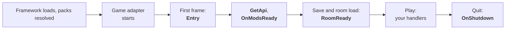

<sub>[Guide](README.md) &nbsp;·&nbsp; [Getting started](getting-started.md) &nbsp;·&nbsp; [Manifest](manifest.md) &nbsp;·&nbsp; **Lifecycle** &nbsp;·&nbsp; [Helper](helper.md) &nbsp;·&nbsp; [Troubleshooting](troubleshooting.md) &nbsp;·&nbsp; [Versioning](versioning.md) &nbsp;·&nbsp; [API reference](../api/README.md)</sub>

# Lifecycle: when your code runs

A code mod has three entry points of its own (`Entry`, `GetApi`, `OnShutdown`); everything else
runs because it subscribed to something. This page shows the order, the one rule that matters most
(no game services in `Entry`), how mods share APIs, and what happens when something throws.

## The order, from start to quit



| # | When | What happens | Your code |
|---|---|---|---|
| 1 | BepInEx loads the framework (`ModLoaderPlugin.Awake`) | The main-thread dispatcher starts. Packs are scanned and resolved: content packs and code mods, one dependency graph, skips reported (`PACKS` lines). The loader reads `[Mods]`, installs its assembly resolver and schedules the load for the first frame (`SETUP … code-mod loader armed`) | none |
| 2 | The other CWY plugins start | The game adapter registers the game-specific helper facets (events, Satone, language, windows; player data from the data plugin). Pack content is applied by its own features as the game gets to it (master data when the game loads it, textures once the room exists) | none |
| 3 | **First frame** | For each code mod, in dependency order: are the code mods it requires loaded? → load the DLL → find the `CwyMod` class → construct it → attach the helper → **`Entry(helper)`** → `MODS <id>@<version> loaded` | constructor, `Entry` |
| 4 | Right after | Every loaded mod's **`GetApi()`**, then every **`Events.OnModsReady`** handler, then one `MODS` summary line | `GetApi`, mods-ready handlers |
| 5 | The game keeps loading | The player's save loads (`GameData.IsReady` becomes true); the room scene loads and its services resolve → **`RoomReady`** | `RoomReady` handlers |
| 6 | Play | Events, data changes, console commands, hotkeys, frame ticks, posted work, window events | your handlers |
| 7 | The game quits (`Application.quitting`) | **`OnShutdown()`** of every loaded mod, in reverse load order; then everything each mod registered is removed | `OnShutdown` |

Everything in rows 3 to 7 runs on Unity's main thread.

<!-- Row 1: src/CwyLs.ModLoader/ModLoaderPlugin.cs:56-66, src/CwyLs.ModLoader/Mods/ModLoader.cs:120-163; row 2: src/CwyLs.ModLoader.Bulbul/BulbulPlugin.cs:60, src/CwyLs.ModLoader.Bulbul.Data/GameDataPlugin.cs:84; row 3: ModLoader.cs:166-201, :237-381; row 4: :203-234, :384-403; row 5: src/CwyLs.ModLoader.Bulbul/Events/EventRunner.cs:106-123; row 7: ModLoader.cs:150, :799-828. -->

## `Entry` registers; the room comes later

Mods load on the **first frame**, well before the room exists. So in `Entry`:

**Do:** subscribe to events, register console commands and hotkeys, bind config entries, read your
own files and manifest, set up your state. Keep it short: it runs inside one frame, and the
`MODS … loaded` line reports how long it took (`ms=`).

**Do not:** make Satone do anything, read the player's data, look for scene objects, build UI that
needs the game's assets, or call another mod's API. None of it is there yet:

- `Satone.CanInteract` is false and `Satone.State` is `unknown` until the room is loaded;
- `GameData.IsReady` is false until the save loads; before that the snapshot holds defaults, not
  the player's data;
- `Language.CurrentCode` is empty until the save loads;
- `ModRegistry.GetApi` returns null (with a warning) until the mods-ready moment.

Do those things when **`RoomReady`** arrives. It is published each time the room scene loads and its
services can be resolved, which is more than once per session if the game reloads the room, so a
"once" action needs its own flag:

```csharp
private bool _greeted;

public override void Entry(ICwyModHelper helper)
{
    helper.Events.Subscribe<RoomReady>(_ =>
    {
        if (_greeted)
        {
            return;
        }

        _greeted = true;
        helper.MainThread.PostAfter(4, "welcome", () => helper.Satone.Say("Welcome back!"));
    });
}
```

`cwy.sample.hello` does the same and also waits until `Satone.CanInteract` is true, so it does not
talk over the game's own arrival lines ([getting-started.md](getting-started.md#the-sample-mod-line-by-line)).

<!-- First-frame load, no game services in Entry: src/CwyLs.ModLoader/Mods/CwyMod.cs:44-51; State "unknown": src/CwyLs.ModLoader/Mods/ICwyModFacets.cs:178; IsReady: :188; CurrentCode empty: :211; GetApi early: src/CwyLs.ModLoader/Mods/ModFacets.Framework.cs:485-491; RoomReady doc: src/CwyLs.ModLoader.Core/Events/GameEvents.cs:361-365. -->

## Talking to other mods: `GetApi`

A mod can offer an object to other mods, and use theirs. Sharing is direct: both mods compile
against the same interface.

**The provider** puts a public interface in a DLL both mods reference (its own DLL, or a small
contract DLL shipped next to it) and returns an implementation from `GetApi`:

```csharp
public interface IGreeterApi
{
    void Greet(string name);
}

public sealed class GreeterApi : IGreeterApi
{
    private readonly ICwyModHelper _helper;

    public GreeterApi(ICwyModHelper helper) => _helper = helper;

    public void Greet(string name) => _helper.Satone.Say("Hello, " + name + "!");
}

// in the provider's CwyMod class:
public override object? GetApi() => new GreeterApi(Helper);
```

**The consumer** references that DLL with `Private=false` (never ships a copy), declares the
provider in `dependsOn` so it loads first, and asks for the API once every mod has entered:

```csharp
helper.Events.OnModsReady(() =>
{
    if (helper.ModRegistry.IsLoaded("yourname.greeter"))
    {
        GreetThroughApi(helper);
    }
});

// A separate method, so Mono only compiles the reference to IGreeterApi when it is called.
[MethodImpl(MethodImplOptions.NoInlining)]
private static void GreetThroughApi(ICwyModHelper helper)
{
    IGreeterApi? greeter = helper.ModRegistry.GetApi<IGreeterApi>("yourname.greeter");
    greeter?.Greet("Sam");
}
```

Rules:

- `GetApi` is called once per mod, after every mod's `Entry`. `ModRegistry.GetApi<T>` works from the
  mods-ready moment on; before that it returns null and logs one warning.
- It returns null when the mod is not loaded, has no API, or its API does not implement `T`; the
  last case is logged once, and usually means the two mods were built against different copies of
  the interface.
- **Optional dependencies and the JIT.** Mono may compile a whole method before it runs a line of
  it. If that method mentions a type from a mod that is not installed, it fails before your
  `IsLoaded` check runs. Keep such code in its own `[MethodImpl(MethodImplOptions.NoInlining)]`
  method and call it only when `ModRegistry.IsLoaded` is true, as above.
- Your mod's private DLLs are found next to your entry DLL; the loader's resolver also looks in the
  folders of mods that already loaded. That is how the consumer finds the provider's contract DLL.

The cross-mod path follows the loader's rules and unit-tested pieces; it has not yet run in the
game (no sample uses it).

<!-- GetApi after Entry: ModLoader.cs:203, :384-403; ModsReady: :213-221; GetApi<T> rules: ModFacets.Framework.cs:482-509; JIT trap: src/CwyLs.ModLoader/Mods/README.md "JIT trap"; resolver order: src/CwyLs.ModLoader.Core/Mods/ModAssemblyRules.cs (ModAssemblyResolver.Decide), mod folder = entry DLL's folder: ModLoader.cs:318. A shipped copy of a loaded assembly is flagged as bundled: ModLoader.cs:259-272 (SharedNames includes loaded names, :639-654). -->

## `OnShutdown`

Called once when the game quits, on the main thread, in reverse load order, for every mod that is
still loaded. Save what you need; after it returns the framework removes your subscriptions,
commands, windows and queued work.

It is **not** called when the game crashes or is killed, or for a mod that failed or was skipped.
So save important state when it changes, not only at shutdown; `helper.Data` writes are atomic,
so a crash never leaves half a file.

<!-- ModLoader.cs:799-828 (only State == Loaded); atomic writes: ModFacets.Framework.cs:87-97, :162-180. -->

## When something throws

Every call the framework makes into your code is wrapped. A failure costs one `MODS` line at error
level with the full stack in the trace file, attributed to your mod; the game and the other mods
keep going.

```
MODS  my.mod failed in Event 'RoomReady': NullReferenceException: Object reference not set to an instance of an object
```

| Where it threw | What happens |
|---|---|
| Constructor or `Entry` | The mod is **Failed**. Everything it registered so far is taken back (below). Code mods that require it are skipped as `DependencyFailed`. `OnShutdown` will not be called |
| `GetApi` | Logged; the mod keeps running, without an API (other mods get null) |
| An event or data handler, an `EveryFrame` tick, a mods-ready handler, work you posted (`Post`, `RunOrPost`, `PostAfter`), a console command, a hotkey, a window event, a `LoadAudioAsync` callback | Logged and counted (`mods list` shows `failures=N`). The mod keeps running and keeps the subscription. A failed console command prints `<name> failed; the error is in the log (MODS line)` |
| Work run with `MainThread.InvokeAsync` / `Invoke` | The exception goes to **your** task or call, as usual in .NET (plus a record in the trace file) |
| `OnShutdown` | Logged; your registrations are removed anyway |

A handler that throws on every frame does not flood the log: repeats at the same place are counted
for 10 s and reported with the next line (`… (+37 earlier)`).

**Taken back when a mod fails or the game quits:** event and data subscriptions, `EveryFrame`
tickers, mods-ready handlers that have not run, queued and delayed main-thread work, console
commands and windows. Hotkeys stay in the key table, but pressing them no longer calls your code.
Your config and data files stay.

**What the framework cannot wrap:**

- **Your own threads and tasks** (`Task.Run`, `new Thread`). Catch and log inside them; use
  `helper.MainThread` to get back to the main thread.
- **Your own Harmony patches.** If you patch the game, create `new Harmony("<your mod id>")`, catch
  inside every patch and fall back to the original code, and never call an id-less `UnpatchAll()`,
  which would remove every other mod's and the framework's patches too. A `helper.Harmony` facet
  with your mod's id and automatic unpatching on failure and shutdown is coming in 1.0 (see
  [helper.md](helper.md#coming-in-10)).

<!-- Isolation: src/CwyLs.ModLoader/Mods/README.md "Isolation"; Guard: src/CwyLs.ModLoader/Mods/ModRuntime.cs:217-307; Entry failure: ModLoader.cs:353-363, :421-428; Deactivate: src/CwyLs.ModLoader/Mods/ModHelper.cs:241-298; command failure text: ModFacets.Framework.cs:393-404; InvokeAsync not wrapped: ModFacets.Framework.cs:430-438; limiter window 10 s: src/CwyLs.ModLoader.Core/Mods/ModFailureLimiter.cs:18; failure line: src/CwyLs.ModLoader.Core/Mods/ModConsoleLines.cs:89-109; Harmony advice: src/CwyLs.ModLoader/Mods/README.md:74-76; helper.Harmony: src/CwyLs.ModLoader/Mods/ICwyModHelper.cs. -->

## Dependencies that fail

| The dependency | Declared as | Your pack or mod |
|---|---|---|
| is not installed, or the resolver skipped it | required (`dependsOn`, `contentPackFor`) | skipped by the resolver as `MissingDependency`, content and code |
| is too old (`minVersion`) | required or optional | skipped as `DependencyVersionTooLow` |
| is a code mod that was skipped or failed at load | required | code skipped as `DependencyFailed` (your content already loaded) |
| is absent, skipped or failed | optional | loads anyway; check `ModRegistry.IsLoaded` before you use it |

<!-- PackResolver.cs:157-210; ModLoadGate: src/CwyLs.ModLoader.Core/Mods/ModLoadPlan.cs:116-160; optional failures ignored: ModLoadPlan.cs:47 (OptionalCodeMods "their failure is ignored"). -->

## No code reload

Mono cannot unload an assembly, so a changed DLL needs a game restart; `packs rescan` rescans pack
content but never reloads code. The `[Mods] AssemblyLoad = Bytes` setting loads DLLs from memory so
the file is not locked or mapped; it is a developer switch, not a reload feature (every load becomes
a new, separate assembly).

<!-- ModLoader.cs:16-27, :48-52, :430-440. -->
