<picture>
  <source media="(prefers-color-scheme: dark)" srcset="../../.github/assets/banner/docs-guide-dark.svg">
  
</picture>

[Guide](README.md) &nbsp;·&nbsp; [Getting started](getting-started.md) &nbsp;·&nbsp; [Manifest](manifest.md) &nbsp;·&nbsp; [Lifecycle](lifecycle.md) &nbsp;·&nbsp; [Helper](helper.md) &nbsp;·&nbsp; [Troubleshooting](troubleshooting.md) &nbsp;·&nbsp; [Versioning](versioning.md) &nbsp;·&nbsp; [API stability](api-stability.md) &nbsp;·&nbsp; [Translate](translate.md) &nbsp;·&nbsp; [Textures](textures.md) &nbsp;·&nbsp; [Porting](porting.md) &nbsp;·&nbsp; **Dub & Subtitle Studio** &nbsp;·&nbsp; [คู่มือภาษาไทย](pack-maker.th.md) &nbsp;·&nbsp; [API reference](../api/README.md)

# Dub & Subtitle Studio: creator guide

**CWY:LS Mod Loader v0.9.2 (preview) · unofficial fan project**

CWY:LS Mod Loader is an unofficial, fan-made project. It is not made, endorsed, or supported by Nestopi.

Dub & Subtitle Studio is Pack Maker in the browser. This guide covers creating a language pack, writing subtitles, recording dubs, and exporting a shareable ZIP.

## Open and close

After [installing the loader](../../README.md#-install), start the full Steam game, press **Ctrl+Shift+C** to open the mod console, and enter `maker` to open Pack Maker in your browser. Use **ไทย / EN** at the top to change Pack Maker's screen language. Enter `maker stop` to close it. Keep the game running while you work.

Each `maker` opens a one-time link that expires after 60 seconds. Reloading the opened tab works while browser cookies are enabled. If you see opening instructions, type `maker` in the game console again for a fresh link.

## The five pages

- **Studio** — Work on the selected scene and line. Compare **Japanese · original** and **English**, write the pack-language subtitle, record dub takes, and try your version in the game.
- **Voice lines** — Search with **Search text or line ID**. Narrow the list with **Scenes** (including **All scenes**), **Character filter** (**All speakers**, **Satone**, or **Narration**), and **Voice filter** (**All**, **Voiced**, or **Text only**). Status filters include **All**, **To do**, **Draft**, **Done**, **Needs retake**, **Warnings**, **Starred**, **No subtitle**, and **No dub**. Select a row to open it in Studio, or use **Record next unrecorded** to jump to the next voiced line without a take.
- **Packs** — Browse **Your packs** and read-only packs, open a pack with **Open pack**, or choose **Create a new pack**.
- **Export** — Review the checks, choose a version bump, add release notes, and build a ZIP.
- **Settings** — Set the pack voice origin and line workflow, open page help, and adjust motion.

## Create a pack

On **Packs**, choose **Create a new pack**, select a **Language**, and enter the **Pack name** and **Pack ID**; **Author** and **Description** are optional. For the ID, use 3–64 lowercase letters, numbers, or hyphens, starting with a letter or number. A custom language uses **Custom language…**, then **Language code** and **Language name**. The built-in game languages cannot be created as new language packs.

For **Pack icon**, choose **Upload PNG** or select a **Preset icon**. An uploaded icon must be a square PNG from 64 to 1024 pixels and no larger than 512 KB. Select **Create** to finish. A new pack is discovered at game startup: restart the game once, then open the console and enter `maker` again. Later subtitle and dub edits update in real time.

Set the game's language to the pack's language for its subtitles and dubs to appear; Pack Maker's screen language is separate. If several packs provide the same subtitle or dub, the later-loaded pack with a value wins; missing entries fall back to earlier packs. **Open pack** selects a pack for editing and does not change load order.

## Write subtitles and track progress

In **Studio**, type in the subtitle field; changes save to the pack automatically. The editor shows line context, **Approx. in-game wrap**, **Reading speed**, and writing checks as you type.

The line statuses are **To do**, **Draft**, **Done**, and **Needs retake**. Studio's shortcut hint is **Enter (outside editor) or Cmd/Ctrl+Enter to mark Done and jump to the next unfinished line**. This applies in Studio; other text inputs keep their usual keys, and Enter on a button or link activates it instead. In the subtitle editor, Enter moves to the next line; use **Shift+Enter for a line break**. In **Settings**, **Mark Done automatically when I move to the next line** can update a line as you leave it, and **Jump to the next unfinished line after Done** controls where you go afterward.

## Record and label dub takes

In the **Dub deck**, select **Set up mic** and press **Record**, or use **Import** to add an audio file. A voiced line can hold up to three takes. Play and trim a take by dragging its edges.

Under **Settings**, set **Pack voice origin** to **My own voice**, **AI-assisted**, or **AI-generated**, then select **Confirm for pack**. New takes use that default. For one take, open **Voice origin** and choose **Override**; choose **Use pack default** to return to the pack setting.

A take that follows the pack default needs no tick of its own. For a take with its own origin, confirm **I confirm this take’s voice and origin** before it goes into the pack. This confirms that the voice is yours or you have the speaker’s permission, that the selected origin is true, and that an AI voice will not be presented as the original voice actor.

Then use **Keep & next** to put the take in the pack and move to the next unrecorded line. If a confirmation prompt appears, check the voice origin and statement above, then choose **I confirm** only if they are true; this continues keeping the take. Otherwise cancel and correct the origin or use audio you have permission to use.

Use **Play original in game** to hear the original Japanese line. Use **Play my version in game** to save and try your subtitle and dub in the game. If you have only written a subtitle, it plays with the original voice. Add a subtitle or a dub take first. If you just created the pack, restart the game first.

## Export a shareable pack

On **Export**, review **Manifest**, **Subtitles**, **Voice audio**, **Voice disclosure**, **Package size**, **Line coverage**, and **Symbolic links**. Fix failed checks before exporting and review warnings.

Every dub in the pack needs a voice label: its origin and a confirmed voice statement. Dubs you publish from the Studio get one from their take. A dub you copied into `audio/voice/` by hand, or saved through the older voice upload, has none, and the export is blocked until it does. Select **Label all unlabelled dubs with the pack default** to label them all with the pack's voice origin. Selecting it confirms the voice statement for those dubs. If the pack has no voice origin yet, the button opens **Settings** so you can set it first.

Choose **Version bump**: **Patch**, **Minor**, **Major**, or **Keep current**. Add **Release notes**; they are prepended to `CHANGELOG.md`. Select **Build & download .zip**: a ZIP up to **256 MiB** downloads by itself when the build finishes. **Download .zip** fetches the same file again. Larger ZIPs are saved but cannot be downloaded through the browser: in your game folder, open `CWYLS Mods/.maker-exports/<pack-id>/` and share the ZIP from there (a refused download also names its folder). The file is named `<pack-id>-v<version>.zip`; it can include `-by-<author-slug>` before `.zip` when the author slug is not already in the pack ID.

## Storage limits and cleanup

New exports are saved in `CWYLS Mods/.maker-exports/<pack-id>/`. Each pack may retain at most **100 files and 4 GiB** there; staged archives and nested files count too. The next export must fit both limits, including its estimated ZIP overhead. Move older exports from the folder named in the error to another location, then retry. Pack Maker never deletes them for you. Older exports in the shared `.maker-exports` folder remain downloadable in place and do not spend the new per-pack budget; an interrupted older export also finishes in its original location.

Creating a pack checks only its new skeleton (**8 MiB** maximum), with a safety cap of **1,024 regular, visible pack folders** in `CWYLS Mods`. Other packs' contents, hidden export folders and unrelated links do not spend that byte budget; linked files are never followed during the storage check. To free a folder slot, move an unused pack out of `CWYLS Mods`. Creation reserves **64 KiB** for staging overhead. Creation and export both keep **64 MiB** of free disk space. If disk space is low, free space on that disk and retry.

The storage message names the affected folder and the action to take. Existing files are preserved when a storage check refuses an operation. Replacing an icon also checks that pack’s `_maker_backup` folder: at most **128 files and 32 MiB**, counting all existing backups there. Move older backups elsewhere if that limit is reached.

## Use the ? help

The **?** control opens **Page help & shortcuts**. **Guide** has **How to use this page**, **How the other pages connect to this one**, and **Keyboard shortcuts**; **Glossary** explains the page’s terms. Help follows Studio, Voice lines, Packs, New pack, Export, and Settings, including when you switch pages while it is open.

Choose **Start the guide** in this panel to spotlight each part of the page. Use **Back**, **Next**, or **Skip**; the counter shows your place. Tours never start automatically. A one-line hint points to **?** on your first visit. **Esc** closes help or the tour and returns focus to **?**. Use Left/Right arrows to switch the help tabs and Tab to move through the controls. In **Settings**, **Open page help** opens the same panel without starting a tour.

In **Settings**, choose **Off**, **Reduced**, or **Full** under **Motion**. Adjust **Page flow** and **Small UI** for transitions and menus. The motion choice is saved in this browser.

<!-- UI labels and built-in help follow src/CwyLs.ModLoader.Maker.Web/ui/i18n/en.js and th.js at 116d492. -->
