<picture>
  <source media="(prefers-color-scheme: dark)" srcset="../../.github/assets/banner/docs-guide-dark.svg">
  
</picture>

[Guide](README.md) &nbsp;·&nbsp; [Getting started](getting-started.md) &nbsp;·&nbsp; [Manifest](manifest.md) &nbsp;·&nbsp; [Lifecycle](lifecycle.md) &nbsp;·&nbsp; [Helper](helper.md) &nbsp;·&nbsp; [Troubleshooting](troubleshooting.md) &nbsp;·&nbsp; [Versioning](versioning.md) &nbsp;·&nbsp; [Translate](translate.md) &nbsp;·&nbsp; [Textures](textures.md) &nbsp;·&nbsp; [Porting](porting.md) &nbsp;·&nbsp; [Dub & Subtitle Studio](pack-maker.md) &nbsp;·&nbsp; **คู่มือภาษาไทย** &nbsp;·&nbsp; [API reference](../api/README.md)

# คู่มือผู้สร้างแพ็ก: Dub & Subtitle Studio

**CWY:LS Mod Loader v0.9.2 (พรีวิว) · โปรเจกต์แฟนเมด ไม่เป็นทางการ**

CWY:LS Mod Loader เป็นโปรเจกต์แฟนเมดที่ไม่เป็นทางการ ไม่ได้จัดทำ รับรอง หรือสนับสนุนโดย Nestopi

Dub & Subtitle Studio (**สตูดิโอพากย์และซับ**) คือ Pack Maker ที่เปิดใช้งานผ่านเบราว์เซอร์ คู่มือนี้ครอบคลุมการสร้างแพ็กภาษา เขียนซับ อัดเสียงพากย์ และส่งออกไฟล์ ZIP สำหรับแชร์

## เปิดและปิด

[ติดตั้งตัวโหลดม็อด](../../README.md#-install) ก่อน แล้วเปิดเกมตัวเต็มจาก Steam กด **Ctrl+Shift+C** เพื่อเปิดคอนโซลม็อด พิมพ์ `maker` เพื่อเปิด Pack Maker ในเบราว์เซอร์ เปลี่ยนภาษาหน้าจอได้ที่ปุ่ม **ไทย / EN** ด้านบน พิมพ์ `maker stop` เพื่อปิด ระหว่างทำงานให้เปิดเกมค้างไว้

แต่ละครั้งที่พิมพ์ `maker` จะเปิดลิงก์ที่ใช้ได้ครั้งเดียวและหมดอายุใน 60 วินาที หลังเปิดแล้วกดรีโหลดได้ตามปกติถ้าเปิดใช้คุกกี้ในเบราว์เซอร์ ถ้าเห็นข้อความให้เปิดจากในเกม ให้พิมพ์ `maker` ในคอนโซลเกมอีกครั้งเพื่อรับลิงก์ใหม่

## ห้าหน้าหลัก

- **สตูดิโอ** — ทำงานกับฉากและบรรทัดที่เลือก เทียบ **ญี่ปุ่น · ต้นฉบับ** กับ **อังกฤษ** เขียนซับในภาษาของแพ็ก อัดเสียงพากย์ และลองฟังในเกม
- **บทพูด** — ค้นหาด้วย **ค้นหาข้อความหรือ ID บรรทัด** แล้วกรองด้วย **ฉาก** (เช่น **ทุกฉาก**), **ตัวกรองตัวละคร** (**ทุกตัวละคร**, **ซาโตเนะ** หรือ **บรรยาย**) และ **ตัวกรองเสียงพูด** (**ทุกแบบ**, **มีเสียงพูด**, หรือ **ข้อความล้วน**) ตัวกรองสถานะมี **ทั้งหมด**, **ยังไม่ทำ**, **ร่าง**, **เสร็จ**, **ต้องอัดใหม่**, **มีคำเตือน**, **ติดดาว**, **ยังไม่มีซับ** และ **ยังไม่มีพากย์** คลิกแถวเพื่อเปิดในสตูดิโอ หรือใช้ **อัดบรรทัดถัดไปที่ยังไม่อัด** เพื่อข้ามไปบรรทัดที่มีเสียงพูดแต่คุณยังไม่ได้อัด
- **แพ็ก** — ดู **แพ็กของคุณ** และแพ็กที่แก้ไม่ได้ กด **เปิดแพ็กนี้** เพื่อเลือกแพ็ก หรือเลือก **สร้างแพ็กใหม่**
- **ส่งออก** — ตรวจแพ็ก เลือกการปรับเลขเวอร์ชัน เพิ่มบันทึกการอัปเดต แล้วสร้างไฟล์ ZIP
- **ตั้งค่า** — ตั้งที่มาของเสียงประจำแพ็กและการทำงานของสถานะบรรทัด เปิดวิธีใช้หน้านี้ และปรับการเคลื่อนไหว

## สร้างแพ็ก

ในหน้า **แพ็ก** เลือก **สร้างแพ็กใหม่** แล้วเลือก **ภาษา** จากนั้นกรอก **ชื่อแพ็ก** กับ **รหัสแพ็ก** ส่วน **ผู้สร้าง** และ **คำอธิบายแพ็ก** จะเว้นไว้ก็ได้ รหัสแพ็กให้ใช้ตัวอักษรอังกฤษตัวเล็ก ตัวเลข หรือขีดกลาง รวม 3–64 ตัว โดยขึ้นต้นด้วยตัวอักษรหรือตัวเลข หากใช้ภาษาอื่น ให้เลือก **กำหนดภาษาเอง…** แล้วกรอก **รหัสภาษา** กับ **ชื่อภาษา** ภาษาที่มีในตัวเกมอยู่แล้วสร้างเป็นแพ็กภาษาใหม่ไม่ได้

สำหรับ **ไอคอนแพ็ก** เลือก **อัปโหลด PNG** หรือ **ใช้ไอคอนสำเร็จรูป** ไฟล์ที่อัปโหลดต้องเป็น PNG จัตุรัส ขนาด 64–1024 พิกเซล และไม่เกิน 512 KB แล้วกด **สร้าง** เพื่อสร้างแพ็ก เกมจะพบแพ็กใหม่เมื่อเริ่มเกม ให้รีสตาร์ตเกมหนึ่งครั้ง แล้วเปิดคอนโซลพิมพ์ `maker` อีกครั้ง หลังจากนั้นการแก้ซับและเสียงพากย์จะอัปเดตแบบ Real-time

ตั้งภาษาในเกมให้ตรงกับภาษาของแพ็กก่อน ซับและเสียงพากย์ถึงจะแสดงในเกม ภาษาหน้าจอ Pack Maker เป็นคนละตัวเลือกกัน ถ้าหลายแพ็กมีซับหรือเสียงพากย์ของบรรทัดเดียวกัน เกมจะใช้ค่าจากแพ็กที่โหลดทีหลัง ถ้าแพ็กนั้นไม่มีค่าก็จะใช้ของแพ็กก่อนหน้า การกด **เปิดแพ็กนี้** แค่เลือกแพ็กที่จะแก้ ไม่ได้เปลี่ยนลำดับโหลด

## เขียนซับและติดตามความคืบหน้า

ใน **สตูดิโอ** พิมพ์ข้อความลงในช่องซับ ระบบจะบันทึกลงแพ็กให้อัตโนมัติ ขณะพิมพ์ ตัวแก้ไขจะแสดงบริบทของบรรทัด **ตัดบรรทัดในเกม (โดยประมาณ)**, **ความเร็วในการอ่าน** และรายการตรวจข้อความ

สถานะบรรทัดมี **ยังไม่ทำ**, **ร่าง**, **เสร็จแล้ว** และ **ต้องอัดใหม่** คำแนะนำคีย์ลัดคือ **กด Enter (นอกช่องพิมพ์) หรือ Cmd/Ctrl+Enter เพื่อทำเครื่องหมายว่าเสร็จแล้ว และข้ามไปบรรทัดที่ยังไม่เสร็จถัดไป** คีย์ลัดนี้ใช้ในหน้าสตูดิโอ ช่องพิมพ์อื่นยังใช้ปุ่มตามปกติ ถ้าเลือกปุ่มหรือลิงก์อยู่ Enter จะกดปุ่มหรือลิงก์นั้นแทน ในช่องซับ กด Enter เพื่อไปบรรทัดถัดไป หรือใช้ **Shift+Enter เพื่อขึ้นบรรทัดใหม่** ใน **ตั้งค่า** ตัวเลือก **เปลี่ยนเป็น “เสร็จแล้ว” อัตโนมัติเมื่อไปบรรทัดถัดไป** จะทำเครื่องหมายให้เมื่อเลื่อนออกจากบรรทัด ส่วน **ข้ามไปบรรทัดที่ยังไม่เสร็จถัดไปหลังกด “เสร็จแล้ว”** กำหนดว่าจะไปบรรทัดไหนต่อ

## อัดและระบุที่มาของเสียงพากย์

ในส่วนอัดเสียง (**เด็คพากย์** บนหน้าจอ) เลือก **ตั้งค่าไมค์** แล้วกด **อัด** หรือนำเข้าไฟล์เสียง เสียงที่อัดหรือนำเข้าแต่ละชุดเรียกว่า **เทค** แต่ละบรรทัดที่มีเสียงพูดเก็บได้สูงสุดสามเทค ฟังและตัดหัวท้ายของเทคได้โดยลากขอบ

ใน **ตั้งค่า** เลือก **ที่มาของเสียงประจำแพ็ก** ให้ตรงตามจริง: **เสียงฉันเอง**, **ใช้ AI ช่วย** หรือ **เสียงที่ AI สร้าง** จากนั้นเลือก **ยืนยันใช้กับแพ็กนี้** เทคใหม่จะใช้ค่านี้เป็นค่าเริ่มต้น หากต้องการตั้งแยกเฉพาะเทค ให้เปิด **ที่มาของเสียง** แล้วเลือก **ตั้งแยกเฉพาะเทคนี้** หรือเลือก **ใช้ค่าเริ่มต้นของแพ็ก** เพื่อกลับไปใช้ค่าแพ็ก

เทคที่ใช้ค่าเริ่มต้นของแพ็กไม่ต้องติ๊กยืนยันเอง ส่วนเทคที่ตั้งที่มาของเสียงเอง ให้ยืนยัน **ฉันยืนยันเรื่องเสียงและที่มาของเทคนี้** ก่อนนำลงแพ็ก การยืนยันนี้หมายความว่าเป็นเสียงของคุณเองหรือได้รับอนุญาตจากเจ้าของเสียง แหล่งที่มาที่เลือกเป็นความจริง และจะไม่นำเสียง AI ไปอ้างว่าเป็นเสียงของนักพากย์ต้นฉบับ

จากนั้นกด **เก็บ & ถัดไป** เพื่อนำเทคลงแพ็กแล้วไปบรรทัดถัดไปที่ยังไม่ได้อัด ถ้ามีหน้าต่างให้ยืนยัน ให้เช็กที่มาของเสียงและอ่านข้อความข้างต้นก่อน กด **ฉันยืนยัน** เมื่อเป็นความจริง ระบบจะเก็บเทคต่อให้ ถ้ายังไม่ตรง ให้ยกเลิกแล้วแก้ที่มาของเสียง หรือใช้เสียงที่ได้รับอนุญาต

ใช้ **เล่นต้นฉบับในเกม** เพื่อฟังบรรทัดภาษาญี่ปุ่น ใช้ **เล่นเวอร์ชันของฉันในเกม** เพื่อบันทึกและลองซับกับเสียงพากย์ของคุณในเกม ถ้าพิมพ์แค่ซับ ยังไม่ได้อัดเสียงพากย์ ก็จะเล่นซับของคุณพร้อมเสียงต้นฉบับ ลองพิมพ์ซับหรืออัดเสียงพากย์ก่อนกดเล่น ถ้าเพิ่งสร้างแพ็ก ให้รีสตาร์ตเกมก่อน

## ส่งออกแพ็กเพื่อแชร์

ในหน้า **ส่งออก** ตรวจ **ไฟล์ Manifest** (`manifest.json` ที่เก็บข้อมูลแพ็ก), **ซับ**, **ไฟล์เสียงพากย์**, **ข้อมูลที่มาของเสียง**, **ขนาดไฟล์แพ็ก**, **ความครบถ้วนของบรรทัด** และ **ลิงก์เชิงสัญลักษณ์** (ทางลัดที่ชี้ไปยังไฟล์หรือโฟลเดอร์อื่น) แก้หัวข้อที่ไม่ผ่านก่อนส่งออก และตรวจดูคำเตือนด้วย

เสียงพากย์ทุกไฟล์ในแพ็กต้องระบุที่มาของเสียงและยืนยันเรื่องเสียงไว้ เสียงพากย์ที่ใช้ในแพ็กจากสตูดิโอจะได้ข้อมูลนี้จากเทคของมัน ส่วนไฟล์ที่คัดลอกใส่ `audio/voice/` เองหรือบันทึกผ่านการอัปโหลดเสียงแบบเดิมจะยังไม่มี และจะส่งออกไม่ได้จนกว่าจะระบุ กด **ระบุที่มาให้เสียงพากย์ที่ยังไม่ระบุทั้งหมดด้วยค่าประจำแพ็ก** เพื่อใช้ที่มาของเสียงประจำแพ็กกับไฟล์เหล่านั้นทั้งหมด การกดถือว่ายืนยันเรื่องเสียงสำหรับไฟล์เหล่านั้น ถ้าแพ็กยังไม่ได้ตั้งที่มาของเสียง ปุ่มจะพาไปที่ **ตั้งค่า** ให้ตั้งก่อน

เลือก **ปรับเลขเวอร์ชัน**: **แพตช์ย่อย**, **เวอร์ชันรอง**, **เวอร์ชันหลัก** หรือ **ใช้เลขเดิม** เพิ่ม **บันทึกการอัปเดต** ซึ่งจะถูกใส่ไว้บนสุดของ `CHANGELOG.md` เลือก **สร้างและดาวน์โหลด .zip** ไฟล์ ZIP ขนาดไม่เกิน **256 MiB** จะดาวน์โหลดให้เอง ส่วน **ดาวน์โหลด .zip** ใช้ดึงไฟล์เดิมอีกครั้ง ถ้า ZIP ใหญ่กว่านี้ ระบบยังบันทึกไว้แต่ดาวน์โหลดผ่านเบราว์เซอร์ไม่ได้ ให้เปิดโฟลเดอร์เกม ไปที่ `CWYLS Mods/.maker-exports/<pack-id>/` แล้วนำ ZIP จากตรงนั้นไปแชร์ได้เลย ถ้ากดดาวน์โหลดแล้วถูกปฏิเสธ ข้อความจะแสดงโฟลเดอร์ที่เก็บไฟล์ด้วย ชื่อไฟล์จะเป็น `<pack-id>-v<version>.zip` และอาจมี `-by-<author-slug>` ก่อน `.zip` โดย `author-slug` คือชื่อผู้สร้างที่ย่อให้เหลือแค่ตัวอักษรอังกฤษตัวเล็กกับตัวเลข ถ้ามีชื่อนี้ในรหัสแพ็กอยู่แล้วก็จะไม่เติมซ้ำ

## ใช้ตัวช่วย ?

ปุ่ม **?** เปิด **วิธีใช้หน้านี้และคีย์ลัด** แท็บ **วิธีใช้** มีหัวข้อ **วิธีใช้งานหน้านี้**, **หน้าอื่น ๆ เชื่อมกับหน้านี้ยังไง** และ **คีย์ลัด** ส่วน **คำศัพท์** อธิบายคำที่เจอบ่อย เนื้อหาจะเปลี่ยนตามหน้า **สตูดิโอ**, **บทพูด**, **แพ็ก**, **สร้างแพ็กใหม่**, **ส่งออก** และ **ตั้งค่า** ถ้าเปลี่ยนหน้าตอนเปิดวิธีใช้อยู่ เนื้อหาก็จะเปลี่ยนตามให้เลย

กด **เริ่มตัวช่วยแนะนำ** ในแผงนี้เพื่อดูทีละส่วน พื้นที่รอบ ๆ จะมืดลง เหลือส่วนที่กำลังแนะนำ ใช้ **ย้อนกลับ**, **ถัดไป** หรือ **ข้าม** ได้ ตัวเลขจะบอกว่าอยู่ขั้นไหน ตัวช่วยจะไม่เริ่มเองอัตโนมัติ ครั้งแรกจะมีข้อความสั้น ๆ ชี้ให้กด **?** เท่านั้น กด **Esc** เพื่อปิดแล้วกลับไปที่ปุ่ม **?** ใช้ลูกศรซ้าย/ขวาสลับแท็บวิธีใช้ และ Tab เลื่อนไปตามปุ่มได้ ใน **ตั้งค่า** ปุ่ม **เปิดวิธีใช้หน้านี้** จะเปิดแผงเดียวกันโดยยังไม่เริ่มตัวช่วย

ใน **ตั้งค่า** หัวข้อ **การเคลื่อนไหว** ให้เลือกระดับ **ระดับการเคลื่อนไหว** เป็น **ปิด**, **ลดลง** หรือ **เต็มที่** แล้วปรับ **จังหวะสลับหน้า** และ **เมนูและป๊อปอัป** ค่าการเคลื่อนไหวจะจำไว้ในเบราว์เซอร์นี้

## ขีดจำกัดพื้นที่จัดเก็บและการย้ายไฟล์เก่า

ไฟล์ส่งออกใหม่อยู่ใน `CWYLS Mods/.maker-exports/<pack-id>/` แต่ละแพ็กเก็บได้ไม่เกิน **100 ไฟล์ และ 4 GiB** โดยนับไฟล์ชั่วคราวและไฟล์ในโฟลเดอร์ย่อยด้วย ไฟล์ส่งออกถัดไปต้องไม่ทำให้เกินทั้งสองขีดจำกัด รวมพื้นที่เผื่อของ ZIP หากเต็ม ให้ย้ายไฟล์ส่งออกเก่าจากโฟลเดอร์ที่ระบุในข้อความไปเก็บที่อื่น แล้วลองใหม่ Pack Maker จะไม่ลบไฟล์ให้ ไฟล์ส่งออกเดิมในโฟลเดอร์รวม `.maker-exports` ยังดาวน์โหลดจากที่เดิมได้และไม่นับรวมในขีดจำกัดใหม่ของแต่ละแพ็ก งานส่งออกเดิมที่ค้างอยู่จะทำต่อในตำแหน่งเดิม

การสร้างแพ็กตรวจขนาดโครงแพ็กใหม่เท่านั้น (ไม่เกิน **8 MiB**) และจำกัดจำนวนโฟลเดอร์แพ็กปกติที่ไม่ซ่อนไว้ที่ **1,024 โฟลเดอร์** ใน `CWYLS Mods` เนื้อหาของแพ็กอื่น โฟลเดอร์ส่งออกที่ซ่อนไว้ และลิงก์ที่ไม่เกี่ยวข้องจะไม่กินโควตาขนาดของแพ็กใหม่ การตรวจพื้นที่จะไม่ตามลิงก์ไปอ่านไฟล์ปลายทาง หากจำนวนโฟลเดอร์เต็ม ให้ย้ายแพ็กที่ไม่ได้ใช้ออกจาก `CWYLS Mods` การสร้างแพ็กเผื่อพื้นที่ชั่วคราว **64 KiB** และทั้งการสร้างแพ็กกับการส่งออกต้องเหลือพื้นที่ว่างบนดิสก์อย่างน้อย **64 MiB** หากพื้นที่ดิสก์ไม่พอ ให้เพิ่มพื้นที่ว่างแล้วลองใหม่

ข้อความจะแสดงโฟลเดอร์ที่เกี่ยวข้องและวิธีแก้ เมื่อการตรวจพื้นที่ไม่ผ่าน ไฟล์เดิมจะยังอยู่ครบ การเปลี่ยนไอคอนจะตรวจโฟลเดอร์ `_maker_backup` ของแพ็กนั้นด้วย โดยจำกัดที่ **128 ไฟล์ และ 32 MiB** และนับไฟล์สำรองทั้งหมดในโฟลเดอร์นี้ หากเต็ม ให้ย้ายไฟล์สำรองเก่าไปเก็บที่อื่น

<!-- UI labels and built-in help follow src/CwyLs.ModLoader.Maker.Web/ui/i18n/en.js and th.js at 116d492. -->
