<picture>
  <source media="(prefers-color-scheme: dark)" srcset="../../.github/assets/banner/docs-porting-dark.svg">
  
</picture>

<sub>[Guide](README.md) &nbsp;·&nbsp; [Getting started](getting-started.md) &nbsp;·&nbsp; [Manifest](manifest.md) &nbsp;·&nbsp; [Lifecycle](lifecycle.md) &nbsp;·&nbsp; [Helper](helper.md) &nbsp;·&nbsp; [Troubleshooting](troubleshooting.md) &nbsp;·&nbsp; [Versioning](versioning.md) &nbsp;·&nbsp; [API stability](api-stability.md) &nbsp;·&nbsp; [Translate](translate.md) &nbsp;·&nbsp; [Textures](textures.md) &nbsp;·&nbsp; **Porting** &nbsp;·&nbsp; [Dub & Subtitle Studio](pack-maker.md) &nbsp;·&nbsp; [คู่มือภาษาไทย](pack-maker.th.md) &nbsp;·&nbsp; [API reference](../api/README.md)</sub>

# Port a BepInEx mod to CWY:LS

This page is for authors of BepInEx plugins for *Chill with You : Lo-Fi Story*: music players,
costume switchers, notification tools and the like. It shows how a plugin becomes a CWY:LS code mod,
with a worked example that compiles against the 0.9 API.

CWY:LS supports mods that run through CWY:LS: content packs and code mods in `CWYLS Mods`. It does
not block other BepInEx plugins, but it does not support or test them either. Port your own plugin,
or ask its author first: their licence decides what you may do with their code.

<!-- Support policy: README.md, FAQ "Do other BepInEx mods work alongside it?". -->

## Why port

- **A game update switches off one feature, not your mod.** At every start the loader checks each
  game method and field it hooks. When an update moves one, the log names it
  (`PATCH TARGET MISSING <id>: …`) and only the feature that needs it switches off. A mod that gets
  its events from the helper, not from patches of its own, usually needs no change when the loader
  is updated for the new build. Your own Harmony patches are not part of that check
  ([below](#when-you-still-need-a-harmony-patch)).
- **One installer for players.** `install.command` (macOS) or `install.bat` (Windows) installs
  BepInEx and the loader. Your mod is then one folder in `CWYLS Mods`, which the installer can open
  for them.
- **A failure stays yours.** Every call the framework makes into your code is wrapped. An exception
  costs one `MODS` line with your mod's id and the full stack in the trace file; the game and the
  other mods keep going. If `Entry` throws, everything your mod registered is taken back.
- **The in-game console.** <kbd>Ctrl</kbd>+<kbd>Shift</kbd>+<kbd>C</kbd> shows your log lines and
  runs your commands (listed under your id in `help`). `mods` tells players whether your mod loaded,
  and if not, why.
- **Windows in the game's own style.** `helper.Ui` builds a window with the game's title bar, close
  button, dragging and fade.
- **The save stays clean.** Your settings go to `BepInEx/config/cwy.mod.<id>.cfg` and your data to
  `BepInEx/data/mods/<id>/` (written atomically). Nothing goes into the game's save, so it keeps
  loading without mods.
- **Files without code.** Your mod folder is also a content pack: textures, voice clips, music
  tracks and text rows in the pack folder layout are applied by the loader, with no code of yours.
- **Version checks that say why.** The manifest names the loader API your mod needs
  (`loaderVersion`), the game build you tested (`gameVersion`, a warning only) and, if you want, the
  oldest and newest game builds it supports (`minGameVersion`, `maxGameVersion`). Other mods can
  require yours at a minimum `version`. A mismatch skips the mod with a line that says why; it never
  half-loads.

<!-- Startup check: src/CwyLs.ModLoader.Bulbul/BulbulPlugin.cs:44-46 (Register, CheckGameVersion, VerifyAll); line prefix: src/CwyLs.ModLoader.Core/PatchTargets/PatchTargetReport.cs:13; one feature off, e.g. src/CwyLs.ModLoader.Bulbul/Language/LanguageFeature.cs:166-174 (CanApply) and :209, src/CwyLs.ModLoader.Bulbul/Events/EventBus.cs:48-56 (per-site failures); docs/maintaining/game-updates.md:8-10; README.md "What it does" (Version safety). Mods load on the first frame, after that check: src/CwyLs.ModLoader/Mods/README.md:18-21. Seams outside the registry fail at runtime, not at the check: docs/CAPABILITIES.md:412. Installer: README.md "Install" (install.command, install.bat, the CWYLS Mods folder). Isolation: lifecycle.md "When something throws" (:162-164, :172, :181-183). Console: getting-started.md step 6. Windows: helper.md "Ui" (:416-420). Config file: src/CwyLs.ModLoader/Mods/ModHelper.cs:22-23; data folder: src/CwyLs.ModLoader/ModLoaderPaths.cs:35, src/CwyLs.ModLoader/Mods/ModFacets.Framework.cs:72; save: AGENTS.md "Project rules", README.md "What it does" (Save safety). Mod folder = content pack: helper.md:323-324, packs/README.md:13-16, packs/cwy.example/README.md "Folder conventions". Version fields: manifest.md "Fields" (:77-86). -->

## From plugin to code mod

Most of a plugin maps across one to one.

| In your BepInEx plugin | In a CWY:LS code mod | Notes |
|---|---|---|
| `[BepInPlugin(guid, name, version)]` | `manifest.json`: `id`, `name`, `version` | The id is lowercase letters, digits, `.`, `_`, `-`, 3 to 64 characters. Your GUID can stay if it fits |
| `[BepInDependency]` | `dependsOn`, with `minVersion` and `"optional": true` for a soft dependency | [manifest.md](manifest.md#fields) |
| `class … : BaseUnityPlugin` | one concrete class deriving from `CwyMod`, with a parameterless constructor | Exactly one per DLL |
| `Awake()` | `Entry(ICwyModHelper helper)` | Runs on the first frame, before the room exists. Register things here |
| `Start()`, or waiting for the room scene | `helper.Events.Subscribe<RoomReady>(…)` | Comes after every room load; use a flag for "once" |
| `OnDestroy()`, `OnApplicationQuit()` | `OnShutdown()` | Not called when the game crashes |
| `Logger.LogInfo` / `LogWarning` / `LogError` | `helper.Log.Info` / `Warn` / `Error(message, exception)` | `MOD  <id>: …` lines in the console |
| `Logger.LogDebug` | `helper.Log.Trace` | Trace file only; the trace is off until `trace on` |
| `Config.Bind(…)` | `helper.Config.Bind(…)` | The same BepInEx `ConfigFile`, in a new file: `cwy.mod.<id>.cfg` |
| `Update()` that polls the game | an event: `helper.Events.Subscribe<T>(…)` | The events are listed in [helper.md](helper.md#events) |
| `Update()` with nothing to subscribe to | `helper.Events.EveryFrame(…)` | Keep it cheap |
| `Input.GetKeyDown` in `Update()` | `helper.Input.Register(…)` | Players can rebind it; it never fires while they type |
| Coroutines, `WaitForSeconds` | `helper.MainThread.PostAfter(seconds, label, work)` | Real-time delay, on the main thread |
| Your own threads handing work to Unity | `helper.MainThread.Post` / `InvokeAsync` | [Threading rules](helper.md#threading-rules) |
| `OnGUI` windows | `helper.Ui` | Build them at `RoomReady` or later ([helper.md](helper.md#ui)) |
| Files next to your DLL | `helper.Content`, `helper.DirectoryPath` | Paths relative to your mod folder |
| Your own save files | `helper.Data` | `BepInEx/data/mods/<id>/`, written atomically |
| `Chainloader.PluginInfos` | `helper.ModRegistry` | `IsLoaded`, `GetApi<T>` ([lifecycle.md](lifecycle.md#talking-to-other-mods-getapi)) |
| `new Harmony(guid).PatchAll()` | an event or a facet first; otherwise `helper.Harmony`, unpatched for you if your mod fails | [Below](#when-you-still-need-a-harmony-patch) |
| The DLL in `BepInEx/plugins/` | `manifest.json` + DLL in `<game root>/CWYLS Mods/<id>/` | The template's build assembles the folder |

Four differences matter more than the rest:

- **`Entry` registers; the room comes later.** Subscribe, register commands and bind config in
  `Entry`. Touch Satone, the player's data or scene objects only once `RoomReady` arrives
  ([lifecycle.md](lifecycle.md#entry-registers-the-room-comes-later)).
- **Your class is not a `MonoBehaviour`.** There is no `Update`, no coroutine and no `gameObject`.
  Do not add a `MonoBehaviour` of your own either: use events, `EveryFrame` and `MainThread`.
- **Main thread.** Everything the framework calls in your mod runs on Unity's main thread. From your
  own threads, go through `helper.MainThread`.
- **Settings move to a new file.** The plugin's old `.cfg` is not read. Keep the section and key
  names, and players can copy their values across.

<!-- CwyMod: src/CwyLs.ModLoader/Mods/CwyMod.cs:22-24 (no MonoBehaviour of your own: use EveryFrame), :36-38 (Helper), :54 (Entry), :61 (GetApi), :67 (OnShutdown); one concrete class: templates/cwy-mod/README.md:37-38. Helper members: src/CwyLs.ModLoader/Mods/ICwyModHelper.cs:17-71; Log src/CwyLs.ModLoader/Mods/ICwyModFacets.cs:18-36; Data :46-89; Events :96-125 (EveryFrame :116); Input :284; Console :299; MainThread Post :415, PostAfter :431, InvokeAsync :452; ModRegistry: ICwyModHelper.cs:176-197. Trace off by default: src/CwyLs.ModLoader.Trace/TracePlugin.cs:76, :201; README.md "What it does" (Diagnostic trace). Id rule and dependsOn: manifest.md:75, :86. Entry before the room, RoomReady per load: lifecycle.md:39-56; OnShutdown not on crash: lifecycle.md:154. Main thread: helper.md "Threading rules" 1-2. Config file name: src/CwyLs.ModLoader/Mods/ModHelper.cs:22-23. -->

## Worked example: Focus Log

Focus Log is a made-up plugin for this page. As a BepInEx plugin it patched the game's pomodoro code
and read the timer every frame. Its shape:

```csharp
using BepInEx;
using BepInEx.Configuration;
using HarmonyLib;

[BepInPlugin("yourname.focuslog", "Focus Log", "1.0.0")]
public class FocusLogPlugin : BaseUnityPlugin
{
    private ConfigEntry<bool>? _logBreaks;

    private void Awake()
    {
        _logBreaks = Config.Bind("General", "LogBreaks", true, "Also log when a break starts and ends.");
        new Harmony("yourname.focuslog").PatchAll();   // patches on the game's pomodoro code
        Logger.LogInfo("loaded");
    }

    private void Update()
    {
        // every frame: read the game's timer, compare with the last frame, log what changed
    }
}
```

As a code mod it needs neither the patches nor `Update`: the loader already publishes the pomodoro
as two events (records in `CwyLs.ModLoader.Core.Events`).

| Event | When | Fields |
|---|---|---|
| `PomodoroEvent` | A pomodoro transition | `Kind`: `Started`, `WorkStarted`, `WorkEnded`, `BreakStarted`, `BreakEnded`, `Completed`, `Paused`, `Unpaused`. `PomodoroType`: the timer's current type, `Work`, `Break` or `Complete` |
| `PomodoroTick` | The timer advanced; about once a second | `PomodoroType`, `ElapsedSec`, `RemainingSec` |

<!-- src/CwyLs.ModLoader.Core/Events/GameEvents.cs:8-33 (PomodoroEventKind), :233-248 (PomodoroEvent, Describe :239), :250-272 (PomodoroTick); published from the game's pomodoro observables: src/CwyLs.ModLoader.Bulbul/Events/EventBridge.cs:160-167; tick throttle 1000 ms per timer type: EventBridge.cs:39-44. The "before" sketch compiled against BepInEx 5 (BepInEx/core) and the game's UnityEngine.dll; it is an illustration, not a real mod. -->

### 1. Copy the template and set the id

```
cp -R templates/cwy-mod mods-src/yourname.focuslog
```

In `MyMod.csproj` (rename the file if you like), set `<ModId>yourname.focuslog</ModId>`,
`<AssemblyName>FocusLog</AssemblyName>` and `<RootNamespace>FocusLog</RootNamespace>`. Then
`manifest.json`:

```json
{
  "id": "yourname.focuslog",
  "name": "Focus Log",
  "version": "1.0.0",
  "author": "yourname",
  "description": "Logs the game's pomodoro and counts work intervals; console command: focus.",
  "gameVersion": "1.18.0",
  "loaderVersion": "0.9.0",
  "entryDll": "FocusLog.dll",
  "dependsOn": []
}
```

`loaderVersion` is the oldest loader API the mod needs. Every member this example uses exists since
API 0.9.0.

<!-- Template fields: getting-started.md step 2; templates/cwy-mod/MyMod.csproj:20-22. APIs present in the v0.9.0-preview tag: GameEvents.cs (PomodoroEvent, PomodoroTick), ICwyModFacets.cs (ReadText, WriteText, Subscribe, Console.Register), checked with git show on 2026-11-03. -->

### 2. Replace `ModEntry.cs`

```csharp
using System.Globalization;
using BepInEx.Configuration;
using CwyLs.ModLoader.Core.Events;   // PomodoroEvent, PomodoroEventKind, PomodoroTick
using CwyLs.ModLoader.Mods;          // CwyMod, ICwyModHelper

namespace FocusLog
{
    public sealed class ModEntry : CwyMod
    {
        private const string TotalKey = "work-intervals.txt";   // in BepInEx/data/mods/yourname.focuslog/

        private ConfigEntry<bool>? _logBreaks;
        private PomodoroEvent? _last;            // the latest transition; null until the first one
        private double _remainingSec = -1;       // from PomodoroTick; -1 = not known
        private int _session;                    // work intervals ended since the game started
        private int _total;                      // all time, kept in the mod's own data folder

        public override void Entry(ICwyModHelper helper)
        {
            _logBreaks = helper.Config.Bind("General", "LogBreaks", true, "Also log when a break starts and ends.");

            var saved = helper.Data.ReadText(TotalKey);
            _total = int.TryParse(saved, NumberStyles.Integer, CultureInfo.InvariantCulture, out var count) ? count : 0;

            helper.Events.Subscribe<PomodoroEvent>(OnPomodoro);
            helper.Events.Subscribe<PomodoroTick>(tick => _remainingSec = tick.RemainingSec);

            helper.Console.Register(
                "focus",
                "Shows the last pomodoro transition and the work intervals ended.",
                "focus",
                _ => Status());

            helper.Log.Info("ready; " + _total + " work interval(s) ended so far");
        }

        private void OnPomodoro(PomodoroEvent e)
        {
            _last = e;
            switch (e.Kind)
            {
                case PomodoroEventKind.WorkEnded:
                    _session++;
                    _total++;
                    Helper.Data.WriteText(TotalKey, _total.ToString(CultureInfo.InvariantCulture));
                    Helper.Log.Info("work interval ended: " + _session + " this session, " + _total + " in all");
                    break;

                case PomodoroEventKind.BreakStarted:
                case PomodoroEventKind.BreakEnded:
                    if (_logBreaks?.Value == true)
                    {
                        Helper.Log.Info("pomodoro: " + e.Describe());
                    }

                    break;

                case PomodoroEventKind.Completed:
                    _remainingSec = -1;
                    Helper.Log.Info("pomodoro complete");
                    break;

                default:                                 // Started, WorkStarted, Paused, Unpaused
                    Helper.Log.Info("pomodoro: " + e.Describe());
                    break;
            }
        }

        private string Status()
        {
            var state = _last is null ? "no pomodoro yet this session" : "last: " + _last.Describe();
            var left = _remainingSec < 0 ? string.Empty : ", " + Clock(_remainingSec) + " left";
            return state + left + "; work intervals ended: " + _session + " this session, " + _total + " in all";
        }

        private static string Clock(double seconds)
        {
            var whole = (int)seconds;
            return (whole / 60).ToString(CultureInfo.InvariantCulture) + ":"
                + (whole % 60).ToString("00", CultureInfo.InvariantCulture);
        }
    }
}
```

What replaced what:

- **`Awake` became `Entry`.** It binds the config entry, reads the running total, subscribes to two
  events and registers one console command. It touches nothing in the game.
- **The pomodoro patches became `Subscribe<PomodoroEvent>`.** The handler runs on the main thread,
  inside the game's own call, so it stays short. `e.Describe()` gives `Kind (PomodoroType)`.
- **The `Update` loop became `Subscribe<PomodoroTick>`.** The tick arrives about once a second
  instead of every frame.
- **`Logger` became `helper.Log`.** Each line appears as `MOD  yourname.focuslog: …` in the console
  and in `BepInEx/cwy-console.log`.
- **The total lives in `helper.Data`,** in `BepInEx/data/mods/yourname.focuslog/work-intervals.txt`.
  It is written when it changes, not in `OnShutdown`, which a crash skips.
- **`focus` in the console** prints the last transition, the time left in the interval and the two
  counts.
- **No cleanup code.** The framework removes the subscriptions and the command when the mod stops.

<!-- Members used, with source lines: CwyMod.Entry src/CwyLs.ModLoader/Mods/CwyMod.cs:54; CwyMod.Helper :36-38; helper.Config ICwyModHelper.cs:35 (BepInEx ConfigFile); helper.Data ICwyModHelper.cs:38, ReadText ICwyModFacets.cs:59, WriteText :65, key rule :39-45; helper.Events ICwyModHelper.cs:41, Subscribe<T> ICwyModFacets.cs:105-106, handlers on the main thread :92-94; helper.Console ICwyModHelper.cs:62, Register ICwyModFacets.cs:299; helper.Log ICwyModHelper.cs:26, Info ICwyModFacets.cs:26; PomodoroEvent.Kind/PomodoroType GameEvents.cs:236, Describe :239; PomodoroEventKind :8-33; PomodoroTick.RemainingSec :257. MOD line format: src/CwyLs.ModLoader/Mods/ModFacets.Framework.cs:25-58 (ModLog; primary text :48), getting-started.md step 6; cwy-console.log: docs/guide/README.md "Where things live". Removal when the mod stops: lifecycle.md:181-183. -->

### 3. Build

```
cd mods-src/yourname.focuslog
dotnet build -c Release
```

The end of the output:

```
  yourname.focuslog -> bin/Release/netstandard2.1/pack/yourname.focuslog/ (private dependencies: )

Build succeeded.
    0 Warning(s)
    0 Error(s)
```

`bin/Release/netstandard2.1/pack/yourname.focuslog/` now holds `FocusLog.dll`, `FocusLog.pdb` and
`manifest.json`: the whole mod.

> [!NOTE]
> The code on this page was compiled against the 0.9 framework on 2026-11-03. It has not been run in
> the game.

<!-- Compiled 2026-11-03 in research/2026-11-03/porting-example/mod (git-ignored scratch): a copy of templates/cwy-mod with ModId yourname.focuslog, AssemblyName and RootNamespace FocusLog, and CwyRepoRoot pointed at the checkout; framework from src/*/bin/Release; game in the default Steam library; .NET SDK 10.0.107; `dotnet build -c Release --no-incremental`: Build succeeded, 0 Warning(s), 0 Error(s). Pack folder: FocusLog.dll, FocusLog.pdb, manifest.json. -->

## Package and install

- **Install with the game closed.** Copy `pack/<id>/` so that it becomes
  `<game root>/CWYLS Mods/<id>/` ([getting-started.md](getting-started.md#5-install-with-the-game-closed)).
- **Remove the old plugin from `BepInEx/plugins/`.** With both installed, both run. If they share an
  assembly name, the loader skips your mod as `AssemblyAlreadyLoaded`: "is the mod installed twice,
  or also in BepInEx/plugins?"
- **Ship only your own files.** The template's build leaves out the framework, BepInEx, Harmony,
  MonoMod, Unity and game DLLs; a bundled copy would be ignored with one `MODS` warning. NuGet
  packages the game does not already provide are copied next to your DLL.

<!-- AssemblyAlreadyLoaded: src/CwyLs.ModLoader/Mods/ModLoader.cs:408-413. Pack step: templates/cwy-mod/MyMod.csproj:83-112 (shared families :93); bundled copy ignored: templates/cwy-mod/README.md:39-47. Install closed: getting-started.md step 5. -->

## When you still need a Harmony patch

Most plugins patch the game to hear that something happened, or to make Satone do something. Both
have a helper facet today:

| Your plugin patched the game to… | Use instead |
|---|---|
| hear about the pomodoro, the music, Satone's lines or state, a scenario, a save, a scene load, the clock | `helper.Events` ([the event table](helper.md#events)) |
| make Satone speak, change her expression, motion or gaze | `helper.Satone` |
| read the player's to-dos, notes, habits, calendar or settings | `helper.GameData` (read-only) |
| replace textures, or add voice clips, music tracks or text | your mod folder, as a content pack ([packs/cwy.example/README.md](../../packs/cwy.example/README.md)) |
| add a hotkey, a debug command or a window | `helper.Input`, `helper.Console`, `helper.Ui` |

You still need a patch of your own to change what the game itself does (skip a method, change what
it returns), or to hear about something no event covers. Harmony is allowed in 0.9, under the rules
in [lifecycle.md](lifecycle.md#when-something-throws):

> **Your own Harmony patches.** If you patch the game, use `helper.Harmony`
> ([helper.md](helper.md#harmony)): it has your mod's id, and the framework unpatches it when your
> mod fails or the game quits. Catch inside every patch and fall back to the original code, and
> never call an id-less `UnpatchAll()`, which would remove every other mod's and the framework's
> patches too.

The shape of a patch that follows them, compiled for this page against 0.9 (`Some.GameType:SomeMethod`
stands for the method your plugin patched):

```csharp
using System;
using CwyLs.ModLoader.Mods;
using HarmonyLib;

namespace PatchDemo
{
    public sealed class ModEntry : CwyMod
    {
        private static ICwyModLog? _log;   // patches are static; they log through this

        public override void Entry(ICwyModHelper helper)
        {
            _log = helper.Log;

            // Register events, commands and config first; patch last.

            var original = AccessTools.Method("Some.GameType:SomeMethod");   // the method you patched before
            if (original is null)
            {
                helper.Log.Warn("Some.GameType:SomeMethod not found (a game update?); this feature is off");
                return;
            }

            // helper.Harmony has your mod id and is unpatched for you if your mod fails or the game quits.
            helper.Harmony.Instance.Patch(original, prefix: new HarmonyMethod(typeof(ModEntry), nameof(BeforeSomeMethod)));
        }

        private static bool BeforeSomeMethod()
        {
            try
            {
                // your code
                return true;                       // true: the game's own method runs as usual
            }
            catch (Exception ex)
            {
                _log?.Error("patch failed; the game's own code runs", ex);
                return true;                       // fall back to the original
            }
        }
    }
}
```

Reference Harmony from the game's BepInEx in your `.csproj`, next to the template's other
references, and never ship it:

```xml
    <Reference Include="0Harmony">
      <HintPath>$(BepInExCorePath)/0Harmony.dll</HintPath>
      <Private>false</Private>
    </Reference>
```

- **Your patches are not in the loader's startup check.** Look each method up yourself and switch
  the feature off when it is gone, as above: `AccessTools.Method` returns null when it cannot find
  the method.
- **A patch runs inside the game's call, outside the framework's wrapping.** An exception there is
  yours to catch.
- **A prefix that returns false skips the game's own method.** Do that only on purpose.

<!-- Rules quoted from lifecycle.md:190-194. Facets today: helper.md "Events" (:140-155), "Satone", "GameData" (read-only :265-268), "Input", "Console", "Ui"; mod folder = content pack: helper.md:323-324, packs/cwy.example/README.md "Folder conventions" (textures, audio/voice, audio/music, data/). Startup check runs in plugin Awake, before mods load on the first frame: src/CwyLs.ModLoader.Bulbul/BulbulPlugin.cs:46, src/CwyLs.ModLoader/Mods/README.md:18. AccessTools.Method returns null: <game root>/BepInEx/core/0Harmony.xml:2408-2413 (HarmonyX 2.9.0). Patch code not wrapped: lifecycle.md:186-194, src/CwyLs.ModLoader/Mods/README.md:91-93. The snippet and the reference compiled 2026-11-03 in research/2026-11-03/porting-example/harmony (template copy + the 0Harmony reference): Build succeeded, 0 Warning(s), 0 Error(s); its pack folder held PatchDemo.dll, PatchDemo.pdb and manifest.json, no 0Harmony.dll (shared family, templates/cwy-mod/MyMod.csproj:93). -->

### Facets that may replace a patch

Several facets cover what plugins patch for today. Working in 0.9.2 (all **experimental**; see
[API stability](api-stability.md)): `Audio` (music, ambience, sound effects), `Scenes` (script
commands, playing scenes, flags), `Grading`, the full window toolkit in `Ui`, `Actions` and
`Conditions`. Not built yet: `UiSkin` (the game's UI sprites), `EditData` and `Camera`.
[helper.md](helper.md#facet-status-in-092) has the state of each, with this advice for the ones not
built yet: "Until a facet is built, do not work around it with your own game patches if you can wait."

<!-- helper.md "Facet status in 0.9.2" and "Not built yet" (advice quoted from its first paragraph). -->

## What a port must not do

Some plugins do things a CWY:LS mod may not. Leave those parts out of the port. From
[the rules](README.md#the-rules) and [`AGENTS.md`](../../AGENTS.md):

- **Ship game files.** No game DLLs, no decompiled game code, no textures, audio, text or voice
  clips taken from the game. A mod contains only your own work.
- **Unlock paid content.** Not the shop, DLC, the full version, level caps or collaboration
  content, by any route.
- **Write into the game's save.** Keep your data in `helper.Data` and your settings in
  `helper.Config`. The save syncs through Steam Cloud, so a broken write travels to every machine,
  and it must stay loadable by the game without mods.
- **Touch account linking, cloud sync, social sharing or the shop.** Do not read, change or
  automate them.
- **Charge for it.** Mods made for or with the loader are shared free of charge, with nothing behind
  a paywall. Tips are fine.
- **Work around the full-game check.** The loader runs only on the full Steam release of the game.

Questions while you port: ask in the [Discord](https://discord.gg/z7vQ63cH6B).

<!-- docs/guide/README.md "The rules" 1-5; AGENTS.md "Project rules" (game files, paid content, account linking/cloud sync/social sharing/shop, saves loadable by the unmodded game, mod content out of save files) and "Protected controls" (demo lock); LICENSE.md Additional Terms (free of charge). Discord link as in translate.md "Share it". -->
