<picture>
  <source media="(prefers-color-scheme: dark)" srcset="../../.github/assets/banner/docs-textures-dark.svg">
  
</picture>

<sub>[Guide](README.md) &nbsp;·&nbsp; [Getting started](getting-started.md) &nbsp;·&nbsp; [Manifest](manifest.md) &nbsp;·&nbsp; [Lifecycle](lifecycle.md) &nbsp;·&nbsp; [Helper](helper.md) &nbsp;·&nbsp; [Troubleshooting](troubleshooting.md) &nbsp;·&nbsp; [Versioning](versioning.md) &nbsp;·&nbsp; [API stability](api-stability.md) &nbsp;·&nbsp; [Translate](translate.md) &nbsp;·&nbsp; **Textures** &nbsp;·&nbsp; [Porting](porting.md) &nbsp;·&nbsp; [Dub & Subtitle Studio](pack-maker.md) &nbsp;·&nbsp; [คู่มือภาษาไทย](pack-maker.th.md) &nbsp;·&nbsp; [API reference](../api/README.md)</sub>

# Outfit and texture packs

A **texture pack** repaints parts of the game with images you made: Satone's outfits, hair and skin,
or objects in the room. It is a content pack: a folder with a `manifest.json` and PNG files. No
programming is needed.

The loader puts your images onto the game's materials in memory while the game runs. No game file is
changed. Remove the pack and the game's own textures come back.

## What you need

- CWY:LS Mod Loader installed (see the [README](../../README.md#-install)).
- An image editor that saves PNG.
- Your own artwork. Read [the rules](#the-rules) first: a pack never contains the game's own
  textures.

## A first pack

1. In the game's `CWYLS Mods` folder, make a folder named after your pack id, e.g.
   `yourname.blue-tee`.
2. Put a `manifest.json` in it:

   ```json
   {
     "id": "yourname.blue-tee",
     "name": "Blue tee",
     "version": "1.0.0",
     "author": "yourname",
     "description": "A blue tee for Satone. Fan-made; not made or endorsed by Nestopi.",
     "gameVersion": "1.18.0",
     "loaderVersion": "0.9.0"
   }
   ```

   Only `id`, `name` and `version` are required. The id uses lowercase letters, digits, `.`, `_`
   and `-`, 3 to 64 characters, and never changes once people use the pack. Every field is in
   [manifest.md](manifest.md).
3. Find the material of the outfit you want to repaint ([Find the names](#find-the-names)). Say it
   is `mt_Tee_B`.
4. Save your image as `textures/@mt_Tee_B/_MainTex.png` inside the pack folder.
5. Start the game. When Satone wears that tee, it shows your image. Keep the game open while you
   paint: each save shows up within a second or two.

The finished folder:

```
CWYLS Mods/
└── yourname.blue-tee/
    ├── manifest.json
    └── textures/
        ├── @mt_Tee_B/
        │   └── _MainTex.png
        └── _source/              yours; the loader never reads it
            └── blue-tee.psd
```

## Where a PNG goes

| Path in the pack | What it writes |
|---|---|
| `textures/@<material>/<slot>.png` | That slot of every loaded material with that name, worn or not. **Use this for outfits.** |
| `textures/<object>/<slot>.png` | That slot of material 0 of the object with that name in the room scene, e.g. `textures/Body/_MainTex.png` |
| `textures/_rules.json` | What the folders cannot say: a file with another name, or a material index other than 0 |
| `textures/_<anything>/…` | Yours: source art, work in progress. Never read as a rule |

- `<slot>` is a shader property spelled exactly (`_MainTex`), or an alias in any case (`base`).
  `_MainTex` is the colour texture. Writing it also fills the material's two copies of it
  (`_BaseMap`, `_BaseColorMap`) where the material has them.
- Material, object and folder names match in any case. A shader property does not: `_maintex` is
  not `_MainTex`.
- A PNG must sit exactly one folder below `textures/`. A PNG directly in `textures/`, or deeper
  down, is ignored unless `_rules.json` names it. Files that are not `.png` are ignored too.
- Two files in one pack for the same slot (e.g. `base.png` and `_MainTex.png` in one folder): one is
  used, and the other gets a warning.
- Two packs for the same slot: the pack that loads later wins. A pack loads after the packs in its
  `dependsOn`; otherwise packs load in the order of their folder names.

The `_rules.json` format is in
[`src/CwyLs.ModLoader.Bulbul/Textures/README.md`](../../src/CwyLs.ModLoader.Bulbul/Textures/README.md).

### Why `@material` for outfits

The game builds the outfit Satone wears when she changes clothes. Its parts get object names that no
pack can know in advance, so `textures/<object>/…` cannot reach them. Material names stay the same,
so `@<material>` can. The loader writes the material even when she is not wearing that outfit, so
it is already right when she changes into it, and it writes again after every outfit change.

Parts that share a material share one texture. In game 1.17.x the default outfit's shirt, cardigan,
bottom and socks all use `mt_Outfit`, so one PNG covers all four.

Materials seen on Satone in game 1.17.x (not a complete list; check your game with `scenery scan`):

| Material | What it is |
|---|---|
| `mt_Body` | Her body and skin; the other outfits use it too |
| `mt_Face` | Her face, and the eye, mouth and eyebrow pieces of her expressions |
| `mt_Hair` | Her hair, both styles |
| `mt_Outfit` | The default outfit (shirt, cardigan, bottom, socks), and the socks of the other outfits |
| `mt_Tee_A`, `mt_Tee_B`, … | The tee; the game swaps the material when the tee's variant changes |
| `mt_Polo_A`, … | The polo shirt |
| `mt_Jeans` | Jeans |
| `mt_Hairpin` | Hairpins |
| `mt_Items` | Headphones |
| `mt_Headphone_cat` | Cat-ear headphones |

### Slots

Most packs only need `_MainTex` (aliases `base`, `main`). The game also fills these:

| Alias | Property | Used by (game 1.17.x) |
|---|---|---|
| `rim` | `_RimColorTex` | `mt_Body` |
| `backlight` | `_BacklightColorTex` | `mt_Body` |
| `shadowborder` | `_ShadowBorderMask` | `mt_Face`, `mt_Hair` |
| `rimshade` | `_RimShadeMask` | `mt_Hair` |
| `reflect` | `_ReflectionColorTex` | `mt_Hair`, `mt_Hairpin` |
| `emission` | `_EmissionMap` | `mt_Headphone_cat` |
| `smoothness` | `_SmoothnessTex` | `mt_Hairpin` |

Watch out: the alias `shadow` writes `_ShadowColorTex`, which this game leaves empty. The game's
images with "shadow" in their names sit in `rim`, `backlight` and `shadowborder`. The full alias list
is in the textures README linked above; a file named after an unknown alias gets a warning that
lists them all.

## Find the names

Open the console with **Ctrl+Shift+C**.

| Command | What it shows |
|---|---|
| `scenery scan <pattern> …` | One line per loaded material whose name matches: its name, shader, how many objects use it and how many of those are visible (`users 2 (1 active)`), and its `_Color` and `_MainTex` (texture name and size). `*` matches any run of characters, `?` one character, in any case. Without a pattern it lists only the room's scenery, desk and window materials |
| `scenery export <pattern>` | Every property of every match, written to `BepInEx/data/materials.json`. `scenery export all` takes every loaded material (up to 500) |
| `tex list` | What your packs did: the rules, what is applied (file, size, materials), and every problem |
| `help scenery`, `help tex` | How to use each command |

To find the outfit she is wearing:

1. Dress Satone in that outfit in the game.
2. Type `scenery scan mt_*`, or narrower, `scenery scan mt_Tee* mt_Polo*`.
3. A material she is wearing right now shows a number above 0 before `active`, e.g.
   `users 1 (1 active)`. Its `_MainTex=… 2048x2048` is the size to paint at.

> [!NOTE]
> `tex scan` and `tex export` do the same as `scenery scan` and `scenery export`. In 0.9.0 and 0.9.1
> they only print the usage, so use the `scenery` forms there.

## The image

- **PNG only.** The loader checks the file's content, not just its name: a JPEG renamed to `.png`
  is refused with `JPEG is not supported; re-save '<name>' as PNG`.
- **Colour.** Every file is read as a colour image (sRGB) with alpha, masks included, and the loader
  builds mip maps for it.
- **Size.** The loader does not check or resize the image; it uses the PNG at its own size. Paint at
  the size `scenery scan` shows for the game's texture. A different size with the same proportions
  still lands in the same places, because a model's texture coordinates are relative. Different
  proportions stretch.
- **Memory.** Each texture is held uncompressed in memory: about 22 MB at 2048 × 2048 with mip
  maps, about 90 MB at 4096 × 4096.
- **Layout.** Your image has to follow the outfit's texture layout (its UV map). In 0.9 you find it
  by painting against the outfit in game: save your PNG and it is on her within seconds
  ([Try it live](#try-it-live)). Do not extract or ship the game's texture: everything in your pack is
  painted by you, and CWY:LS Mod Loader does not export game textures. Dub & Subtitle Studio makes
  subtitle and dub packs; it does not provide a texture-layout editor. See the [creator guide](pack-maker.md).

## Try it live

A new pack is read when the game starts. After that, each loaded pack's `textures/` folder is
watched:

- Save a PNG in place and the game shows it within a second or two. (The loader also checks the
  files every 2 seconds, in case the folder watch misses a save.)
- Adding, renaming and deleting files works too. Deleting a file puts the game's own texture back.
- **Ctrl+Shift+R** (or **F8**; on macOS hold Fn) reloads every pack texture at once.

The loader applies your textures one frame after the room loads, again 2 and 10 seconds later,
after every outfit change, after a change of decoration or window view, and on every reload.

## Check that it worked

These lines appear in the console and in `BepInEx/cwy-console.log`:

```
TEXTURE  1 rule applied  failed=0 trigger=sceneLoaded+2s mode=Shared files=1
TEXTURE  reloaded 1 file(s) (1 changed on disk, 0 new, 0 removed)  applied=1 failed=0 ms=41 trigger=key
```

- `trigger=` says what caused the pass: the room loading (`sceneLoaded`, then `+2s` and `+10s`),
  an outfit change (`costume change …`) or a reload (`reload …`).
- `failed=` above 0: a `WARN` line says why (see below).
- `files=` counts every PNG under your packs' `textures/` folders, `_` folders included. If it is
  higher than you expect rules, a PNG is at the wrong depth.
- `packs list` shows whether your pack loaded at all; if it was skipped, its `PACKS` line says why
  ([troubleshooting.md](troubleshooting.md)).

`tex list` shows each applied rule:

```
TEXTURES: 1 applied, 0 failed, 1 rule(s) from packs
  TEXTURES: applied 1 rule(s), 0 failed
  @mt_Tee_B._MainTex <- yourname.blue-tee/textures/@mt_Tee_B/_MainTex.png (2048x2048) [material] mat=… -> mt_Tee_B{_MainTex+…}
```

### Warnings

Each problem is printed once, as a `WARN` line.

| Line | What to do |
|---|---|
| `TEXTURES: <pack>/textures/@mt_Tee_B/glow.png: "glow" is not a known slot alias; use a shader property such as _MainTex, or one of: …` | The file name is not a slot. Rename the file |
| `TEXTURES: no loaded material named 'mt_Tee_X' (…); scanned N material(s) over M name(s)` | Check the spelling with `scenery scan`. If the name is right, put that outfit on: the loader tries again after every outfit change |
| `TEXTURES: no renderer named 'Top9' in the scene (…)` | The object form names something that is not in the room scene. For outfits, use `@material` |
| `TEXTURES: nothing written for …: none of the 1 material(s) named 'mt_Tee_B' declares _maintex` | The material has no such property. Check the spelling and the case |
| `TEXTURES: <pack>/textures/@mt_Tee_B/base.png: another file in the same pack also sets @mt_Tee_B._MainTex; this one is not used` | Two files for one slot. Delete one |
| `load failed: <path>: JPEG is not supported; re-save '<name>' as PNG` | Re-save the image as PNG |
| `TEXTURES: <pack>/…: '<name>' looks like paid content (matches *dlc*); CWY:LS Mod Loader never modifies paid content` | Refused on purpose; see [the rules](#the-rules) |

### Smoke checks

The loader's self-test, the smoke checks, includes texture checks. **Ctrl+Shift+S** (or **F9**)
runs the quiet checks. `smoke run loud` in the console also runs the loud ones, which change the
screen while they run. `smoke report` shows the last result; the file is
`BepInEx/smoke-report.json`.

| Check | Passes when |
|---|---|
| `p1.textures.rules` | Your packs produced at least one rule |
| `p1.textures.applied` | Every rule's texture (same name and size) is on a visible object. A rule for an outfit she is not wearing is reported as not worn, not as a failure |
| `p1.textures.material_rule` | An `@material` rule reached a material that a visible object uses: proof that the worn outfit was repainted. The detail ends with `costume seams patched 4/4` |
| `p1.textures.restore` (loud) | Taking every pack texture off works; then they go back on |
| `p2.textures.reload` (loud) | A reload runs and leaves the same number of rules applied |

**Not worn** means your texture is on the material, but no visible object uses that material right
now: Satone is wearing another outfit. That is the player's choice, not a fault, so the check reports
it as not yet observed, e.g.
`@mt_Tee_B._MainTex not worn (no active renderer uses material 'mt_Tee_B'; applied as '_MainTex' 2048x2048)`.
Put the outfit on and run the checks again.

**Costume seams** are the four places in the game's outfit-change code where the loader hooks in to
put your textures back on after Satone changes clothes. `4/4` means all four are in place. A lower
number means a game update moved one; the loader then prints `PATCH TARGET MISSING` at startup.
Your textures still apply when the room loads and on every reload, but after an outfit change she
may show the game's texture until you press Ctrl+Shift+R.

## Colour without painting

`textures/_rules.json` also takes **values** instead of files: a tint, a colour, a number or a vector,
written onto every loaded material whose name matches (wildcards allowed):

```json
[
  { "material": "mt_desk_1", "property": "_Color", "tint": "#C9A27E" }
]
```

`tint` multiplies the game's own colour and keeps its shading; `color` replaces it. A value rule
ships no image at all. The demo pack [`packs/cwy.demo.scenery/`](../../packs/cwy.demo.scenery/)
tints the desk this way. The loader applies value rules to any loaded material by name, Satone's
included, but in the game they have been tested on the desk and the scenery only. The format is
under "Material property rules" in the textures README. Players can switch value rules off with
`[Scenery] Enabled = false`.

**Grading presets** change the look of the whole picture instead of one material: Lightroom-style
sliders (exposure, white balance, colour, curves, vignette, grain) over everything the room camera
shows, Satone included. The game's UI is never graded. A pack ships them as `grading/<name>.json`;
the player picks one with `grade apply <name>` and compares it with the game's look with `grade ab`.
Format: [`src/CwyLs.ModLoader.Bulbul/Grading/README.md`](../../src/CwyLs.ModLoader.Bulbul/Grading/README.md);
examples: `packs/cwy.demo.scenery/grading/`.

## Not possible yet

- **The UI** (menus, buttons, icons): a texture pack cannot change it. The `UiSkin` facet, not built
  yet ([helper.md](helper.md#not-built-yet)), is meant to reskin the game's UI sprites.
- **Shapes:** a pack changes textures and material values only, never meshes or models.
- **A point-and-click texture editor** is not part of Pack Maker. Make texture-pack folders by hand;
  [Dub & Subtitle Studio](pack-maker.md) covers subtitle and dub packs.

## The rules

All six [rules of the guide](README.md#the-rules) apply. For texture packs, four matter most:

1. **Free of charge.** "Mods, content packs and other works made for or with the loader must be
   shared free of charge, with nothing behind a paywall (tips are fine)." This is a condition of the
   [licence](../../LICENSE.md), Additional Terms 3.
2. **Your files only.** "A pack contains your own work. Never copy, extract or redistribute game
   files (textures, audio, text, code); they belong to Nestopi Inc." For a texture pack this means:
   paint your own texture, and do not extract or ship the game's.
3. **Paid game content is never modded.** "No unlocking of the shop, DLC, the full version or level
   caps, or collaboration content, by any route." A texture pack must not give players a DLC or
   collaboration outfit they have not unlocked, for example by painting it onto another outfit. The
   loader also refuses any rule whose material or object name looks like paid content (`*dlc*`,
   `*shop*`, `*purchase*`, `*premium*`).
4. **Unofficial.** "CWY:LS Mod Loader is not made, endorsed or supported by Nestopi Inc. Please do
   not contact Nestopi about it or about mods made with it." Say in your pack's description that it
   is fan-made and not made or endorsed by Nestopi.
5. **No explicit or sexual content.** "Never share a mod or pack with explicit or sexual content."
   That includes outfits, textures and tints that make Satone look explicit.

This is a summary for authors, not legal advice.

## Share it

- Zip the pack folder, with `manifest.json` directly inside it. Players unzip it into their
  `CWYLS Mods` folder; they need CWY:LS Mod Loader installed.
- Free, your own work, and marked as unofficial (see the rules above).
- Tell us in the [Discord](https://discord.gg/z7vQ63cH6B) and we'll help people find it.

<!-- Sources.
Path forms: src/CwyLs.ModLoader.Core/Textures/TextureRuleParser.cs:40 (.png only), :43 (_rules.json), :49 and :148-151 (_ folders), :127-133 (exactly textures/<folder>/<file>.png; a PNG directly in textures/ is not a rule), :153-157 (unknown slot), :160-164 (paid guard), :167-178 (@material), :180 (renderer, index 0), :186-188 (file relative to textures/), :462-472 (same slot twice in one pack); PackContentIndex.cs:240-242 (files= counts textures/**.png); packs/cwy.example/README.md:15-25. No "textures/<name>.png by texture name" form exists.
Names case: MaterialLookup.cs:25-26, RendererLookup.cs:31 (OrdinalIgnoreCase); TextureSlotAliases.cs:57-85 (aliases, case-insensitive), :139-175 (explicit property keeps its case).
Mirrors: TextureSlotAliases.cs MainTexMirrors; Textures README "SRP mirrors".
Shared write mode default: src/CwyLs.ModLoader.Bulbul/Textures/TextureFeature.cs:263-271. @material writes worn or not: MaterialLookup.cs:10-16, :64-67 (Resources.FindObjectsOfTypeAll<Material>).
Pack order: TextureRuleSet.cs:12-13 (later pack wins); src/CwyLs.ModLoader/Packs/PackManager.cs:364 (folders sorted); packs/README.md dependsOn ("Dependencies load first").
Materials and slots on Satone (game 1.17.x): src/CwyLs.ModLoader.Bulbul/Textures/README.md "Renderer names", "The costume problem", "Slot aliases". Tee variant swap: CostumePatchTargets.cs ChangeSkin(Material) seam; Textures README "Consequence for outfits".
Commands: src/CwyLs.ModLoader.Bulbul/Console/BulbulConsoleCommands.cs:96-98 (tex usage), :266-316 (TexCommand routes scan/export to SceneryFeature since 0.9.2; in 0.9.0-0.9.1 they sat inside VoiceCommand, so 'tex scan' printed the usage); src/CwyLs.ModLoader.Bulbul/Textures/SceneryFeature.cs:91-96 (scenery usage), :115-140 (Run), :41 (materials.json), Export writes under ModLoaderPaths.DataRoot (BepInEx/data); SceneryScanner.cs:18 (500 cap), :25-62; Core/Textures/SceneryMaterials.cs:37-38 (default patterns); MaterialNamePattern.cs:6-8 (* ? case-insensitive); MaterialScan.cs:247-248, :258-285 (summary line), :111-124 (texture name WxH).
Image: src/CwyLs.ModLoader/Loaders/TextureLoader.cs:71-75 (content sniff), :82 (RGBA32, mips, sRGB), no size check anywhere in TextureLoader or TextureFeature.ApplyRule; Core/Loaders/FileKindDetector.cs:52-55 (JPEG message); TextureLoadOptions.cs:27 (linear=false, mipMaps=true); LoaderDiagnostics.cs:36-39 ("load failed:" warning). Memory: 2048*2048*4 B * 4/3 = 22.4 MB; 4096: 89.5 MB.
Live reload: src/CwyLs.ModLoader.Bulbul/Textures/TextureReload.cs:40, :52 (0.4 s debounce), :145-154 (Ctrl+Shift+R, F8); Textures.WatchPollSeconds default 2 (Textures README "Config"); new pack needs a restart: packs/README.md:27-28. Pass triggers: TextureHost.cs:44 (+2 s, +10 s), CostumePatches.cs:136, SceneryFeature.cs:246, SceneryPatches.cs:96, TextureFeature.cs:1147.
Console lines: TextureFeature.cs:654-668 (pass line), :500-504 and :506-520 (reload line), TextureFileSnapshot.cs:166-167 (Counts); ConsoleRecordFormatter.cs:141-151 (quoted values); CwyConsoleListener.cs:127-153 (warnings as WARN). tex list: BulbulConsoleCommands.cs:292-315; AppliedTexture.cs:77-79; TextureRule.cs:176-187.
Warnings: TextureFeature.cs:577 (problems), :828 (no renderer), :925 (no material), :887 and :992 (nothing written); TextureRuleProblem.cs:47; Core/Textures/PaidContentGuard.cs:31, :48-49.
Smoke: src/CwyLs.ModLoader.Bulbul/Textures/TextureSmokeChecks.cs:39-57 (ids, loud), :131-136 and :153-160 (not worn = NotYetObserved), :173-239 (material_rule, costume seams N/4); src/CwyLs.ModLoader/Smoke/SmokeRunner.cs:22-27 (Ctrl+Shift+S | F9, smoke run loud); BuiltInCommands.cs:52-54; SmokeHost.cs:79 (smoke-report.json).
Costume seams: CostumePatchTargets.cs:19-40 (four seams), CostumePatches.cs:92-101; registered and verified at startup: TextureFeature.cs:304-308.
Value rules: Textures README "Material property rules"; MaterialPropertyRules.cs has no family filter; SceneryFeature.cs:69-73 ([Scenery] Enabled); packs/cwy.demo.scenery/textures/_rules.json, README.md.
Grading: src/CwyLs.ModLoader.Bulbul/Grading/README.md:31 (UI never graded), :48 (what it covers), :50-52 (grading/<name>.json); GradingCommands.cs:32.
Not built: docs/guide/helper.md "Not built yet" (UiSkin). Pack Maker covers subtitle and dub packs, not textures. No mesh or model replacement in src/.
Rules quoted from docs/guide/README.md "The rules" (1, 2, 4, 6, 7) and LICENSE.md Additional Terms 3; NOTICE.md:11-13.
Verified in game 2026-09-22: an @mt_Tee_B rule repainted the worn tee (Costume_Tee_001, Top2), costume seams 4/4. -->
