<picture>
  <source media="(prefers-color-scheme: dark)" srcset="../../.github/assets/banner/docs-translate-dark.svg">
  
</picture>

<sub>[Guide](README.md) &nbsp;·&nbsp; [Getting started](getting-started.md) &nbsp;·&nbsp; [Manifest](manifest.md) &nbsp;·&nbsp; [Lifecycle](lifecycle.md) &nbsp;·&nbsp; [Helper](helper.md) &nbsp;·&nbsp; [Troubleshooting](troubleshooting.md) &nbsp;·&nbsp; [Versioning](versioning.md) &nbsp;·&nbsp; **Translate** &nbsp;·&nbsp; [API reference](../api/README.md)</sub>

# Translate the game

A **language pack** adds your language to the game's own language list. Players pick it in
**Settings › Language** like any other language. English and the other languages stay, no game file is
changed, and it works the same on macOS and Windows. A game update keeps your pack working: lines the
update adds show in your fallback language until you translate them.

No programming is needed: a language pack is a folder of text files. The loader does the hard
parts, such as tone marks and line breaks for Thai, so the pack only has to hold your text.

## What you need

- CWY:LS Mod Loader installed (see the [README](../../README.md#-install)).
- A script the game's fonts can draw. Latin-script languages work with the game's default font. Thai
  works with the game's own Thai font. A pack can't bring its own font file yet.
- Your translation, as text.

## Steps

1. Copy [`templates/cwy-language/`](../../templates/cwy-language/) into the game's `CWYLS Mods`
   folder and rename it to your pack id, e.g. `yourname.lang.th`.
2. In `manifest.json`, set `id` (the folder name), `name`, `author` and `description`.
3. In `language.json`, set your language. For Thai it is ready as it is. For another language:
   - `code`: a language code such as `vi` or `id`. Not one of the game's own seven (`ja`, `en`,
     `zh-hans`, `zh-hant`, `pt-br`, `ko`, `ru`); to change their text, use `data/localization.json`.
   - `caption`: the language's own name for itself, as the list shows it, e.g. `Tiếng Việt`.
   - `englishName`, `script` (e.g. `Latn`), `fallback` (default `["en"]`).
   - Remove `font` for a Latin-script language; the default font already draws it.

   Every member is in [manifest.md](manifest.md#languagejson-a-separate-file-not-a-manifest-member).
4. Rename `data/subtitles/th.json` to your code (`vi.json`) and put your text in it: one row per
   line, the line's id, then your text.

   ```json
   {
     "tutorial_01_001": "your translation of this line",
     "tutorial_01_002": "your translation of the next one"
   }
   ```

   A line without a row shows in the fallback language. Ids are the game's own localization ids.
5. Start the game, open **Settings › Language** and pick your language. If it isn't listed, the
   console (<kbd>Ctrl</kbd>+<kbd>Shift</kbd>+<kbd>C</kbd>) and `BepInEx/LogOutput.log` say why, naming
   the file and the member.

## What the loader does for Thai

- **Tone marks.** The game's text renderer doesn't place stacked Thai marks, so a tone mark after an
  upper vowel would be drawn inside it (ที่ would look like ที). Since 0.9.1 the loader carries the
  positioning table for the game's Thai font and applies it by itself, with or without a pack:
  marks sit above their vowels, beside tall consonants (ป ฝ ฟ ฬ) and under ฎ ฏ.
- **Line breaks.** Thai has no spaces between words. With `"script": "Thai"` and
  `"lineBreaks": "auto"`, long lines wrap only between syllables, so a vowel or a tone mark never
  starts a new line.
- **Sara am** (น้ำ, ค่ำ) is drawn with its tone mark in the right place.
- **Known limit:** a lower vowel under ฐ or ญ (rare) can touch the letter. The font fixes that by
  switching to another glyph shape, which the renderer can't do.

## Share it

- **Free.** Packs made for or with the loader are shared free of charge; tips are fine
  ([licence](../../LICENSE.md), Additional Terms 3).
- **Only your own text.** Never include the game's own files, its original text or its assets; a
  language pack ships nothing but your translation.
- **Unofficial.** Say in your pack's description that it is a fan translation, not made or endorsed
  by Nestopi.
- Tell us in the [Discord](https://discord.gg/z7vQ63cH6B) and we'll help people find it.

<!-- Built-in Thai marks: src/CwyLs.ModLoader.Core/Subtitles/BuiltInMarkTables.cs, thai-marks.json (113 pairs);
installed by src/CwyLs.ModLoader.Bulbul/Language/LanguageFonts.cs ApplyBuiltIn (after pack tables, never replacing an
installed pair). Line breaks: src/CwyLs.ModLoader.Core/Subtitles/ThaiText.cs. Verified in game 2026-11-01: loader
0.9.1, no Thai pack, Base_TH and Dynamic_TH 113 records each; the mod-window demo draws ที่นี่ ซื่อ นี้ เริ่ม ตั้ง. -->
