<picture>
  <source media="(prefers-color-scheme: dark)" srcset="../../.github/assets/banner/docs-troubleshooting-dark.svg">
  
</picture>

<sub>[Guide](README.md) &nbsp;·&nbsp; [Getting started](getting-started.md) &nbsp;·&nbsp; [Manifest](manifest.md) &nbsp;·&nbsp; [Lifecycle](lifecycle.md) &nbsp;·&nbsp; [Helper](helper.md) &nbsp;·&nbsp; **Troubleshooting** &nbsp;·&nbsp; [Versioning](versioning.md) &nbsp;·&nbsp; [Translate](translate.md) &nbsp;·&nbsp; [API reference](../api/README.md)</sub>

# Troubleshooting

Start with the console, then the log files. Almost every problem has a line that names it.

## Where to look

1. **The in-game console** (Ctrl+Shift+C): `mods` shows every code mod's state and why, the API
   version, which game facets are available (`backends`) and the dispatcher's state. `packs list`
   shows what the resolver loaded and skipped. `help` shows whether your commands registered.
2. **`BepInEx/cwy-console.log`**: every console line of this session, one per event, in the form
   `HH:mm:ss.fff  TAG  <text>  key=value …`. The previous five sessions are kept as
   `cwy-console.<stamp>.log`. `tools/mac/watch-log.sh` follows it in colour.
3. **The trace file** for stacks and detail: `BepInEx/trace/trace-<stamp>.jsonl`;
   `BepInEx/trace/latest.txt` names the file being written. One JSON object per line; the loader's
   records have `"sys":"mods"`, your `Log.Trace` lines have `"sys":"mod"`. Older sessions are
   compressed to `.jsonl.gz`.

   ```
   cd "<game root>/BepInEx/trace"
   grep '"sys":"mods"' "$(cat latest.txt)" | grep '"mod":"yourname.mymod"'
   gzip -dc trace-20260929-101500.jsonl.gz | grep '"m":"failed"'
   ```

   A failure record carries `mod`, `stage`, `label`, `error` and the full `stack`.
4. **`BepInEx/LogOutput.log`**: BepInEx's own log. Look here when CWY:LS Mod Loader itself did not start
   (no `SETUP` lines at all).

<!-- mods command: src/CwyLs.ModLoader/Mods/ModCommands.cs:43-102; console log roll: src/CwyLs.ModLoader/README.md "Where it goes"; trace line shape: src/CwyLs.ModLoader.Core/Trace/TraceLineBuilder.cs:216-252 ("sys", "m", payload flattened); latest.txt: src/CwyLs.ModLoader.Trace/TracePlugin.cs:237; failure payload: src/CwyLs.ModLoader/Mods/ModRuntime.cs:237-249. -->

## The lines, and what they mean

`MODS` is the loader talking about mods; `MOD` is a mod talking through `helper.Log`.

| Line | Level | Meaning |
|---|---|---|
| `SETUP  code-mod loader armed; mods load on the first frame  src=mods api=0.9.0 enabled=True assemblyLoad=LoadFrom` | info | The loader is ready. `enabled=False` means `[Mods] Enabled` is off |
| `MODS  <id>@<version> loaded  type=<class> ms=<n>` | info | Your `Entry` returned; `ms` is how long it took |
| `MODS  N loaded (…); M skipped (<id>: <Reason>, …); K failed (<id>: <Stage>, …)  api=… backends=…` | info | The summary after the last mod. `backends` lists the game facets that are available |
| `MODS  <id> skipped: <Reason> - <detail>` | warning | Refused before any of its code ran ([manifest.md](manifest.md#stage-2-the-code-mod-loader-first-frame)) |
| `MODS  <id> failed in <Stage> '<label>': <Exception>: <message> (+N earlier)` | error | Your code threw. `Stage` is Construct, Entry, GetApi, Event, Command, Hotkey, Tick, MainThread, ModsReady or Shutdown; `label` names the handler, command or work item; `(+N earlier)` counts repeats swallowed in the last 10 s |
| `MODS  <id>: ignoring its own copy of <files> (…); delete them and reference them with Private=false` | warning | Your folder contains a DLL the game, BepInEx, the framework or an earlier mod already provides. It is never loaded; delete it |
| `MODS  not loading <file>: <name> is a framework, game or BepInEx assembly and is never taken from a mod folder` | warning | The same, noticed while resolving a reference |
| `MODS  <id>: N type(s) could not load (…); was it built against another CWY:LS Mod Loader version?` | warning | Some of your types reference framework members that do not exist in this build |
| `MODS  <id>: game events are not available (no game adapter); …` (likewise for Satone and the player-data bus) | warning, once | A game facet was used without the game adapter (`backends` in `mods status`) |
| `MODS  <id>: GetApi("<other>") was called before every mod entered; call it from Events.OnModsReady. Returned null` | warning, once | Ask for APIs in `OnModsReady` |
| `MODS  <id>: the API of <other> (<type>) does not implement <interface>; returned null. …` | warning, once | The two mods compiled against different copies of the interface |
| `MODS  <id>: console command '<name>' already belongs to '<owner>'; not replaced` | warning, once | Pick another command name |
| `MODS  <id>: hotkey '<key>': '<chord>' is not a chord like Ctrl+Shift+H or F7; not registered` | warning, once | Fix the chord text |
| `MODS  <id> uses <member>, deprecated since <version> …; use <replacement> instead` | info or warning | You call a deprecated member ([versioning.md](versioning.md)) |
| `MOD  <id>: <message>` | yours | What your mod logged |
| `PACKS  N loaded (…); M skipped (…)` | info | The resolver's result; each skip also gets its own warning line with the detail |

Trace-file-only loader records (`"sys":"mods"`): `backend`, `api`, `resolve`, `deactivated` (what
was taken back from a failed or stopped mod), `satone` (each Satone call and the mod that made it),
`deprecated` (Notice stage), `typeSkipped`, `shutdown`. Failures of work you ran with
`InvokeAsync` are recorded as `"sys":"mainthread"` `invokeFailed`, and also reach your task.

<!-- Lines: src/CwyLs.ModLoader/Mods/ModLoader.cs:157-162 (SETUP), :369-380 (loaded), :223-234 (summary), :405-419 (skipped), :265-272 (bundled copy), :741-747 (resolver), :462-468 (type load); failure text src/CwyLs.ModLoader.Core/Mods/ModConsoleLines.cs:89-109; warn-once lines src/CwyLs.ModLoader/Mods/ModFacets.Game.cs:33, ModFacets.Framework.cs:278-292, :364-370, :485-509; deprecation src/CwyLs.ModLoader.Core/Mods/DeprecationLedger.cs:48-58; trace-only records src/CwyLs.ModLoader/Mods/README.md "Config, command, smoke checks, console lines". -->

## Common problems

| Symptom | Likely cause | What to do |
|---|---|---|
| Your mod is not in `mods` at all | It is not a code mod (no `entryDll`), the resolver skipped it, or the folder is not in `CWYLS Mods` | Find its `PACKS` skip line; check the folder is `<game root>/CWYLS Mods/<id>/` with `manifest.json` at the top |
| `skipped: EntryDllMissing` | The DLL was not copied, or `entryDll` names another file | Copy the whole `pack/<id>/` build folder; match `entryDll` to `<AssemblyName>.dll` |
| `skipped: NoEntryType … derives from a CwyMod in another copy of CwyLs.ModLoader` | Your mod carries or bound to its own `CwyLs.ModLoader.dll` | Reference `CwyLs.ModLoader` with `Private=false`, delete any framework DLL from the folder, rebuild |
| `skipped: NoEntryType` / `MultipleEntryTypes` | Zero or several concrete `CwyMod` classes, or no parameterless constructor | Exactly one non-abstract, non-generic `CwyMod` subclass with a parameterless constructor |
| `skipped: AssemblyAlreadyLoaded` | The mod is installed twice (also under another folder, or in `BepInEx/plugins`), or two mods share an assembly name | Keep one copy; give your assembly a unique `AssemblyName` |
| `ignoring its own copy of …` | The build copied a framework, BepInEx, Unity or Harmony DLL into your folder | Harmless, but delete it and set `Private=false` on that reference |
| `FileNotFoundException` for **your own** helper DLL | Mono never looks in a mod folder by itself. The framework's resolver looks next to your entry DLL (not in subfolders), then in the folders of mods that already loaded | Put private DLLs in the same folder as the entry DLL |
| `FileNotFoundException` or `TypeLoadException` naming **another mod's** assembly, although you check `IsLoaded` | Mono compiled the method before your check ran | Move that code into its own `[MethodImpl(MethodImplOptions.NoInlining)]` method, called only after `ModRegistry.IsLoaded` ([lifecycle.md](lifecycle.md#talking-to-other-mods-getapi)) |
| `MissingMethodException`, `TypeLoadException`, or `type(s) could not load … another CWY:LS Mod Loader version?` | Your DLL was built against a different framework build | Rebuild against the framework that is installed (the checkout that deployed it) |
| A change has no effect | No code reload; or the old folder is still in `CWYLS Mods` | Quit, copy, start. `./deploy-packs.sh` replaces the whole folder |
| The game crashed after you copied a DLL | A loaded mod DLL stays memory-mapped; overwriting it under a running game can crash it | Always install with the game closed |
| Stack frames end in `<filename unknown>:0` or `<…>:0` | No line numbers | Ship the `.pdb` next to the DLL (the template does). Line numbers also need the game's Mono to have debug info switched on; that is not confirmed yet, so do not count on them |
| `failed in Event '…' … (+37 earlier)` | A handler throws every time it runs | Fix it; the mod keeps running and the subscription stays |
| A facet does nothing and says `not available` | The game adapter plugins (`CwyLs.ModLoader.Bulbul`, `CwyLs.ModLoader.Bulbul.Data`) are missing or failed | `mods status` lists the available facets; look in `LogOutput.log` for the adapter's errors |
| `Say` comes back `Rejected` | `Detail` says why: blank or too long text (500 characters), a bad voice name, the queue (8) full, Say switched off, no adapter | Fix the request; say fewer lines at once |
| Satone ignores you before the room is up | `CanInteract` is false and there is no room yet | Act on `RoomReady`, and wait for `CanInteract` |
| An expression or motion name does nothing | The name is not in the table: `Face`/`Motion` return false, and in a `SayRequest` the name is ignored with a warning | Use a name from `satone-table.json`, or try it with the console's `satone face <name>` |
| `InvalidOperationException` from `GameData.Snapshot`, `Content.LoadTexture` or `LoadWav` | Called off the main thread | Wrap it in `helper.MainThread.InvokeAsync` |
| `ArgumentException` from `Data` or `Content` | A data key breaks the naming rule, or a content path leaves your folder | Keys: letters, digits, `_ . -`, 1 to 64 characters; paths relative, no `..` |
| `TimeoutException` from `InvokeAsync` | The main thread did not start the work within the timeout (2 s by default): a long frame, a busy queue, the game unfocused, or the Mac asleep | Use a longer timeout for slow work; expect a few after a wake. Skipped work never runs late |
| `Post` returns false | Your queue is full (256 waiting, 64 delayed), or your mod has stopped | Post less often; batch work |
| A hotkey does nothing | A text field has focus, the chord was refused (warning), an F-key on macOS without Fn, or the mod failed | Check the `KEYS` lines and `keys`; prefer Ctrl+Shift+letter |
| No `SETUP` lines at all | BepInEx or CWY:LS Mod Loader did not start | Launch with `tools/mac/launch-mac.sh --log` and read `LogOutput.log` |

<!-- Resolver: src/CwyLs.ModLoader.Core/Mods/ModAssemblyRules.cs (ModAssemblyResolver.Decide, folder + name + ".dll" only), mod folder = entry DLL folder src/CwyLs.ModLoader/Mods/ModLoader.cs:318; JIT trap: src/CwyLs.ModLoader/Mods/README.md; Say limits: src/CwyLs.ModLoader.Core/Satone/Say/SayRequest.cs:40, SayQueue.cs:40; facial warning: src/CwyLs.ModLoader.Bulbul/Satone/Say/SatoneSayFeature.cs:852-870; queue caps: src/CwyLs.ModLoader.Core/Threading/MainThreadQueue.cs:143,:149. -->

## Deprecation lines

When the framework retires a member, calling it still works, and your mod gets one line per member
per session, depending on the stage:

| Stage | Where it shows | What to do |
|---|---|---|
| `Notice` | Trace file only (`"sys":"mods"`, `"m":"deprecated"`) | Nothing urgent; switch at your next update |
| `Info` | A `MODS … uses …, deprecated since …` console line | Switch to the replacement in your next update |
| `PendingRemoval` | The same line at warning level, with `and due for removal` | Switch now: the member goes at the next breaking version |

[versioning.md](versioning.md) explains when members may change.

<!-- src/CwyLs.ModLoader/Mods/CwyDeprecations.cs:29-67; stages: src/CwyLs.ModLoader.Core/Mods/CwyDeprecatedAttribute.cs:9-25. -->
