<picture>
  <source media="(prefers-color-scheme: dark)" srcset="../../.github/assets/banner/docs-versioning-dark.svg">
  
</picture>

[Guide](README.md) &nbsp;·&nbsp; [Getting started](getting-started.md) &nbsp;·&nbsp; [Manifest](manifest.md) &nbsp;·&nbsp; [Lifecycle](lifecycle.md) &nbsp;·&nbsp; [Helper](helper.md) &nbsp;·&nbsp; [Troubleshooting](troubleshooting.md) &nbsp;·&nbsp; **Versioning** &nbsp;·&nbsp; [Translate](translate.md) &nbsp;·&nbsp; [API reference](../api/README.md)

# Versioning and deprecation

Three version numbers matter to a mod, and they move independently:

| Number | Where | Says |
|---|---|---|
| Your `version` | your `manifest.json` | Which release of your pack or mod this is; what other manifests' `minVersion` compares against |
| The CWY:LS Mod Loader API version | `CwyApi.Version`, today **0.9.0**; also the framework plugin's version, printed by the console's `version` and `mods status` | Which mod API the running framework offers; checked against your `loaderVersion` |
| The game version | `gameVersion`, `minGameVersion`, `maxGameVersion` in your manifest | Which game builds your pack was made for ([manifest.md](manifest.md#fields)) |

Files with their own `schema` number (`language.json` is schema 1) are versioned on their own.

<!-- src/CwyLs.ModLoader.Core/Mods/CwyApi.cs:21-47; plugin version = API version: src/CwyLs.ModLoader/CwyLsModLoader.cs:15-20; mods status text: src/CwyLs.ModLoader/Mods/ModCommands.cs:96-102. -->

## The road to 1.0

| API version | What may change |
|---|---|
| **0.9.x, 0.x** (now, until 1.0) | A minor version may change or remove members of the mod API. Every such change is announced first: the member is marked deprecated and your mod gets a log line when it calls it (below), before it goes |
| **1.0.0** | The API freezes. From then on only a new **major** version may break a mod, and a deprecated member stays until that major version |

`mods status` says which applies: `api 0.9.0 (0.x: may change before 1.0.0)`, and `(frozen)` from
1.0 on.

**Set `loaderVersion`** to the API version you built against. On an older framework your
mod is then skipped with `CoreVersionTooOld` and a clear message, instead of loading and failing
halfway.

The promise covers the **mod API**: `CwyMod`, the helper and its facets, and the types they hand
you, which the [API reference](../api/README.md) marks *mod API*. `CwyLs.ModLoader` and
`CwyLs.ModLoader.Core` contain many more public types; they are public for the framework's own plugins
and tests. If you use them, you follow their changes yourself.

<!-- Freeze at 1.0: src/CwyLs.ModLoader.Core/Mods/CwyApi.cs:10-19, :27-39; announcement first: CwyApi.cs:12-13, templates/cwy-mod/README.md:46-47; CoreVersionTooOld: src/CwyLs.ModLoader.Core/Packs/PackResolver.cs:122-129. -->

## How a deprecation reaches you

A deprecated member carries `[CwyDeprecated("<since>", DeprecationStage.<stage>, Replacement = "…")]`
and reports each call. The framework finds the calling mod on the stack and writes **one line per
mod per member per session**:

| Stage | You see | Meaning |
|---|---|---|
| `Notice` | Nothing on the console; one record in the trace file (`"sys":"mods"`, `"m":"deprecated"`) | It will not go soon. Switch when convenient |
| `Info` | `MODS  my.mod uses <member>, deprecated since 0.9.x; use <replacement> instead` | Switch in your next update |
| `PendingRemoval` | The same line at warning level, with `… and due for removal` | It goes at the next breaking version: before 1.0 a minor version, after 1.0 a major one |

The API reference shows a **Deprecated** note with the version, stage and replacement on every
such member. Right now no member of the mod API is deprecated.

<!-- src/CwyLs.ModLoader.Core/Mods/CwyDeprecatedAttribute.cs:5-66; src/CwyLs.ModLoader/Mods/CwyDeprecations.cs:9-67; line text: src/CwyLs.ModLoader.Core/Mods/DeprecationLedger.cs:48-58; none deprecated: no [CwyDeprecated] usage in the source (docs/api has no Deprecated marks). -->

## What "additive" means for your mod

Before and after 1.0, the framework grows by **adding**. These changes never need a deprecation,
so write your mod so that they cannot break it:

| The framework may add | So in your mod |
|---|---|
| Members on `ICwyModHelper`, its facets and the other `ICwyMod…` interfaces | Use them; never implement these interfaces yourself (only the framework does, which is why adding members is safe) |
| Virtual members on `CwyMod`, with empty defaults | Override only what you need |
| New facets ([coming in 1.0](helper.md#coming-in-10)) | Nothing to do until you want them |
| New event types | `SubscribeAny` handlers must ignore names they do not know |
| New values in enums (`SayOutcome`, `PomodoroEventKind`, `GameDataSection`, `ModState`, …) | Give every `switch` over them a `default` branch |
| New properties on records and snapshot views | Do not depend on their exact set, for example when you serialise them |
| New optional manifest fields and pack folders | Nothing to do |

What would break a mod (removing or renaming a member, changing a signature or what a member does)
happens only after a deprecation notice before 1.0, and only at a major version after 1.0.

## When your DLL meets another framework version

Your DLL keeps working on a later framework as long as everything it calls still exists. If
something it calls was removed, Mono notices when it compiles the method that uses it: your mod
fails in that method (`MODS … failed in … MissingMethodException`), or the loader warns
`… type(s) could not load …; was it built against another CWY:LS Mod Loader version?`. Rebuild against the
framework that is installed, and follow the deprecation lines you saw before the removal.

<!-- Type load warning: src/CwyLs.ModLoader/Mods/ModLoader.cs:442-471. -->
